<p align="center">

</p>

# minecraft-builder-skill (BuildingSkillPlus)

An agent skill for building Minecraft structures that look hand-made by a skilled builder. The
agent writes a JavaScript recipe with a building kit, exports a vanilla structure `.nbt` (or
`.schem` / `.litematic`), renders it headlessly from several angles, critiques the renders and
iterates. A builder's handbook in `references/building/` teaches it the craft: proportions, depth,
palettes, roofs, styles, landscaping, interiors, lighting and composition.

## Install (Claude plugin)

This repo is a Claude plugin (`minecraft-builder`) and its own marketplace. The plugin bundles the
skill, a tool server (`new_spawn`, `build_recipe`, `screenshot`, `render_build`, `inspect_build`,
`convert_build`), a `/minecraft-builder:spawn` command and a `spawn-critic` review agent. Its only dependency ships
inside it: install it and it works.

**Claude Code** (needs Node 20.19+ on your machine):

```
/plugin marketplace add Faboit1/BuildingSkillPlus
/plugin install minecraft-builder@buildingskillplus
```

(on Claude Code 2.1.275+ in one step: `/plugin install minecraft-builder --marketplace Faboit1/BuildingSkillPlus`;
from a shell: `claude plugin marketplace add Faboit1/BuildingSkillPlus && claude plugin install minecraft-builder@buildingskillplus`).
The repository must be reachable with your GitHub login if it is private.

**Claude Cowork / claude.ai:** build the zip with `bash scripts/dev/package-plugin.sh` (or take it
from a release) and upload it under **Customize > Plugins > Add > Upload plugin**. Cowork runs the
tool server when the session runs on your computer; claude.ai chat uses the skill and its scripts.

Then just ask, or run the command:

```
/minecraft-builder:spawn lifesteal smp called Crimson SMP, about 10 npcs, dark red vibe
```

It interviews you (type, size, NPC count, theme; the program; options like top-3 statues, a
warzone with a moshpit and KOTH, landmarks, giant trees, raised areas and rocks, block-letter signs;
every question has "Let Claude decide", and "Surprise me" picks everything), shows the plan, and
after your yes **builds the spawn itself** in `minecraft-builds/<name>/`, looking at screenshots and
fixing it as it goes. Ask for changes the same way: "make a winter version", "add more stuff".

## Server spawns, built by Claude

Claude designs and builds every spawn by hand, like a build team, block by block. Nothing is
generated and nothing is pasted from stock pieces:

1. **Interview** the server owner, then **plan** the layout: the districts and the land, every
   place with its coordinates, and a sentence on the design of each element. Spawns are big: 1000
   blocks a side by default (800-1500), a compact centre in a town and a landscape.
2. **`new_spawn`** makes a folder with:
   - `spawn.mjs`, a skeleton Claude fills in section by section;
   - the frame, which does only the plumbing: the canvas, angles, the NPC, hologram, crate, board
     and portal records for the setup sheet, spawn-proofing, the export;
   - the manual's element examples;
   - reference spawns to read.
3. **Claude builds every element itself, district by district**:
   - the land as a landscape (`b.land`): mountain ranges with spurs and foothills, valleys and
     pads, real hydraulic erosion, a shaded map preview in seconds, blocks chosen by slope, height
     and wetness, a floating island's hanging underside;
   - the mountains and cliffs, the rivers, lakes and waterfalls;
   - the ground and the paving, the stepped spawn dais;
   - every stone; big trees with trunks 2-5 across in all-bark wood, and giant landmark trees;
   - streets lined with houses, shoulder to shoulder, each its own;
   - the hero: a landmark 60-120 tall grown out of its ground;
   - every NPC stand, the boards and top-3 pillars, the crates and the gatehouses;
   - every big building, wall, tower, bridge, lamp and prop.

   For each one it reads the manual's chapter: what to do and what not to do, side by side, with
   tested code for one worked example. Then it writes this spawn's own version from the brief and
   the theme. After every section it looks at the isometric overview and **first-person
   screenshots** (`screenshot`, a CPU renderer: what a player sees from the spawn point or any
   spot) and fixes what it sees, round after round, until the quality gate passes: it is told to
   take the builds and tokens the spawn needs, not to stop at the first pass.
4. Every build prints an **audit** measured from the blocks:
   - bare lawn, flat land and lawn speckle;
   - repeated buildings and low decks over water;
   - NPC spacing and the views from the spawn;
   - sand and gravel that would fall, cane that would break, water that would flow;
   - the build count.

   The export refuses until it passes, so a spawn is never delivered half done.
5. It delivers `.schem` / `.litematic` and a setup sheet with the NPC, hologram, crate and
   WorldGuard commands.

How the plugin was tuned: fresh Haiku and Sonnet agents built whole spawns from it, every build
was judged the same way (`scripts/dev/judge.mjs`, `docs/judging.md`), and every correction they
needed became a rule, a check or a tool (`docs/agent-test-log.md`).

The craft is written down in the **spawn manual**, `references/spawns/build-guide.md`:

- what makes a spawn great, with the numbers;
- the workflow;
- one chapter per element, each with a do / don't picture (`references/spawns/img/`) and a worked
  example (`references/spawns/elements/`);
- the layouts and their numbers, materials for any theme, and a cookbook for what server owners ask;
- the screenshot-and-fix loop, and delivery.

It sits on the spawn handbook (`references/spawns/README.md`: real spawns measured, the
don't-look-AI checklist).

Big builds are fast and fit in memory: the kit stores blocks in 16 x 16 x 16 sections and writes
the structure as a stream, so a 1000-wide spawn of 30 million blocks builds in under two minutes,
and the scripts give themselves three quarters of the machine's memory. While it works on one
district, Claude drafts just that box (`focus`) in under a minute.

| | |
| --- | --- |
| 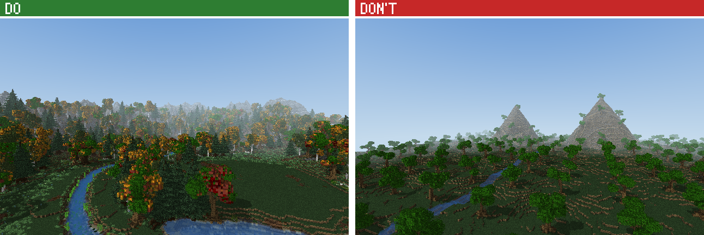 | 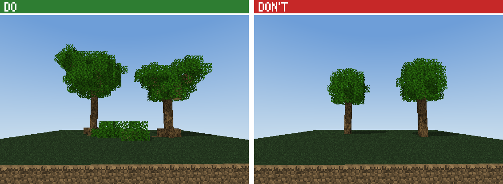 |
| 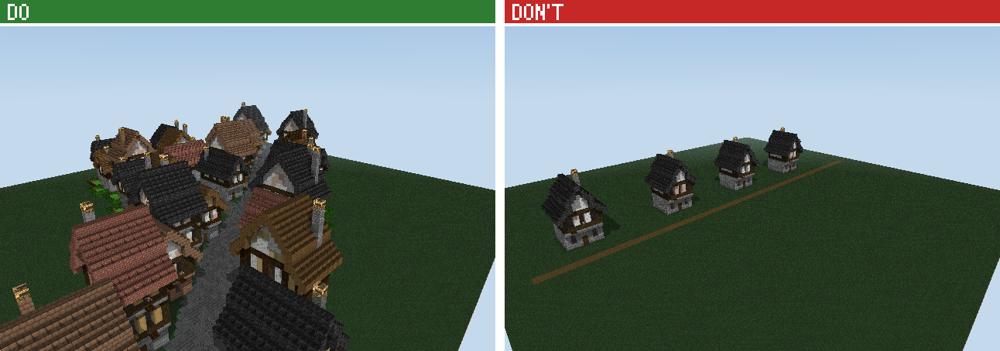 | 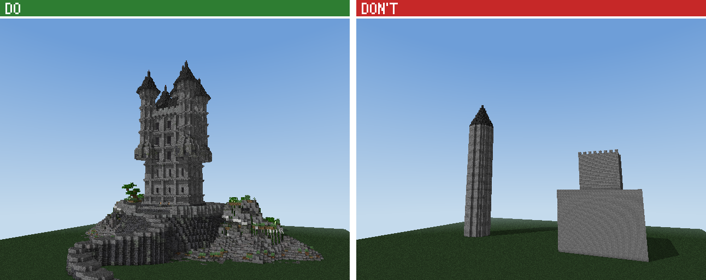 |
| 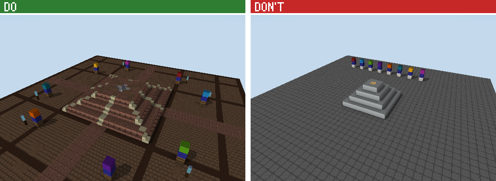 | 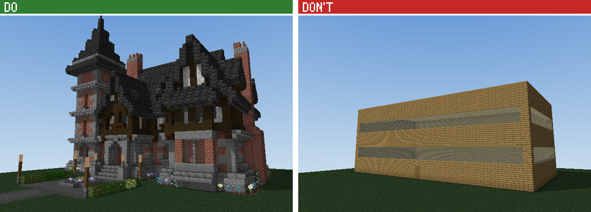 |
| 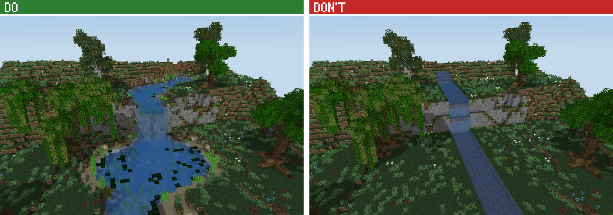 | 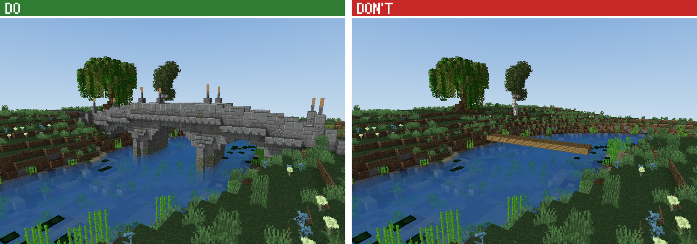 |
| 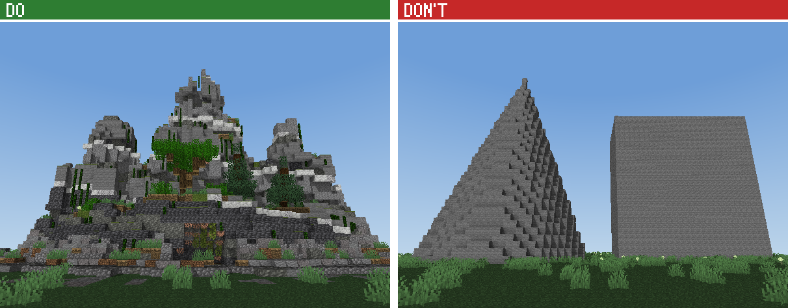 | 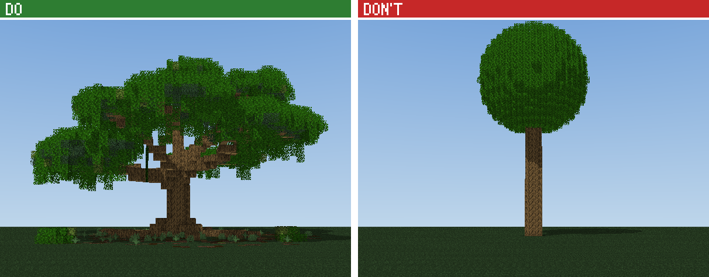 |
| 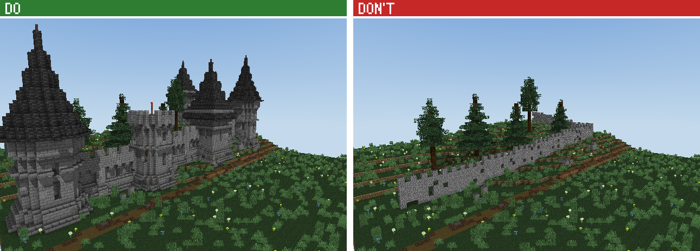 | 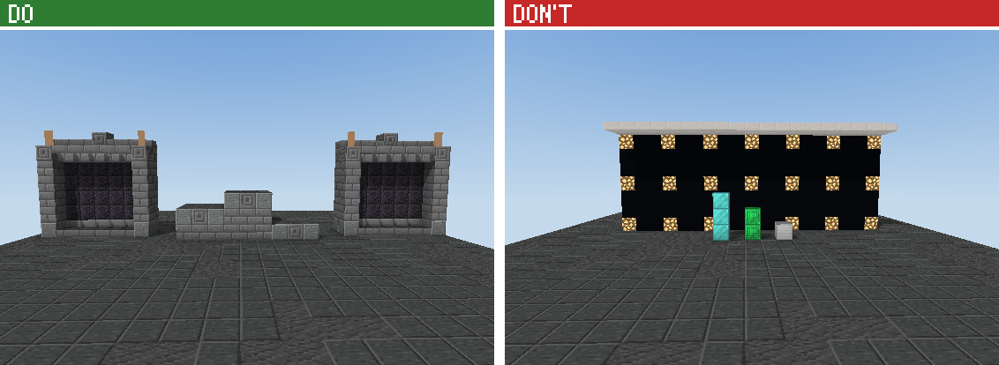 |

Reference spawns (`assets/examples/spawns/`): whole spawns Claude reads to see how a layout fits
together. Left the overview, right the `screenshot` from the spawn point (what a player sees on joining):

| | |
| --- | --- |
| 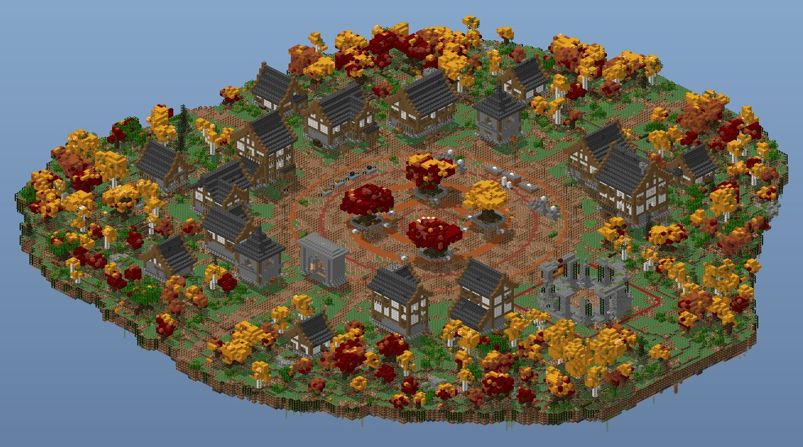 | 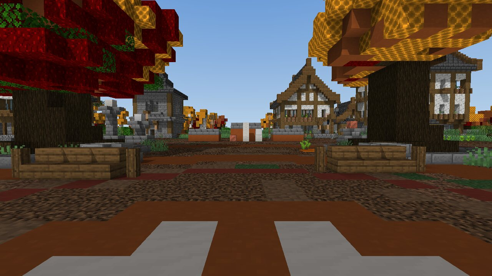 |
| **Ember SMP** (`ember-smp.mjs`): normal spawn, round plaza, autumn, 10 NPCs in rings, top-3 pillars, 220 x 220 | |
| 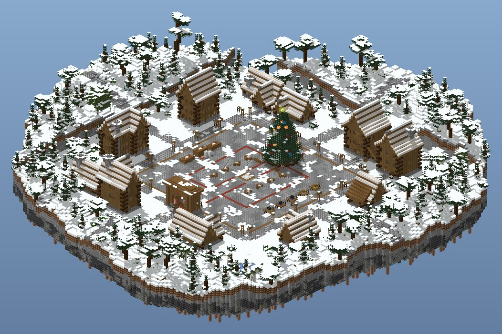 | 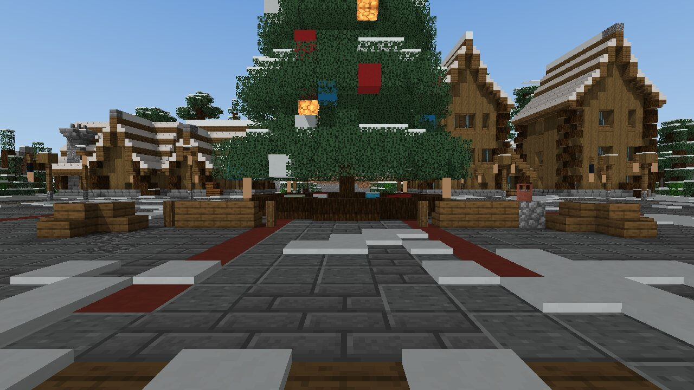 |
| **Frost SMP** (`frost-smp.mjs`): normal spawn, square plaza, winter, a hand-built Christmas spruce, snowfall | |
| 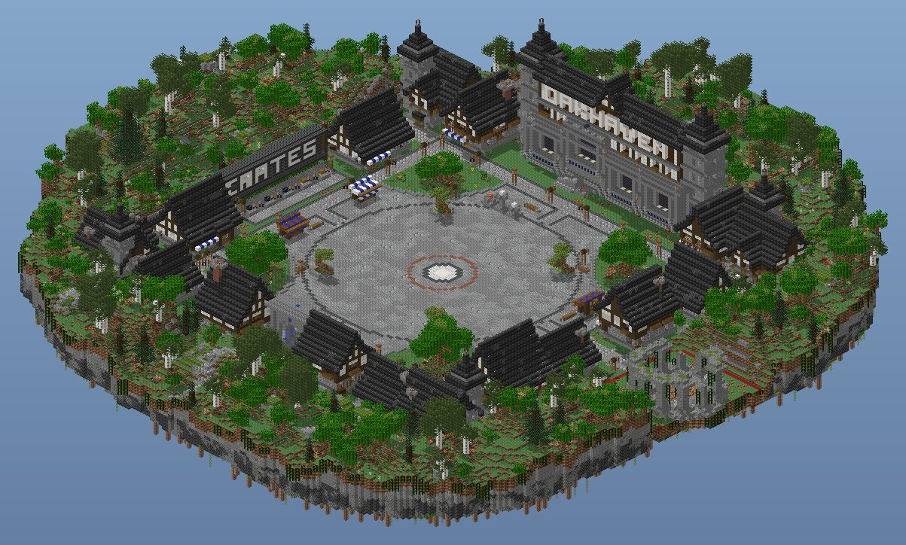 | 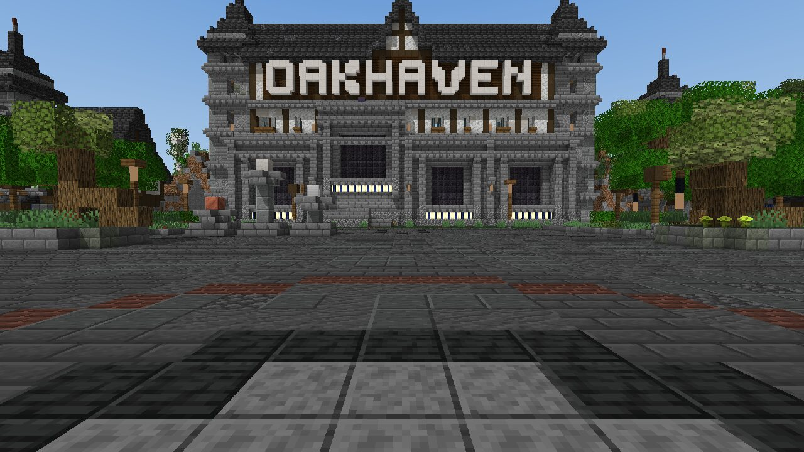 |
| **Oakhaven** (`oakhaven-hub.mjs`): spawn+ town, medieval, 14 NPCs each in its own building, the name in quartz letters | |
| 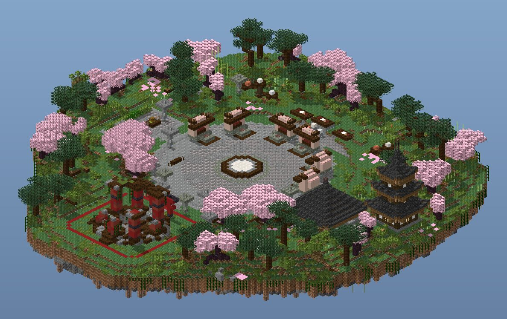 | 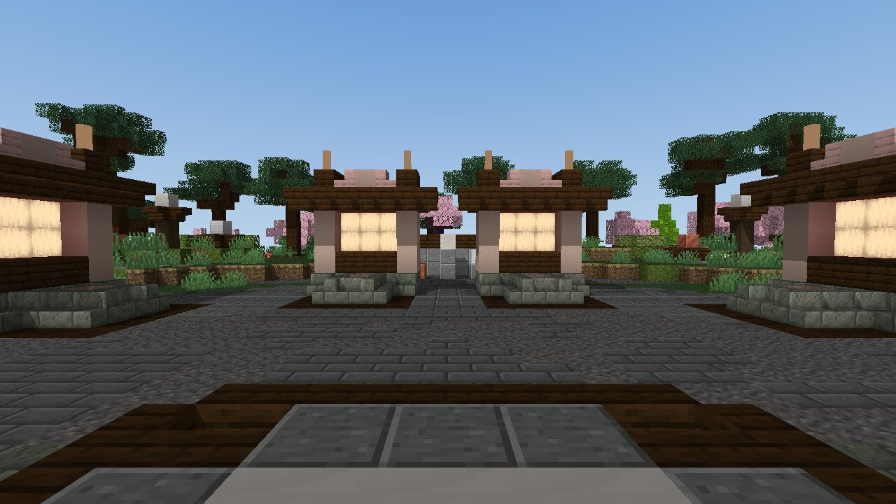 |
| **Kirin Practice** (`kirin-practice.mjs`): PvP lobby, japanese, queue NPCs in an arc, FFA arena | |
| 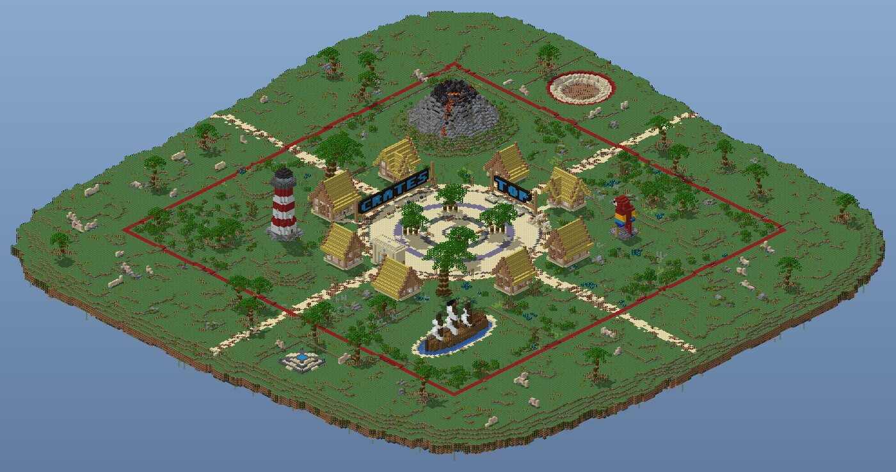 | 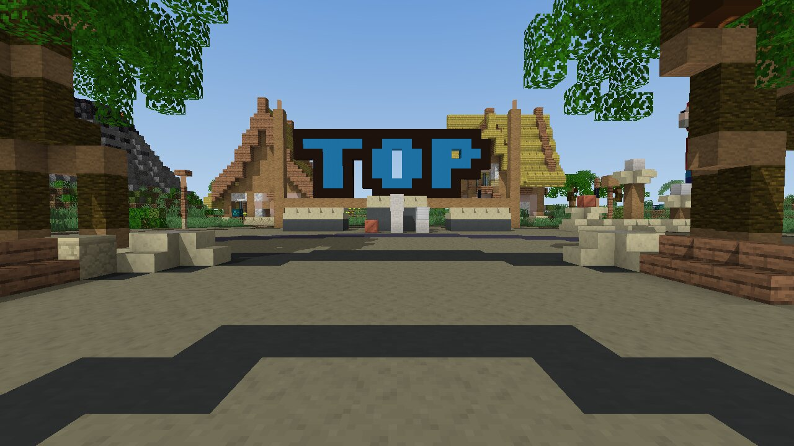 |
| **Tortuga SMP** (`pirate-isle.mjs`): tropical island: volcano, ship, lighthouse, parrot statue, giant palms, a warzone with a moshpit and KOTH, colourful signs | |

### The browser spawn builder (not part of the plugin)

`apps/spawn-generator/` is a one-click spawn generator as a single offline HTML page: fill in a
brief, generate, look at it in 3D, download the .schem/.litematic and the setup sheet. Open
`apps/spawn-generator/dist/spawn-generator.html`. Its engine (`apps/spawn-generator/spawngen/`) runs
the reference spawn parts; the plugin itself has no generator: Claude builds every spawn.

## What's inside

- **Builder's handbook** (`references/building/`, about 15k lines): 25 laws and a staged workflow,
  then chapters on principles, components (every roof type, windows, doors, arches, towers...),
  20 architectural styles, palettes and value structure, detailing with 32 tested micro-modules,
  nature (trees, forests, terrain, water), interiors and lighting, composition (villages, castles,
  megabuilds), sculpting (statues, creatures, ships), procedural generation, Mojang's own building
  language, and a self-review rubric. Two chapters are measured rather than written:
  - `benchmarks.md`: per-style norms from 1,212 human-made builds (palette breadth, partial-block
    mix, upside-down stairs, lighting density, contrast...).
  - `community-lessons.md`: 71 skilled community builds analysed block by block against Mojang's
    village houses.
- **Building kit** (`api.builder`, `api.kit`; reference in `references/kit-api.md`):
  - Painting with clumped palettes, ordered gradients and `b.texture` (WesterosCraft-style
    gradient retexturing), organic `b.weather` and measured block colours (`kit.colors`).
  - Shapes: spheres, tubes, splines, SDFs (smooth union, displacement), lathe.
  - Roofs from pitch profiles (gable, hip, pyramid, mansard, gambrel, shed, curved, flat rings),
    `b.compoundRoof` for L/T/U/courtyard plans, cones, domes, onion domes and dormers, finished
    the way Mojang finishes them (soffits, rakes, solid gables).
  - Architecture: windows, doors, supersampled arches, columns, battlements, spiral stairs,
    stairways, bridges, timber framing, chimneys, lamps.
  - Nature: 14 tree presets, space-colonization and Forester trees, whole forests, terrain,
    paths, ponds, boulders, overgrowth, floating islands.
  - Sculpting: tapered spline tubes, surface shading, erosion, ship hulls, figures, crystals,
    mushrooms, clouds, rock arches.
  - Settlements: terrain-aware roads, lots, curtain walls, plazas and a skyline report.
  - Modules stamped with rotation/mirroring, and `b.importStructure` for existing schematics.
- **Exports match the game.** Every block state is checked against Minecraft's own 1.21.1 block
  report; missing properties get vanilla defaults; doors, beds and tall plants get their other half;
  stair corners, wall posts, and fence and pane connections are computed the way the game does.
- **Headless renders** (`scripts/render.mjs`): multi-angle PNGs and contact sheets, close-ups,
  cutaways and night lighting with colour-neutral daylight.
- **First-person screenshots** (`scripts/screenshot.mjs`, the `screenshot` tool): what a player
  sees standing anywhere in a build, rendered on the CPU (textures, shadows, fog, plant sprites,
  water and glass; a few seconds a view), so Claude can check a spawn from the spawn point and
  every section. `scripts/isorender.mjs` draws whole builds isometrically, any size.
- **Inspector** (`scripts/inspect.mjs`): palette stats, ASCII slices, lint checks, and a 0–100
  scorecard against the human-build norms with a fix for every out-of-band metric.
- **Converter** (`scripts/convert.mjs`): `.nbt` ⇄ `.schem` ⇄ `.litematic`, plus legacy `.schematic`.
- **Examples** (`assets/examples/`): thirteen commented showcase recipes, from a Tudor house and
  a furnished tavern to a gothic cathedral, Japanese shrine, desert palace, modern villa, elven
  treehouse and pirate cove.

## Gallery

Every image below is a headless render of an example recipe in `assets/examples/`, generated by
the skill's own pipeline (`npm run gallery`). Each recipe is commented as teaching material.

| | |
| --- | --- |
|  |  |
| **Medieval house** · [night](docs/gallery/medieval-house-night.jpg) · [recipe](assets/examples/medieval-house.mjs) | **Tavern (furnished interior)** · [night](docs/gallery/tavern-night.jpg) · [recipe](assets/examples/tavern.mjs) |
|  |  |
| **Castle** · [night](docs/gallery/castle-night.jpg) · [recipe](assets/examples/castle.mjs) | **Gothic cathedral** · [night](docs/gallery/gothic-cathedral-night.jpg) · [recipe](assets/examples/gothic-cathedral.mjs) |
|  |  |
| **Wizard tower** · [night](docs/gallery/wizard-tower-night.jpg) · [recipe](assets/examples/wizard-tower.mjs) | **Japanese shrine** · [night](docs/gallery/japanese-shrine-night.jpg) · [recipe](assets/examples/japanese-shrine.mjs) |
|  |  |
| **Nordic longhouse** · [night](docs/gallery/nordic-longhouse-night.jpg) · [recipe](assets/examples/nordic-longhouse.mjs) | **Desert palace** · [night](docs/gallery/desert-palace-night.jpg) · [recipe](assets/examples/desert-palace.mjs) |
|  |  |
| **Coastal village** · [night](docs/gallery/coastal-village-night.jpg) · [recipe](assets/examples/coastal-village.mjs) | **Modern villa** · [night](docs/gallery/modern-villa-night.jpg) · [recipe](assets/examples/modern-villa.mjs) |
|  |  |
| **Elven treehouse** · [night](docs/gallery/elven-treehouse-night.jpg) · [recipe](assets/examples/elven-treehouse.mjs) | **Pirate cove** · [night](docs/gallery/pirate-cove-night.jpg) · [recipe](assets/examples/pirate-cove.mjs) |

## Requirements

- Node.js 20.19 or newer and `npx`
- An agent that can load Skills CLI skills
- For renders: Playwright with Chromium (the skill tells the agent how to install it if it's missing)

## Setup

```bash
npx skills install Faboit1/BuildingSkillPlus
# or target a specific agent
npx skills install Faboit1/BuildingSkillPlus --agent claude-code
```

Restart or reload your agent. On first use the skill installs its Node dependencies.

## Use

```text
Build a timber-framed medieval inn on a hillside with a garden, export it as .schem, and show me
renders from all sides plus a night view.
```

Manual commands, run from the plugin directory (`npm install` only for `render.mjs` and `preview.mjs`):

```bash
node scripts/run-build.mjs assets/examples/medieval-house.mjs --out-dir minecraft-builds/medieval-house
node scripts/render.mjs --nbt minecraft-builds/medieval-house/medieval-house.nbt --lighting both
node scripts/convert.mjs minecraft-builds/medieval-house/medieval-house.nbt --out medieval-house.schem
node scripts/preview.mjs --nbt minecraft-builds/medieval-house/medieval-house.nbt
npm test   # kit self-test
```

To get a build into the game, use `/place template` with a structure file, WorldEdit `//schem load`, or
Litematica. Details are in `references/formats.md`.
