<p align="center">

</p>

# minecraft-builder-skill (BuildingSkillPlus)

An agent skill for building Minecraft structures that look hand-made by a skilled builder. The
agent writes a JavaScript recipe with a building kit, exports a vanilla structure `.nbt` (or
`.schem` / `.litematic`), renders it headlessly from several angles, critiques the renders and
iterates. A builder's handbook in `references/building/` teaches it the craft: proportions, depth,
palettes, roofs, styles, landscaping, interiors, lighting and composition.

## Server spawns in one command

Interview the server owner, write a short brief, run one command:

```bash
node scripts/make-spawn.mjs assets/spawn-briefs/autumn-lifesteal.json
```

`scripts/make-spawn.mjs` generates the whole spawn on a floating island: plaza, NPC places, the
leaderboard hall with the server name in quartz letters, crates, the RTP gate, a PvP ruin, themed
cottages, trees and lamps, all spawn-proofed. It writes `.nbt` / `.schem` / `.litematic`, the
NPC/hologram/crate/WorldGuard setup commands and the renders. Three layouts: **normal** (FreshSMP-like
plaza, NPCs in a ring), **spawn+** (DonutSMP-like town, one building per NPC) and **PvP lobby**;
six themes (autumn, medieval, white-town, japanese, winter, fantasy); five island settings.
`SKILL.md` gives the agent the five-step workflow; the briefs below are in `assets/spawn-briefs/`.

| | |
| --- | --- |
| 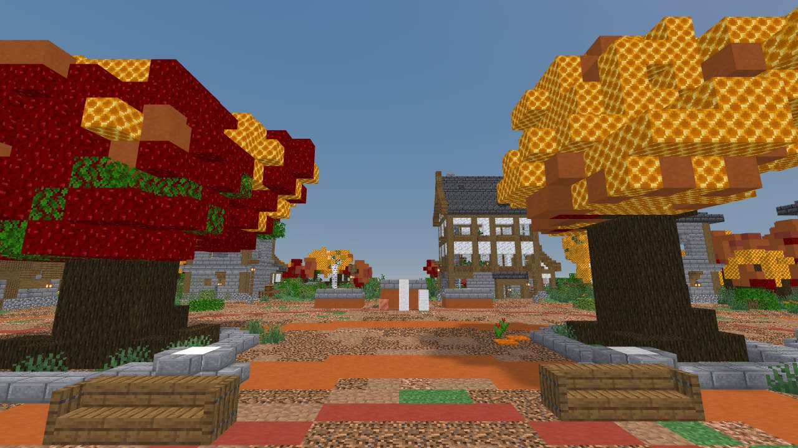 | 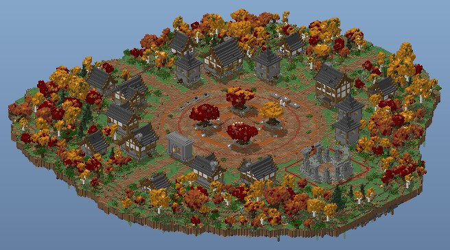 |
| **Ember SMP**: normal spawn, autumn, 12 NPCs | overview |
| 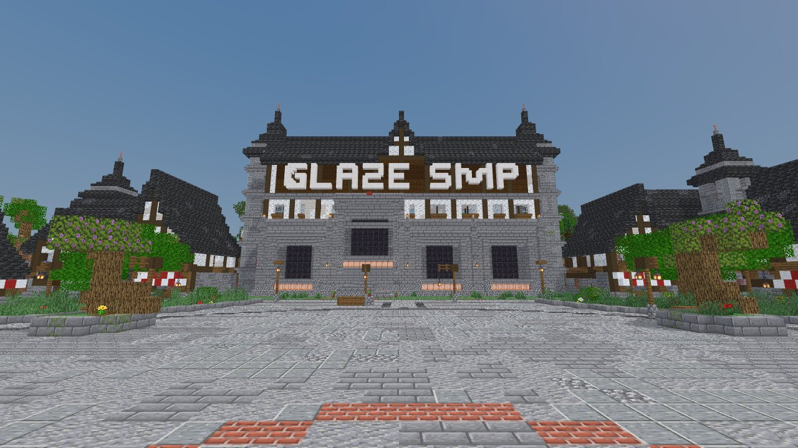 | 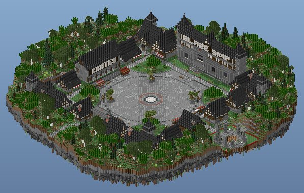 |
| **Glaze SMP**: spawn+, medieval valley, 16 NPCs in their own buildings | overview |
| 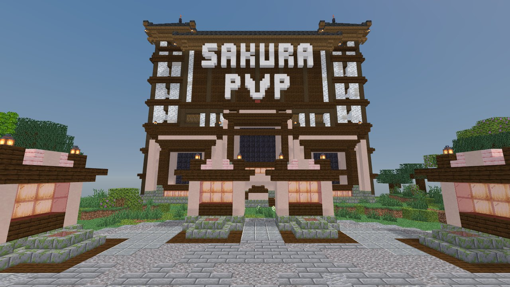 | 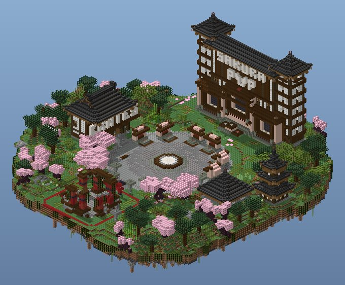 |
| **Sakura PvP**: PvP lobby, japanese, 6 queue NPCs | overview |
| 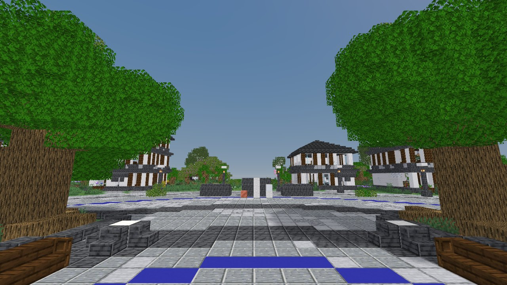 | 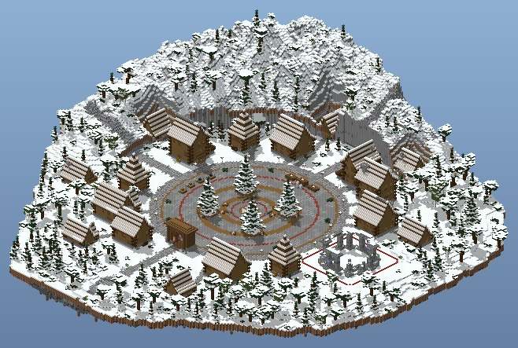 |
| **CheeseSMP**: normal spawn, white-town, blue accent, coast | **Frost SMP**: normal spawn, winter, mountain ridge |

## What's inside

- **Builder's handbook** (`references/building/`, about 15k lines): 25 laws and a staged workflow,
  then chapters on principles, components (every roof type, windows, doors, arches, towers...),
  20 architectural styles, palettes and value structure, detailing with 32 tested micro-modules,
  nature (trees, forests, terrain, water), interiors and lighting, composition (villages, castles,
  megabuilds), sculpting (statues, creatures, ships), procedural generation, Mojang's own building
  language, and a self-review rubric. Two chapters are measured rather than written:
  - `benchmarks.md`: per-style norms from 1,212 human-made builds (palette breadth, partial-block
    mix, upside-down stairs, lighting density, contrast...).
  - `community-lessons.md`: 71 skilled community builds analysed block by block against Mojang's
    village houses.
- **Building kit** (`api.builder`, `api.kit`; reference in `references/kit-api.md`):
  - Painting with clumped palettes, ordered gradients and `b.texture` (WesterosCraft-style
    gradient retexturing), organic `b.weather` and measured block colours (`kit.colors`).
  - Shapes: spheres, tubes, splines, SDFs (smooth union, displacement), lathe.
  - Roofs from pitch profiles (gable, hip, pyramid, mansard, gambrel, shed, curved, flat rings),
    `b.compoundRoof` for L/T/U/courtyard plans, cones, domes, onion domes and dormers, finished
    the way Mojang finishes them (soffits, rakes, solid gables).
  - Architecture: windows, doors, supersampled arches, columns, battlements, spiral stairs,
    stairways, bridges, timber framing, chimneys, lamps.
  - Nature: 14 tree presets, space-colonization and Forester trees, whole forests, terrain,
    paths, ponds, boulders, overgrowth, floating islands.
  - Sculpting: tapered spline tubes, surface shading, erosion, ship hulls, figures, crystals,
    mushrooms, clouds, rock arches.
  - Settlements: terrain-aware roads, lots, curtain walls, plazas and a skyline report.
  - Modules stamped with rotation/mirroring, and `b.importStructure` for existing schematics.
- **Exports match the game.** Every block state is checked against Minecraft's own 1.21.1 block
  report; missing properties get vanilla defaults; doors, beds and tall plants get their other half;
  stair corners, wall posts, and fence and pane connections are computed the way the game does.
- **Headless renders** (`scripts/render.mjs`): multi-angle PNGs and contact sheets, close-ups,
  cutaways and night lighting with colour-neutral daylight.
- **Inspector** (`scripts/inspect.mjs`): palette stats, ASCII slices, lint checks, and a 0–100
  scorecard against the human-build norms with a fix for every out-of-band metric.
- **Converter** (`scripts/convert.mjs`): `.nbt` ⇄ `.schem` ⇄ `.litematic`, plus legacy `.schematic`.
- **Examples** (`assets/examples/`): thirteen commented showcase recipes, from a Tudor house and
  a furnished tavern to a gothic cathedral, Japanese shrine, desert palace, modern villa, elven
  treehouse and pirate cove.

## Gallery

Every image below is a headless render of an example recipe in `assets/examples/`, generated by
the skill's own pipeline (`npm run gallery`). Each recipe is commented as teaching material.

| | |
| --- | --- |
| 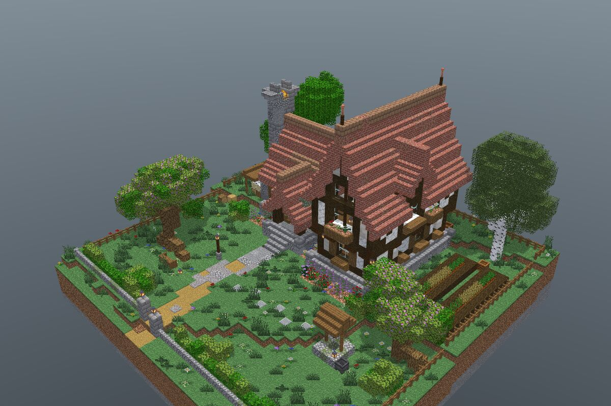 | 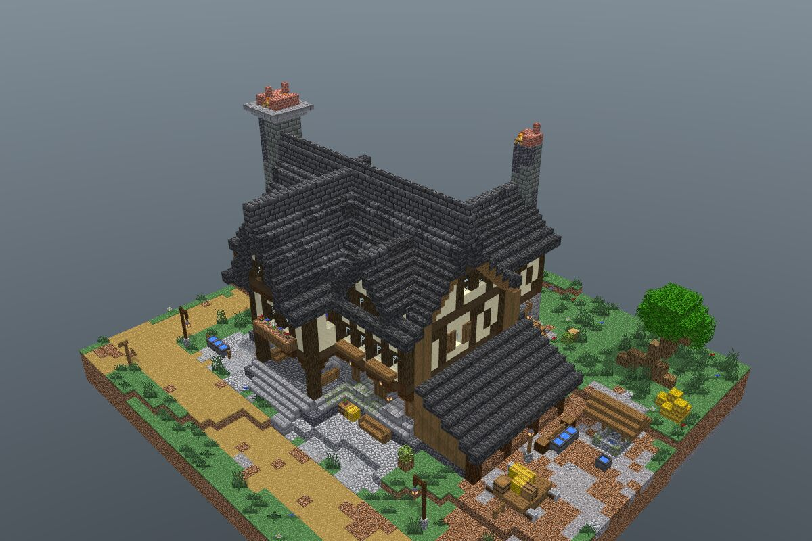 |
| **Medieval house** · [night](docs/gallery/medieval-house-night.jpg) · [recipe](assets/examples/medieval-house.mjs) | **Tavern (furnished interior)** · [night](docs/gallery/tavern-night.jpg) · [recipe](assets/examples/tavern.mjs) |
| 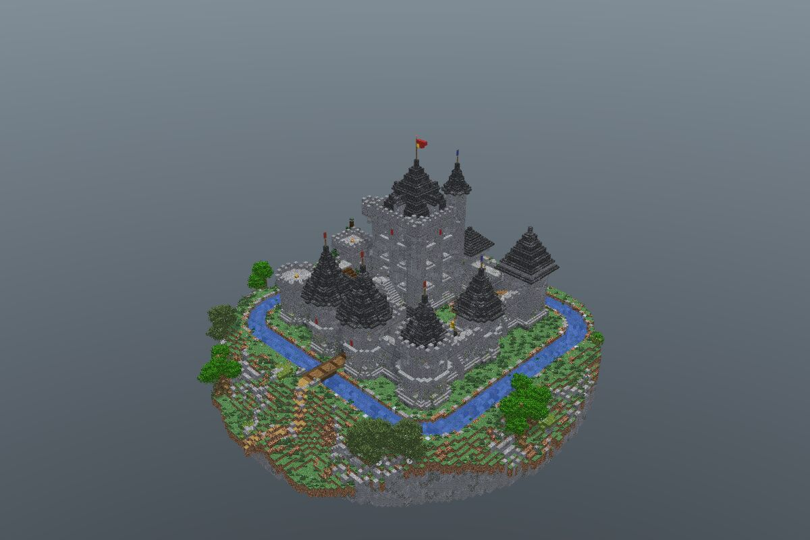 | 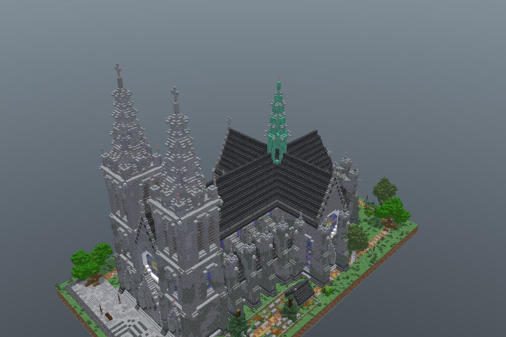 |
| **Castle** · [night](docs/gallery/castle-night.jpg) · [recipe](assets/examples/castle.mjs) | **Gothic cathedral** · [night](docs/gallery/gothic-cathedral-night.jpg) · [recipe](assets/examples/gothic-cathedral.mjs) |
| 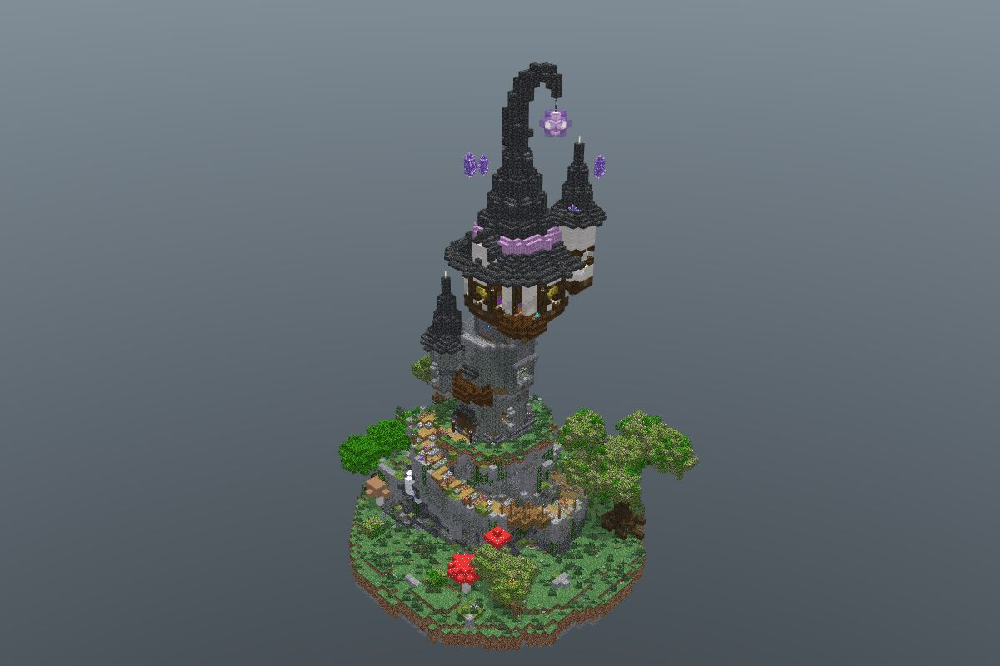 | 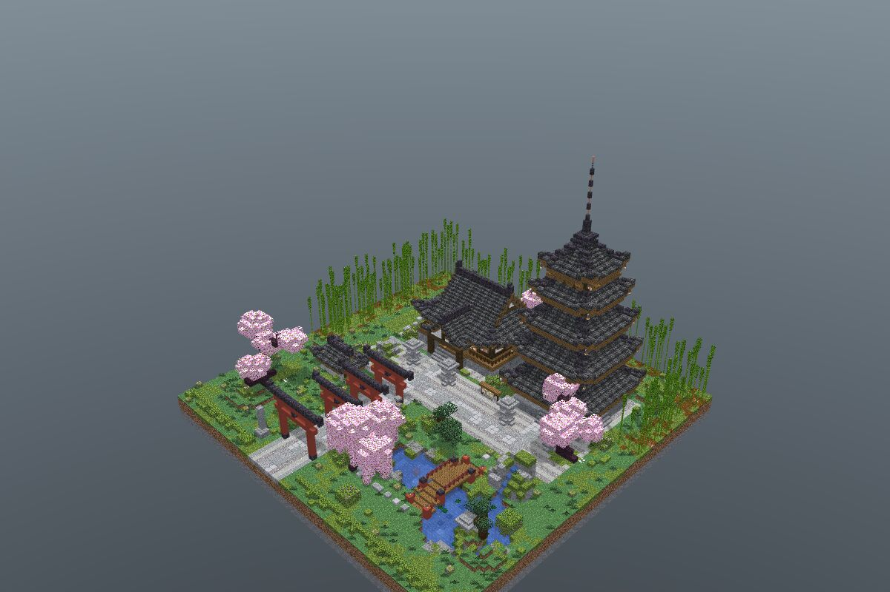 |
| **Wizard tower** · [night](docs/gallery/wizard-tower-night.jpg) · [recipe](assets/examples/wizard-tower.mjs) | **Japanese shrine** · [night](docs/gallery/japanese-shrine-night.jpg) · [recipe](assets/examples/japanese-shrine.mjs) |
| 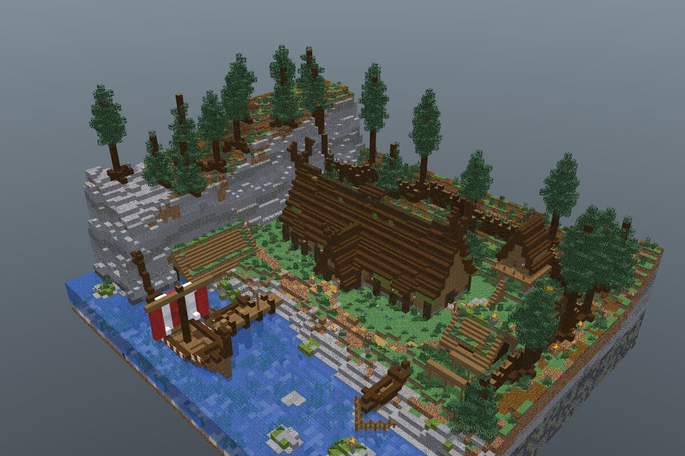 | 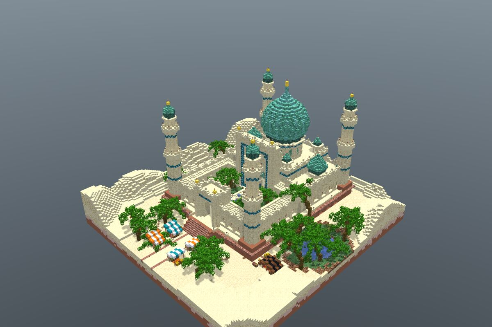 |
| **Nordic longhouse** · [night](docs/gallery/nordic-longhouse-night.jpg) · [recipe](assets/examples/nordic-longhouse.mjs) | **Desert palace** · [night](docs/gallery/desert-palace-night.jpg) · [recipe](assets/examples/desert-palace.mjs) |
| 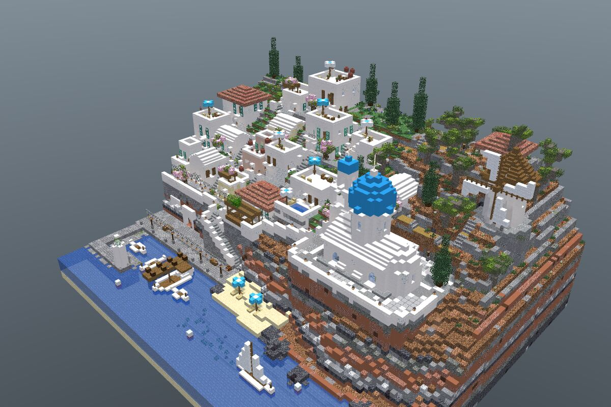 | 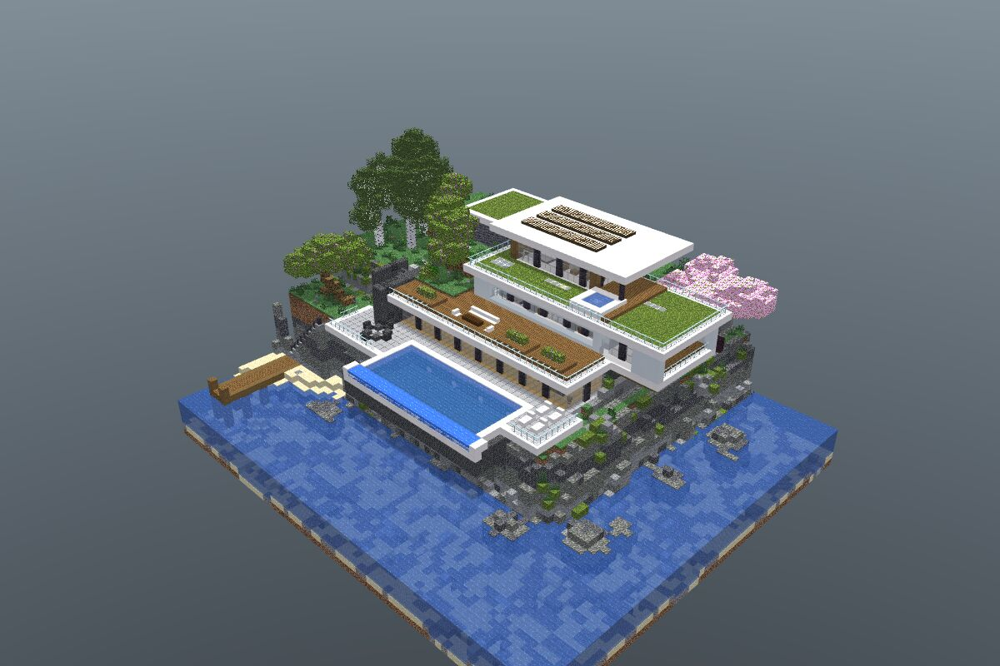 |
| **Coastal village** · [night](docs/gallery/coastal-village-night.jpg) · [recipe](assets/examples/coastal-village.mjs) | **Modern villa** · [night](docs/gallery/modern-villa-night.jpg) · [recipe](assets/examples/modern-villa.mjs) |
| 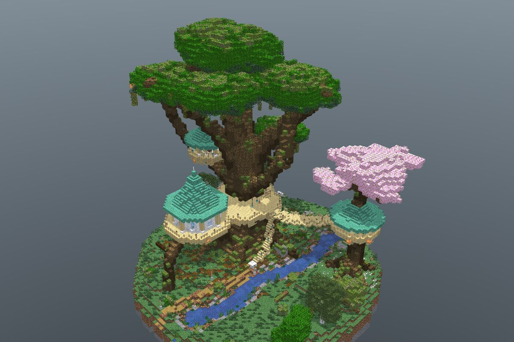 | 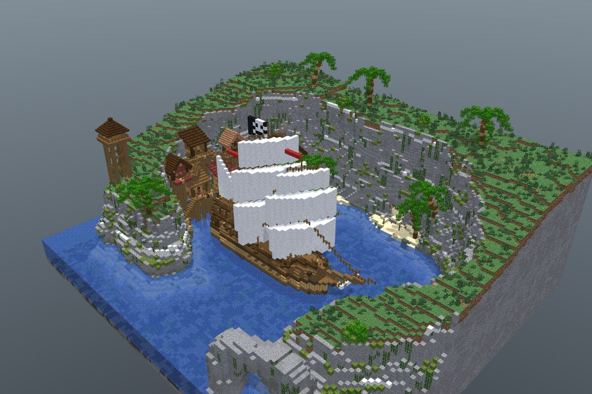 |
| **Elven treehouse** · [night](docs/gallery/elven-treehouse-night.jpg) · [recipe](assets/examples/elven-treehouse.mjs) | **Pirate cove** · [night](docs/gallery/pirate-cove-night.jpg) · [recipe](assets/examples/pirate-cove.mjs) |

## Requirements

- Node.js 20.19 or newer and `npx`
- An agent that can load Skills CLI skills
- For renders: Playwright with Chromium (the skill tells the agent how to install it if it's missing)

## Setup

```bash
npx skills install Faboit1/BuildingSkillPlus
# or target a specific agent
npx skills install Faboit1/BuildingSkillPlus --agent claude-code
```

Restart or reload your agent. On first use the skill installs its Node dependencies.

## Use

```text
Use minecraft-builder-skill to build a timber-framed medieval inn on a hillside with a garden,
export it as .schem, and show me renders from all sides plus a night view.
```

Manual commands, run from the skill directory:

```bash
npm install --omit=dev
node scripts/run-build.mjs assets/examples/medieval-house.mjs --out-dir minecraft-builds/medieval-house
node scripts/render.mjs --nbt minecraft-builds/medieval-house/medieval-house.nbt --lighting both
node scripts/convert.mjs minecraft-builds/medieval-house/medieval-house.nbt --out medieval-house.schem
node scripts/preview.mjs --nbt minecraft-builds/medieval-house/medieval-house.nbt
npm test   # kit self-test
```

To get a build into the game, use `/place template` with a structure file, WorldEdit `//schem load`, or
Litematica. Details are in `references/formats.md`.
