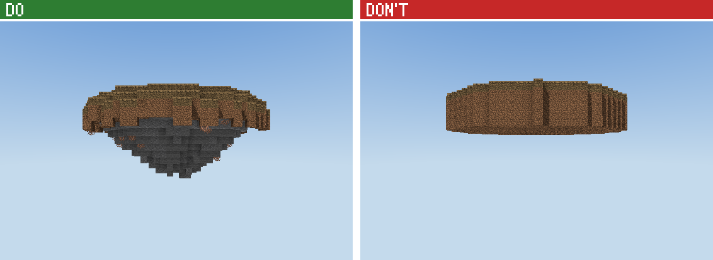

# The spawn manual: building a server spawn by hand

You build every block of the spawn yourself: the island, the ground, the paving, every stone and
tree, every NPC place, the boards, the crates, the gates, every building, every lamp. Nothing is
generated for you and nothing is pasted from a stock piece. This manual teaches each element with a
picture of what to do next to what not to do, and with the code of one worked example.
The examples show how an element is made. What this spawn's elements look like is yours to design
from the user's brief and the theme.

The frame (`frame/frame.mjs` in the spawn folder) does only the plumbing nobody sees: the canvas, a
reservation grid, angles, the world spawn, the records the server admin needs (NPC, hologram, crate,
board and portal positions, regions), spawn-proofing and the export. The kit (`ctx.kit`, `ctx.b`) is
your toolbox: palettes, noise, block states, stairs and slabs, modules, and the building helpers for
roofs, windows and doors (`references/kit-api.md`). Use the tools freely; the design is yours.

| § | Section | Use it when |
| --- | --- | --- |
| 1 | What a great spawn is | planning, judging screenshots |
| 2 | The workflow | always: the order of work |
| 3 | Coordinates, angles and facing | writing any position or direction |
| 4 | The frame, the marks and the tools | the API you build with |
| 5 | The elements, one chapter each | before you write each element |
| 6 | Layouts and their numbers | planning |
| 7 | Materials for a theme | choosing blocks |
| 8 | The cookbook: what the user asks | "make it winter", "add more stuff"... |
| 9 | Looking at it: screenshots, critique, fixes | after every build |
| 10 | Troubleshooting | an error or a warning |
| 11 | Delivery | the end |
| 12 | The reference spawns | seeing how a whole spawn fits together |

The element examples are in `references/spawns/elements/` (copied into every spawn folder as
`elements/`), their pictures in `references/spawns/img/`. `references/spawns/README.md` is the
handbook: the interview, the measured numbers, the don't-look-AI checklist.
`references/building/` covers the building craft in depth.

---

## 1. What a great spawn is

### 1.1 The first minute

A player joins and does these things in order:

1. Sees the first view: the hero and the plaza.
2. Reads the NPC holograms nearest them.
3. Walks to the crates or the boards.
4. Leaves through the RTP gate or a road.

A great spawn makes each step obvious without a sign. The hero pulls the eye, the NPCs face the
player, and the places stand in the open where they can be seen. The way out is in the first view.
Everything below serves that minute.

### 1.2 The rules, with the numbers to hit

1. **The first view is the design.** From the spawn point (eye 1.62 above the floor, facing north):
   - a frame close by (an arch, two trees, columns);
   - the hero 20-45 blocks out on the axis, filling a quarter to half of the frame height, with open
     sky behind it;
   - the NPCs and the way on visible;
   - nothing above eye level in the middle 30 degrees.
2. **One hero, three tiers.** One landmark (a monument, the boards' place, a gate, a big tree) 1.5-2
   times the height of what surrounds it. Feature buildings a third to a half of it. NPC places at
   human scale.
3. **Short distances.** Core NPCs within 15-25 blocks of the spawn (in a town: 25 to the plaza ring,
   75 to the farthest district). Nothing important more than about 12 seconds of sprinting away
   (5.6 blocks/s).
4. **Places that work.**
   - NPCs 4-7 apart, facing the spawn, 2 blocks clear in front and 3 of air above.
   - Crates 6 or more apart, 3 x 3 clear in front, open sky above.
   - Boards with a standing area 10-12 deep in front.
5. **Shaped floors.** One field material for 70% or more of the floor. Borders and inlays every 7-12
   blocks that point at the exits. No plain patch over 16 x 16, and no per-block random speckle.
6. **Variety, not symmetry.** No exact mirror of the layout: keep the ceremonial axis symmetric and
   vary everything else. At most 3 identical pieces in one view. Neighbouring buildings are
   siblings, not clones.
7. **One accent, used sparingly.** The accent colour at 5% or less of what you see, as points and
   short runs. Never gold blocks; lettering in quartz.
8. **Light by design.** Lamps on posts along the walks and at doors and gates. Hidden light for the
   rest. `finishSpawn` spawn-proofs what you leave dark.
9. **A designed edge.** The town meets the land with planting, steps and rocks. The island's shore
   and underside look natural. The PvP boundary is a visible red line.
10. **It looks hand-built.** Detail is clustered at entrances and focal points, and 30-50% of walls
    are calm. Partial blocks (stairs, slabs, walls) make up 16-28% of what you see. Trees look grown.

### 1.3 The three types

| | Normal spawn (FreshSMP-like) | Spawn+ (DonutSMP-like) | PvP lobby |
| --- | --- | --- | --- |
| The idea | one big plaza, NPC places round the spawn | a town round a hub, every NPC its own building | a compact lobby, queue NPCs in an arc, an arena |
| Size | 160-260 | 160-320 | 90-140 |
| NPCs | 5-20 | 10-30 | 4-10 |
| Boards, crates | on the plaza: boards on the axis, crates to one side | a hero wall with the boards, a crate yard or hall | boards behind the arc, crates to a side |
| Way out | an RTP gate opposite the first view, roads | the RTP gate, a road to the arena | the arena's gate |

---

## 2. The workflow

| Step | You do | Done when |
| --- | --- | --- |
| 1. Interview | ask in rounds with AskUserQuestion (SKILL.md, README.md §1) | you know the type, size, NPCs, boards, crates, theme and extras |
| 2. Plan | write `brief.md`: the answers and a top-view sketch with the numbers; show it, ask "Build this?" | the user said yes |
| 3. Scaffold | `new_spawn` with the name and the brief | the folder exists, the skeleton builds |
| 4. Build, element by element | for each section of the skeleton: read its chapter (§5), design it for this spawn, write it, build, look | every section is built and looks right |
| 5. Look and fix | screenshots from the player's spots (§9), two critique rounds, `spawn-critic` | the §9.2 checklist passes |
| 6. Deliver | `build_recipe` with `export: true`, `origin`, `world` | they have the files and know how to paste them |

**Plan.** Most bad spawns are bad plans, and a plan costs nothing to change. Decide:

- every place with its coordinates: the plaza, the spawn point and its first view, each NPC place,
  the boards, the crates, the gates and the buildings;
- for each element, a sentence on its design: "the crates in a walled yard west, each on a carved
  stage with a lantern arch, the tier in a glass strip".

For example:

```
CHEESE SMP: normal spawn, white-and-blue town, plains island, 200 x 200, 10 NPCs
Spawn at the middle facing north. First view: a gateway arch 14 north framing the boards' place 30 north.
NPCs: an inner ring r 12 (Shop, Auction, Kits, Store, Quests, Sell), an outer arc r 22 (Warps, Events,
  Vote, Start Here); each on its own plinth with a hedge behind, lanterns on posts.
Boards north: 3 framed recesses in a low wall, a 3/2/1 podium between the middle two.
Crates west: a yard behind a low wall, 4 carved stages 7 apart in an arc facing the spawn.
RTP gate south on the axis, a road out east. PvP ruin east behind a red line.
Buildings: 14 timber-and-plaster houses round the plaza from r 47, no two alike.
Life: 5 groups of oaks, rocks at the rim, flower drifts, benches facing the plaza, a fountain SW.

              N   boards + podium
                     (arch, r 14)
        crates   o  o  inner ring r 12  o  o     PvP ruin east (red line)
        (yard)      o     SPAWN      o
                  o   outer arc r 22    o
        [fountain]       RTP gate
                     houses from r 47
```

**Scaffold.** `new_spawn` with `name` and `brief` (the plan text). It writes
`minecraft-builds/<slug>/` with these files:

| File | What it is |
| --- | --- |
| `spawn.mjs` | The skeleton: the frame and one empty section per element group, each pointing at its chapter. |
| `frame/` | The plumbing. |
| `elements/` | The worked examples of this manual, with their do and don't comments. |
| `parts/` and `examples/` | Reference spawns to read (§12). |
| `brief.md` | The brief and the plan. |

**Build, element by element.** Work through the skeleton's sections in order: plan, land, floor,
places, buildings, life, then text. For each element:

1. Read its chapter in §5 and look at its picture.
2. Write the element for this spawn as its own function, below `build()` or in a file next to it.
   Give it its own shape, sizes and materials, and vary it as the chapter says.
3. Call the function, build with `build_recipe` and look at the views.

Build after every section. A first build in 10 minutes that you then improve beats a perfect plan
you never look at.

**Look and fix.** §9. Do at least two rounds after you think the spawn is done; the second round
always finds something. The `spawn-critic` agent gives a second opinion with ranked fixes.

A typical spawn takes 10-20 builds. A 200 x 200 spawn builds in 10-30 s, and a screenshot takes 2-3 s.

---

## 3. Coordinates, angles and facing

```
            north (z smaller)                      angle 0
                  ^                                  |
   west  <--------+--------> east (x bigger)   270 --+-- 90      polar(ctx, angle, r)
   (x smaller)    |                                  |           0 = north, clockwise
                  v                                 180
            south (z bigger)
```

- **Axes.** `x` points east, `y` up, `z` south. The canvas is `S x H x S`. `[cx, cz] = ctx.C` is its
  middle column, where the world spawn usually stands. Players spawn facing **north**.
- **The floor.** `FY` is the plaza's floor block, and players stand at `FY + 1`. The examples take
  positions as **ground block levels**: a thing "at `[x, FY, z]`" starts at `FY + 1`.
- **Angles round the spawn.** `polar(ctx, angle, r)` returns `[x, z]`, not rounded, so use
  `Math.round` before using them as block positions. 0 = north, 90 = east, 180 = south, 270 = west.
- **`facing` = the side the player stands on.** An NPC looks that way, a crate opens to it, a door is
  on that face, an arch reads from there. `facingToward([x, z], [cx, cz])` gives the facing that looks
  at the spawn.
- **Building something that faces a way.** Use `local(pos, facing)` from the frame:
  - `.at(u, d, h)` is the block `u` to the right (as the players in front see it), `d` toward the
    players and `h` up from `pos`.
  - `.out`, `.back`, `.left` and `.right` name the directions for block states.
  - `.across` and `.deep` are the log axes.

  Write the element once in `u, d, h` and it works for all four facings. Every element example
  uses it.
- **Stairs.** `facing` is the side of the tall back: you walk up toward it. Upside-down stairs
  (`half=top`) go under eaves, as sills and in arches, with the tall back toward the wall or pier.
- **Open trapdoors** (shutters, armrests, wheels) lie flat against the side of their block opposite
  their `facing`.
- **Yaw and pitch** (screenshots, NPCs) are Minecraft's own: yaw 0 looks south, 90 west, 180 north
  and -90 east; pitch above 0 looks down. `yawToward(from, to)` computes the yaw.
- **Local and world coordinates.** Everything in the recipe, the screenshots and `placements.json`'s
  `pos` is local: the structure's minimum corner is 0 0 0. World = the paste corner (`origin`) +
  local. setup.md and the `world` fields use world coordinates (§11).

---

## 4. The frame, the marks and the tools

### 4.1 The frame (`frame/frame.mjs`)

| Function | Does |
| --- | --- |
| `startSpawn(api, { name, size, height, seed, floorY })` → `ctx` | The canvas and everything below. `size` 120-320, `height` 80-110. `floorY` defaults to about a third of the height. |
| `finishSpawn(ctx, { safeZone, description, land })` | Removes what the game would drop (flowers on stone, lanterns hanging from air), adds the `spawn` safe region (pvp, mobs, fall damage and item drops denied; priority 10), spawn-proofs every dark walkable cell with invisible light and exports. `land(x, z)` = true on your island keeps spawn-proofing on it. |
| `ctx` | `api`, `kit`, `b` (the builder), `name`, `slug`, `rng` (`rng()`, `rng.int(a, b)`, `rng.range(a, b)`, `rng.chance(p)`), `seed`, `S`, `H`, `FY`, `C`, `grid`, `layout` (your plan), `hologram(id, text, [x, y, z])`, `warn(msg)`, `place(fn, ...args)` (runs `fn(ctx, ...args)` and turns an error into a warning) |
| `ctx.grid` | One tag per column: `reserve(x0, z0, x1, z1, tag, pad)`, `reserveDisc(cx, cz, r, tag)`, `free(x0, z0, x1, z1)`, `freeDisc(cx, cz, r)`, `tag(x, z)`. Reserve every place while planning, so trees and rocks placed later keep off it. |
| `findSpot(ctx, { r, ring: [r0, r1], angles, box, tag, edge })` → `{ x, z, r }` or `null` | Finds and reserves a free disc; `angles` are tried first. |
| `polar`, `facingToward`, `yawToward`, `local` | §3 |

### 4.2 The marks: what the server admin needs

A mark places no block. It records a position for `placements.json` and the commands in setup.md,
and it keeps the cells the place needs clear: `finish()` warns, naming the cell, if anything you
build fills one.

| Call | Records | Keeps clear |
| --- | --- | --- |
| `b.spawnPoint([x, FY, z], facing)` | the world spawn (players appear at `y + 1`) | 2 above it |
| `b.markNpc(pos, facing, { id, label, role })` | an NPC standing on block `pos` (its feet at `y + 1`), its hologram 2.4 above its feet | 3 above its feet, 2 in front |
| `b.markCrate(pos, facing, { id, label, tier, block })` | the crate block at `pos` and its hologram 1.6 above it | 2 above it, 2 in front |
| `b.markBoard([x, y, z], facing, { id, label, size: [w, h] })` | a hologram leaderboard whose top line floats at `[x, y, z]` (fractions allowed) | its volume: `w` across, `h` down |
| `b.markPortal(min, max, { id, label, kind, facing })` | a portal's trigger region (the cells players walk through); `kind` is `rtp`, `warp`, `pvp`, `nether` or any word | the opening |
| `ctx.hologram(id, text, [x, y, z])` | a free-standing hologram (rules, a welcome, a district name); `y` is its top line | nothing |
| `b.region(id, min, max, flags)` | a WorldGuard region, e.g. `{ pvp: 'allow', priority: 20 }` (above the spawn's 10 to override it) | nothing |

### 4.3 The tools

The kit is in `ctx.kit` and on `b`, documented in `references/kit-api.md`. The ones every element
uses:

| Tool | For |
| --- | --- |
| `b.set(x, y, z, block)`, `b.box(min, max, block)`, `b.get`, `b.nameAt`, `b.remove` | placing and reading blocks; `block` is an id with states (`'minecraft:spruce_stairs[facing=north,half=top]'`) or a palette |
| `kit.palette({ stone: 5, andesite: 3, tuff: 1 }, { scale, seed })` | a clumped mix; `scale` is the clump size in blocks. Give the main block most of the weight: 1 in 7 reads as texture, 1 in 3 as speckle. |
| `kit.noise.fbm2(x, z, { scale, seed })`, `fbm3`, `coherent01`; `kit.hash01(x, y, z, seed)` | smooth noise (about ±0.6; `coherent01` is 0..1) for shapes and patches; a fixed per-block random number |
| `kit.material(name)` | a family's blocks: `.stairs`, `.slab`, `.wall`, `.mossy`, `.cracked`, `.chiseled` (not every family has every variant) |
| `kit.stairs(name, facing, half)`, `kit.slab(name, type)`, `kit.trapdoor`, `kit.log(name, axis)` | state strings |
| `b.module([w, h, d])` and `b.stamp(m, corner, { rotate })` | build a piece once, place it turned |
| `b.roof`, `b.window`, `b.door`, `b.column`, `b.arch` | building helpers (kit-api.md, `references/building/components.md`); tools, not designs: choose their sizes, materials and where they go |
| `b.hull`, `b.figure`, the SDF shapes | statues, monuments, ships (`references/building/sculpting.md`) |

---

## 5. The elements, one chapter each

Each chapter has a picture (do on the left, don't on the right), the rules and the worked example
in `elements/`. That file's header repeats the rules, and its code builds the do half of the
picture. Read the code to see how each rule turns into blocks. Then write the element for this
spawn:

- its own sizes, shapes and materials;
- several variants where the spawn has several of it (no two trees, rocks or buildings alike);
- placed where the plan says.

The examples' functions can be imported. When you do, give every call its own options and make the
result fit the spawn, so the element is designed for this place and does not repeat the example.

### 5.1 The land: the island (`elements/island.mjs`)



- **Do:**
  - an outline that wanders (a radius pushed in and out by noise);
  - flat where people walk, rolling a little further out, a shore that drops 1-3 at the rim;
  - an underside that tapers to a ragged point, deepest under the middle (half to two thirds of the
    radius), in rock strata under 2-4 blocks of soil;
  - a few roots hanging from the rim.
- **Don't:** a cylinder (vertical dirt walls, a flat bottom), a perfect cone, the same depth
  everywhere, or noise hills where the NPCs stand.
- **The example:** `island(ctx, { cx, cz, r, depth, seed, flat, top, soil, rock })` builds the
  island and returns `groundY(x, z)`, the walking surface's level (-1 off the island). Keep such a
  function so the elements off the plaza stand on the ground. Pass `land` to `finishSpawn` so
  spawn-proofing stays on the island.
- **Make it yours:**
  - an outline for the layout: round for a plaza, longer for a town on an axis, with bays and spurs;
  - the theme's ground and rock (snow and stone; sand, sandstone and terracotta; moss and deepslate);
  - flat pads for every building and place (lerp the surface to the pad's level over 3-5 blocks);
  - hills, a ridge or a cliff behind the hero.
- **Numbers:** for a plaza of radius `R`, the island's radius is `R` + 30-60 (room for buildings and
  woodland); the underside is 25-60 deep.

### 5.2 Ground, planting and walks (`elements/ground.mjs`)


- **Do:**
  - one main ground block (grass) with 2-3 others in clumps a few blocks across, from coherent noise;
  - flowers in drifts, one or two species per patch, grass round them;
  - walks 3-5 wide that follow the ground, with frayed edges.
- **Don't:** per-block speckle of five ground blocks, flowers one per block in rows, a rainbow of
  every flower, or a 1-wide gravel line ruled across the grass.
- **The example:**
  - `naturalGround(ctx, cells, { mix, seed })` makes the clumped mix;
  - `plantDrifts(ctx, area, { flowers, seed })` makes the drifts;
  - `walk(ctx, points, { width, seed })` makes a frayed walk along points.
- **Make it yours:**
  - the theme's mix (podzol and coarse dirt under spruces, snow and powder snow in winter, sand and
    dead bushes in a desert);
  - the flower species of the season;
  - walks that curve to the doors and gates instead of ruling straight lines.

### 5.3 Paving: the plaza floor (`elements/paving.mjs`)


- **Do:**
  - one field material for 70% or more of the floor, in 2-3 close shades clumped together;
  - borders and inlays of a contrasting block every 7-12 blocks, as rings round the spawn or long
    lines that point at the exits;
  - a rose (a small figure of the best stone) where players land, a kerb where the plaza ends.
- **Don't:** speckle, a checkerboard, one flat block over a huge area, or dotted and scattered inlay
  blocks.
- **The example:** `roundPlaza(ctx, { cx, cz, r, field, border, inlay, rose })`: a rose, a ring
  round it, an inner ring near the edge, inlay lines on the four axes and a kerb.
- **Make it yours:**
  - the shape of your plaza (square with cut corners, a long forum, two linked circles);
  - rings at the radii of your NPC rings (a border band under each);
  - inlay lines toward your exits, not the four axes by habit;
  - the theme's stones (smooth sandstone and cut red sandstone; deepslate tiles and polished
    blackstone; mud bricks and packed mud).
- **Numbers:** paths 5-9 wide; a plaza over 40 across needs a figure every 12-16 blocks.

### 5.4 Stones and rocks (`elements/stones.mjs`)


- **Do:**
  - groups, not singles: one big stone with one or two smaller ones against it and loose bits round
    them;
  - irregular shapes (an ellipsoid pushed in and out by noise), wider than tall, with a flatter top;
  - sunk a block into the ground, in a clumped mix of 3-4 grey stones;
  - moss on the faces that look up, plants at the foot.
- **Don't:** a sphere of one block sitting on the grass, speckle of five materials, the same rock in
  a row or a ring, or stones on paving, in a doorway or in front of an NPC.
- **The example:**
  - `boulder(ctx, pos, { r: [rx, ry, rz], seed, moss })` makes one stone;
  - `rockGroup(ctx, pos, { size, seed })` makes the group (sizes 1 : 0.6 : 0.35).
- **Make it yours:**
  - sizes for the place: 1-2 at a path's edge, 4-8 at the rim, cliffs of 12+ behind the hero;
  - the theme's stones (sandstone and terracotta in a desert, calcite and packed ice in winter,
    blackstone and basalt for a dark theme);
  - lean them, stack them into outcrops, or put a waterfall between two.

### 5.5 Trees and bushes (`elements/trees.mjs`)


- **Do:**
  - a trunk that flares at the foot and narrows as it climbs;
  - 3-5 branches at different heights and directions, rising as they go out;
  - a crown wider than tall, lumpy, with gaps;
  - three size classes in groups; bushes at their feet;
  - near the plaza, crowns kept above head height and off NPCs, boards and signs.
- **Don't:** the lollipop (a pole with a ball on top), perfect spheres or cubes of leaves, every
  tree the same height, trees in a row at equal steps, or wool as foliage.
- **The example:**
  - `broadleaf(ctx, pos, { height, seed, log, leaves, branches })` grows a broadleaf;
  - `bush(ctx, pos, { r, seed, leaves })` makes a bush.
- **Make it yours:**
  - the theme's species, each with its own shape:
    - a spruce is a narrow cone of tiers;
    - a birch is tall and thin with a small crown;
    - a cherry or an azalea is wide and low;
    - a palm leans and has a fan of fronds;
    - a dead tree is bare branches;
  - a hero tree 2-3 times the others for a landmark;
  - every tree its own seed, height and lean. Never the same tree twice in one view.
- **Numbers:** feature trees 12-20 tall, medium 8-12, small 5-8, bushes 2-3. Woodland at 1 tree
  per 40-80 columns, denser at the rim.

### 5.6 NPC places (`elements/npc.mjs`)


- **Do:**
  - stand the NPC 1 block above the players' floor (2 at most);
  - a place of its own: a plinth with a skirt of steps, something behind it (a hedge, a wall, a
    stall's back) and an apron of its own paving in front;
  - face it where players come from;
  - keep 3 clear above its feet and nothing within 2 in front;
  - light it from the sides.
- **Don't:** a pillar 4+ up, a glass box, NPCs in a row against a wall 2 apart all alike, or anything
  in its face (a sign, a lantern, leaves, a crate).
- **The example:** `npcPlace(ctx, pos, facing, { label, role, plinth, skirt, apron, hedge, post })`
  builds the place and calls `b.markNpc`. In the picture, the NPC stands on the empty middle of the
  plinth.
- **Make it yours:** a place that says what the NPC does:
  - the shop at a stall with a striped awning;
  - the auction house under an arcade;
  - the quests by a notice board;
  - the warps in a small gate;
  - the store on a dais with banners;
  - in a town, the NPC on its building's porch or behind its counter.

  Vary the plinths in a ring: two or three designs, and the role in a detail.

### 5.7 Leaderboards and the top-3 podium (`elements/boards.mjs`)


- **Do:**
  - a framed recess: piers at the sides, a base and a lintel, the backdrop set 1 back, dark only
    behind the text;
  - the text's top line 4-6 above the floor, 5 wide and 4 tall per 10-12 lines;
  - free floor in front (6+ deep);
  - the podium beside the boards or between them: steps 3 / 2 / 1 high with the 1st in the middle,
    each 3 wide;
  - hidden light.
- **Don't:** a black wall with a glowstone grid, a flat panel in the open, a roof or anything over
  the text, a podium of diamond, emerald and iron blocks, or statues in front of a board.
- **The example:**
  - `boardRecess(ctx, pos, facing, { label, width, height, stone, backdrop })` calls `b.markBoard`;
  - `podium(ctx, pos, facing)` marks the statues with `b.markNpc` (`role: 'statue'`).
- **Make it yours:**
  - boards set into a building's front, a garden wall, the base of the hero monument or a
    colonnade;
  - 2-5 boards, the middle one bigger;
  - the podium as steps, plinths or columns in the theme's stone;
  - the server's name over them as a hologram, or in quartz letters only if asked.

### 5.8 Crates (`elements/crates.mjs`)


- **Do:**
  - a corner or hall of their own off the main path, every crate on its own low stage;
  - 6+ apart centre to centre;
  - a backdrop behind each whose accent is the tier's colour, the stone the same for all;
  - the crate block facing the players with nothing over it, the best crate in the middle and a
    little bigger;
  - 3+ blocks free in front.
- **Don't:** chests on the grass 2 apart on blocks of coloured concrete, glowstone next to them,
  signs or roofs over them, or every crate a different style.
- **The example:**
  `crateStage(ctx, pos, facing, { label, tier, colour, block, stone, hero })` builds a stage, a
  screen and lantern posts, and calls `b.markCrate`.
- **Make it yours:**
  - the setting: a yard behind a low wall, a vaulted hall, a market row, an arc on the plaza facing
    the spawn;
  - the backdrop: an arch, a niche, a shrine, a banner;
  - the crate block for the theme (an ender chest, a chest, a barrel, a shulker box);
  - the tier colours from the user's crate list.

### 5.9 Gates and portals (`elements/gate.mjs`)


- **Do:**
  - two piers with a base and a cap, an arch or a lintel with a keystone, 2 deep;
  - the opening 3+ wide and 4+ high, kept clear and marked with `b.markPortal`;
  - a threshold of its own paving, lanterns on the piers, its name on a hologram above;
  - the gate at the end of a path or axis.
- **Don't:** a bare obsidian rectangle, a frame of glowstone or beacons, glass, water or portal
  blocks in the opening, or a gate in the middle of the plaza with nothing leading to it.
- **The example:**
  `gate(ctx, pos, facing, { label, kind, width, height, stone, threshold })` calls `b.markPortal`
  and `ctx.hologram`.
- **Make it yours:**
  - the gate for its kind: a stone arch for RTP, a ruined arch behind the red line for PvP, a torii
    in a Japanese spawn, a ship's gangway on a pirate island, a ring of stone for warps;
  - for nether portals, a frame of crying obsidian and blackstone round real portal blocks
    (`kind: 'nether'`).

### 5.10 Buildings (`elements/buildings.mjs`)


- **Do:**
  - a plinth of stone, and a frame you can read: corner posts and a top plate, posts beside the
    door;
  - infill lighter than the frame;
  - depth on every face: windows with sills and shutters, a hood or porch over the door, a step up;
  - a roof that overhangs by 1 all round, at 45 degrees or steeper, with filled gable ends, a ridge
    and a chimney;
  - walls 4-6 high on 5-9 wide, with a rhythm of window, post, door, post, window.
- **Don't:** the plank box (one material, a flat roof, flush glass in a row, no plinth), glass walls
  or concrete on a rustic spawn, or every building the same box in a row.
- **The example:** `house(ctx, pos, facing, { w, d, h, plinth, post, fill, roof, gable })`: a timber
  house with a gable roof along its front.
- **Make it yours:** design each building from its job and the theme:
  - a tavern with a sign arm and a beer-garden fence;
  - a bank of stone with columns;
  - a tower with string courses;
  - a market hall open on arches.

  Vary along a street:
  - width, storeys (an upper storey jettied out by 1), roof direction (gable to the street or along
    it), roof shape (gable, hip, half-hip), set-backs and colours.

  The kit's `b.roof`, `b.window` and `b.door` save time once you know what you want
  (`references/building/components.md`).
- **Numbers:** houses 7-15 x 7-13, halls 13-27 x 11-21; a street of 6 has at most 2 of the same size
  next to each other. Pave a walk from each door to the street.

### 5.11 Lamps and light (`elements/lamps.mjs`)


- **Do:**
  - lamps where people walk: posts along the paths every 7-10 blocks, alternating sides; at doors,
    gates, NPC places and crates;
  - a post with a base, a cap and an arm that holds the lantern out;
  - hidden light for the rest: light blocks, a lantern in a hedge, shroomlight in a crown, a sea
    lantern under carpet;
  - warm light for warm themes.
- **Don't:** glowstone or sea lanterns in the floor in a grid, torches every 2 blocks, or lamps in a
  doorway, in front of an NPC or under a board's text.
- **The example:** `lampPost(ctx, pos, armToward, { height, wood, base })`.
- **Make it yours:**
  - an iron post (chains and an iron bar) in a town;
  - a stone column with a brazier (a campfire) on a castle spawn;
  - a stone lantern in a Japanese garden;
  - a lantern on a rope between two posts at a market.

### 5.12 Props (`elements/props.mjs`)


- **Do:**
  - props in groups that tell a story (barrels and a crate by a stall, a bench under a tree facing
    the view, an anvil by the smithy);
  - built props: a bench of stairs with armrests and a back against a hedge, a cart with wheels, a
    table with things on it;
  - barrels upright and on their sides;
  - out of the way, along edges and walls.
- **Don't:** random single blocks (an anvil, a cauldron, a hay bale, a jukebox) scattered in a grid
  or a ring, the same prop at every lamp post, or a prop in the middle of a path.
- **The example:** `bench(ctx, pos, facing)`, `stallGoods(ctx, pos, facing)`, `cart(ctx, pos, facing)`.
- **Make it yours:**
  - the theme's life: nets, barrels and a rowing boat at a dock; a forge with a grindstone at a
    smithy;
  - market stalls with awnings in the accent colour;
  - pumpkins and hay in autumn, presents under a decorated tree in winter.

### 5.13 Fountains and water (`elements/fountain.mjs`)


- **Do:**
  - a basin with a rim (a block with a slab on it makes a seat), the water a block below the rim's
    top and 1-2 deep;
  - a centre that rises in tiers with water spilling down;
  - a few lily pads near the rim;
  - the fountain off the landing point, on an axis.
- **Don't:** a square hole of water flush with the floor with a glowstone in it, a glass pillar
  shooting water, or water everywhere.
- **The example:** `fountain(ctx, pos, { r, rim, floor, centre })`.
- **Make it yours:**
  - a square basin with cut corners;
  - a long canal with bridges;
  - a well with a roof in a village;
  - a pond with reeds and stepping stones in a park;
  - a waterfall off the island's rim.

### 5.14 Signs, holograms and the name

- **Holograms are the text of a spawn:** NPC names, crate titles, board text, the rules, the
  district names and the welcome. The marks record them (§4.2). Add your own free-standing ones
  with `ctx.hologram(id, text, [x, y, z])`, with the top line 3 above the floor and nothing over it.
- **Block letters** only when the user asks for them. Use them for the server's name and at most 2-3
  titles, in quartz (never gold), at least 1/12 of the viewing distance tall, with 30+ L* contrast
  to their board. Write them yourself, letter by letter, from a 5-high pixel font
  (`kit.signWidth` measures a text, `b.sign` builds one: kit-api.md).
- **Signs** (the block) for small things: shop prices, a "coming soon", a joke on a notice board.

### 5.15 The PvP line, AFK and regions

- **A PvP area** (a ruin, a pit, an arena, a warzone round the spawn) has a red line where it
  starts: red concrete or red terracotta 2 wide, continuous, with a hologram warning at each
  entrance. Add a region with `b.region('pvp', min, max, { pvp: 'allow', priority: 20 })`. A
  warzone round the whole spawn has priority 5, with `finishSpawn(ctx, { safeZone })` set to the
  spawn's square.
- **An AFK area** is a quiet garden or pool with its own region (`'afk'`).
- Keep PvP and AFK out of the first view's middle, and their entrances off the main paths.

### 5.16 The hero and landmarks

The hero is the one thing this server has that no other has: its mascot or logo as a statue, a
monument to its theme, a giant tree, a ship, a lighthouse, a volcano. It stands on the spawn's axis,
20-45 out, 1.5-2 times the height of the buildings round it. Its silhouette must read from the
spawn, and it is lit at night. Read `references/building/sculpting.md` for statues, monuments and
ships. Get the silhouette right from the spawn view before any detail. Add 1-3 more landmarks on
the diagonals behind the buildings, never on the axis in front of the hero.

---

## 6. Layouts and their numbers

### 6.1 Normal spawn, round plaza (FreshSMP-style)

A big flat plaza with the NPC places in rings round the spawn, the boards and crates in the open,
buildings all round it.

| Piece | Number |
| --- | --- |
| Inner NPC ring | r 10-14, NPCs 6 apart along it, broken by 4 path mouths 9 wide |
| Outer NPC ring | r 20-26, or wider for more NPCs: r = n x 6 / (2 pi x 0.7); leave out the boards' sector and the crates' |
| Plaza | radius 30-45; a kerb; a street ring 5 wide round it |
| Paving | the rose r 0-1.5, a ring at 3.5-4.5, a border band under each NPC ring, inlay lines to the exits |
| Feature trees | 4-6 on the diagonals between the rings (not exact), in grass beds r 3-4, crowns kept off the places |
| Boards | north on the axis, 6 in from the rim, facing the spawn, a podium beside or between them |
| Crates | an arc 6 in from the rim on one side, 6-7 apart, each facing the spawn |
| RTP gate | south on the axis, at the plaza's rim |
| Buildings | a ring from the street out, facing the plaza: a hall every third or so, now and then a tower (never two side by side), houses of 2-3 storeys; smaller ones further out |
| Size | 2 x (plaza radius + 60-70): 200-220 for up to ~14 NPCs |

### 6.2 Spawn+ town (DonutSMP-style)

A square or round hub plaza with a ring road (5 wide) and a band of lots round it. Every NPC gets
its own building facing the road.

- The hub has a centre piece on each side: the hero wall with the boards and the name, the crate
  yard or hall, the RTP gate, a road to the arena.
- Lots either side are 11-15 wide, 2-4 apart, 11-13 deep and 1-2 back from the road. Halls stand on
  the corners.
- The first NPCs (the shop, the auction house) get the buildings in the first view.
- Dress the plaza: gardens in the corners, stalls along the sides, planters, benches facing the rose.

### 6.3 PvP lobby

- A raised round spawn dais (r 4, a stair skirt) facing north.
- The queue NPCs on pedestals in a 150-degree arc, 7 apart, at radius Rn = max(11, 7N x 180 /
  (pi x 150)). The plaza's radius is Rn + 5.
- The boards behind the plaza rim, with podiums either side.
- The arena south behind its red line, the crates to a side.
- The canvas is 2 x (plaza radius + 36).

### 6.4 Composing your own

Mix them: a round plaza with a ring of shops, a warzone round any of them, a town on a mountain
terrace, a harbour town on a coast. Keep the rules:

- one hero on the spawn's axis;
- everything important within 15-25 blocks of the spawn (25-75 in a town);
- places that face the spawn, and corridors out;
- nothing mirrored exactly, at most 3 identical pieces in one view.

The order of work never changes:

1. Plan: reserve everything, fill `ctx.layout`.
2. The island.
3. The paving and the spawn point.
4. The places.
5. Buildings and their walks.
6. Rocks, trees, planting and props.
7. Text.
8. `finishSpawn`.

---

## 7. Materials for a theme

A theme is your choice of blocks for each role. Write it down in the plan, then use it in every
element:

- the ground mix;
- the paving's field, border and inlay;
- the wall stone and the wall's infill;
- the timber;
- the roof;
- the trim (it needs stairs and slabs);
- the tree species;
- the flowers;
- the light;
- the one accent colour.

Some starting points:

| Theme | Walls | Roofs | Trees | Accent |
| --- | --- | --- | --- | --- |
| Medieval | stone bricks and white terracotta plaster with spruce or dark oak timber | dark oak or deepslate tiles, steep gables | oak, birch | red or blue |
| Autumn | stone bricks, spruce timber | steep dark oak | oaks with orange, red and yellow crowns (acacia, cherry, mangrove leaves mixed) | orange |
| White town | smooth quartz with deepslate frames | deepslate tile hips | oak | blue |
| Japanese | white plaster, dark oak | curved deepslate roofs | cherry, pine | red |
| Winter | spruce log cabins | steep spruce under snow | snowy spruce | red |
| Fantasy | calcite, birch timber | prismarine bell roofs | azalea, blossom | purple |
| Dark / lifesteal | polished blackstone bricks, crimson stems | nether bricks | crimson fungi | red |
| Tropical | white terracotta, sandstone, jungle timber | bamboo, thatch of hay | palms | light blue |
| Desert | smooth and cut sandstone, cut red sandstone | flat with parapets, domes | palms, cacti | cyan |

Rules:

- 3-5 shades per material, in clumps, with the main one weighted most.
- Partial blocks of the same family for depth.
- The accent at 5% or less.
- No gold anywhere; lettering in quartz.
- Plants grow only on soil (grass, dirt, moss, podzol): on sand, use dead bushes, cacti and an oasis.

---

## 8. The cookbook: what the user asks, and what you build

| They ask | You build |
| --- | --- |
| "Make a winter version" | snow on every open top (snow layers, deeper in drifts, walks swept), snowy spruces, frozen water edges, log cabins with steep roofs; a decorated tree as the hero |
| "Autumn feel" | autumn crowns, leaf litter (carpets in clumps on the ground), pumpkins and hay by doors |
| "Christmas" | winter, plus a decorated tree on the axis (lights in the crown, presents under it), red and white accents |
| "Halloween" | autumn, orange accent, jack o'lanterns, a dead tree on the axis, cobwebs in corners |
| "Tropical / pirate" | a coast with a beach, palms, a ship moored at a jetty, a lighthouse |
| "Desert", "candy", "sci-fi" or any look | your own theme (§7) |
| "Add more stuff" | first more places with a job (an AFK garden, a market, a top-3 set), then set pieces: a fountain, a gateway on the axis, statues, a garden, stalls along the street; keep the plaza readable and the corridors free |
| "It looks empty" | planters and benches between the rings, inlay lines, a fountain, tree groups in grass beds, rocks at the rim |
| "It looks crowded" | fewer props, wider rings (a bigger canvas), corridors 9 wide |
| "Bigger" / "smaller" | the canvas `size`, then re-plan the rings and the building band |
| "More NPCs" / "fewer" | re-plan the rings (§6.1's formula) or the lots |
| "Move the crates" | re-plan: move them to the other side and turn them to face the spawn |
| "Their logo / mascot" | a statue as the hero (§5.16) |
| "A welcome message", "rules" | `ctx.hologram(...)` |
| "Signs on the sections" | holograms by default; block letters only if they insist (§5.14) |
| "A warzone", "a moshpit", "KOTH" | §5.15, with a sunken pit or a stepped hill and their regions |
| "Another variation" | a new seed, and new designs for the places, not only new positions |
| "A night look" | lamps along every walk; show it with `node scripts/render.mjs --nbt <file> --lighting night` |
| "Make it more unique" | a hero only this server has, a set piece on a diagonal sightline, a story detail (a statue of the season-1 champion, a "coming soon" scaffold) |

---

## 9. Looking at it: screenshots, critique, fixes

### 9.1 The shot list

`build_recipe` returns the overview and the view from the spawn. After every change, take
screenshots of what you changed. Before delivering, take the whole set:

| Shot | How |
| --- | --- |
| The spawn view | `{ "name": "spawn", "spawn": true }` |
| In front of the crates | stand 4-6 out along a crate's facing and look at it |
| At the boards | stand 8-10 in front of the middle board and look at its anchor |
| At each NPC place | stand 4 in front and look at its hologram |
| The plaza rim looking back | stand at the street on the south axis and look at the spawn |
| The way out | stand at the RTP gate looking out, or on a corridor |
| Each set piece | from where players first see it |
| High views | `{ "eye": [x, FY + 40, z + 60], "yaw": 180, "pitch": 32 }` over the plaza; `render_build` from two corners |

Positions come from `<slug>.placements.json`, next to the .nbt, in local coordinates:

- every `crate`'s `pos` and `facing`;
- every `leaderboard`'s `anchor`;
- every NPC's `pos`;
- the `spawn`'s `pos` and `yaw`.

"Stand in front of X" means X's pos plus its facing's step times the distance (north `z - d`, south
`z + d`, east `x + d`, west `x - d`), with `lookAt` set to X.

`screenshot` takes up to 6 shots per call:

- `pos: [x, z]` stands on the ground there (`[x, y, z]` = the feet block);
- `eye` places the camera exactly;
- `lookAt`, or `yaw` and `pitch`, aims it;
- `fov` defaults to 70.

`render_build` gives isometric views from above:

- `px` 2-3 for the whole spawn;
- `px` 6-9 with a `box` (`x0,z0,x1,z1`) for a district;
- `ymin` to cut the island away.

### 9.2 What to check, in every picture

- **The first view:** the hero on the axis, framed, sky behind it; NPCs visible; the way out visible.
- **The places:** every NPC, crate and board readable and reachable, with nothing in front of it,
  no tree over it and nothing blocking a walk.
- **Nothing broken:** no floating or buried pieces, no building cut by a path, no tree in a doorway,
  no lantern hanging from air.
- **Each element against its chapter:** compare it with the do and don't picture. Stones in groups
  and sunk; trees with branches and gaps; buildings with a plinth, depth and eaves; paving
  structured, not speckled.
- **Variety:** no two identical neighbours, no exact mirror, three height tiers.
- **The edge:** the town meets the land with planting and steps; the shore and the underside look
  natural.
- **The brief:** everything the user asked for is there and reads the way they meant it.

Then run `inspect_build` (mode `checks`): floating blocks, plants on stone, fluids, dark spots. The
`spawn-critic` agent reviews the folder and answers with ranked fixes as code.

### 9.3 Symptom → fix

| You see | Fix |
| --- | --- |
| The first view is a wall, a tree trunk or empty sky | move or shrink what blocks it; put the hero 20-45 out on the axis |
| A tree covers an NPC, a crate or a board | a smaller crown there, or move the tree 2-3 off the line; reserve the place's footprint before you plant |
| A piece floats or is half buried | build it on `groundY(x, z)` from your island, or level a pad under it |
| Buildings overlap | reserve every lot on the grid while planning; check `grid.free` before you place |
| The plaza looks empty | planters, benches, inlay lines, a fountain, a gateway, more places with a job |
| Everything looks the same | vary sizes, storeys, set-backs, roofs, seeds; break symmetry on purpose |
| Speckled ground or walls | give the main material more weight, a bigger palette `scale` |
| A rock, a tree or a building looks generated | compare it with its chapter's picture: groups, sinking, irregular shapes, depth, variation |

---

## 10. Troubleshooting

| Report line | Means | Do |
| --- | --- | --- |
| `build failed: run-build: X is not defined` | a name your code uses is not imported or is misspelled | check the imports at the top; the `at build (.../spawn.mjs:LINE:COL)` line under it is where |
| `build failed: run-build: ...` with any other message | your code threw | the `at` lines under the message name the file and line |
| `spawn: <fn> failed: ...` | a function run by `ctx.place` threw and was skipped | call it directly to see the error with its line |
| `problems: ["unknown block id ..."]` | a block id that does not exist in 1.21.1 | fix the id; check `kit.material(id)` for families (not every block has stairs, mossy or cracked variants) |
| `clipped: N` with `clippedFrom` | N placements fell outside the canvas | the line named; keep pieces inside the canvas, or make it bigger |
| `... cell(s) that must stay clear are filled` | something blocks an NPC's head room or front, a crate's front, a board's text or a portal's opening | move it; the cell is named |
| `hanging lantern(s) hang from air` | a lantern with nothing above it | put a chain or a block above it |
| `spawnPoint called twice` | two world spawns | keep one `b.spawnPoint` |
| `no world spawn` | `b.spawnPoint` was never called | call it on the plaza |
| `spawnProof: N dark walkable cell(s) left` | no free cell for a light there | add a lamp near the cell named |
| A build takes over a minute | a big canvas | fine for the final build; work on a smaller one, or build one district at a time while iterating |

---

## 11. Delivery

1. **Ask where it goes** if they have not said: the world name, and the paste corner (the world
   block where the schematic's minimum corner goes), or "centred on 0, 0". To centre the spawn on
   0, 0 with the plaza floor at world height Y, use `origin = [-cx, Y - FY, -cz]`. Local `cx`, `FY`
   and `cz` come from the placements' spawn, which stands at `[cx, FY + 1, cz]`.
2. **Export:** `build_recipe` with `export: true`, `origin: "x,y,z"` and `world: "name"`. It writes
   these files next to `spawn.mjs`:

   | File | For |
   | --- | --- |
   | `<slug>.schem` | WorldEdit / FAWE |
   | `<slug>.litematic` | Litematica |
   | `<slug>.nbt` | structure blocks, `/place template` |
   | `<slug>.setup.md` | every command |
   | `<slug>.placements.json` | the same positions as data |

3. **Check the setup sheet.** It has, all in world coordinates:
   - the world spawn (`setworldspawn` with its angle);
   - the NPCs (Citizens and FancyNpcs lines);
   - the holograms (DecentHolograms: NPC labels, boards, crates, your free ones);
   - the crates (ExcellentCrates and CrazyCrates);
   - the regions (WorldGuard).
4. **Send** the .schem and .litematic, setup.md, 3-4 screenshots (the spawn view, the overview, the
   main sections) and a short note:

```
Cheese SMP spawn: 200 x 90 x 200, white town, 10 NPCs, 3 boards, 4 crates.
Paste: //schem load cheese-smp, stand at -100 64 -100 (the minimum corner) and //paste.
The world spawn is then 0 95 0 facing north (setworldspawn is in setup.md).
setup.md has every NPC, hologram, crate and region command, ready for the console.
Holograms carry the names and board text, so in the schematic the NPC places, boards and crates
are empty stages until the plugins fill them.
```

WorldEdit pastes the minimum corner at your feet (`//paste -a` skips air; a void world needs no
`-a`). For Litematica, put the file in `.minecraft/schematics`, load it, and set the placement origin
to the corner. Vanilla structure blocks load at most 48 x 48 x 48; `/place template` from a datapack
has no such limit (`references/formats.md`).

---

## 12. The reference spawns

Every spawn folder also gets two reference sets to read. They show how a whole spawn fits together:
how a layout is planned, how places are reserved, how districts connect, how a spawn+ town lines its
streets.

- `examples/`: whole spawns written earlier (a round-plaza spawn, a square one, a town, a PvP lobby,
  a pirate island).
- `parts/`: the library those spawns are built from (sites, plinths, buildings, landscapes,
  landmarks, warzones). Each file starts with a header listing its functions.

Read them for structure and ideas. They are references, not starting points: this spawn's plan,
layout and elements are designed for this server, and its elements follow the chapters of §5. A
function from `parts/` may be imported when it does exactly what the plan needs. Then give it this
spawn's sizes, materials and options, look at the result, and change it until it fits the place.
