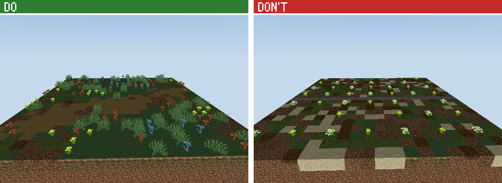
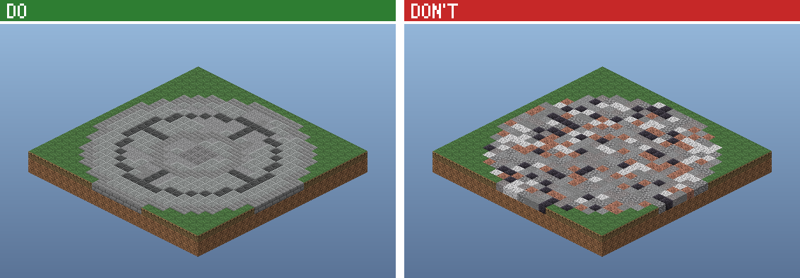
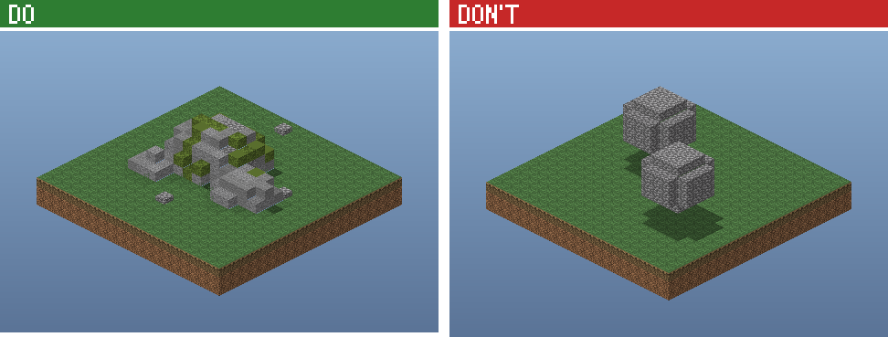
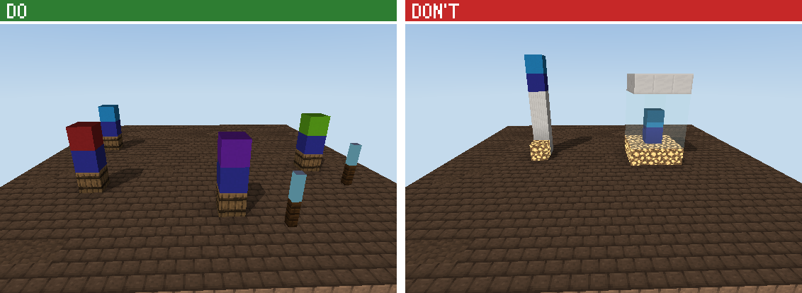
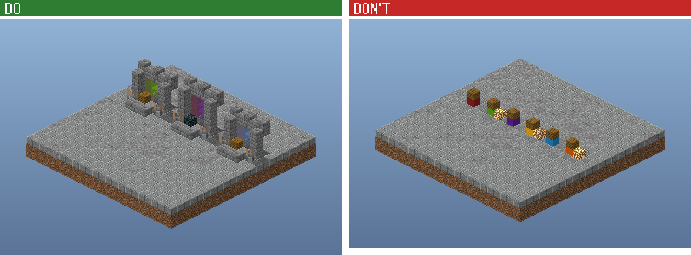
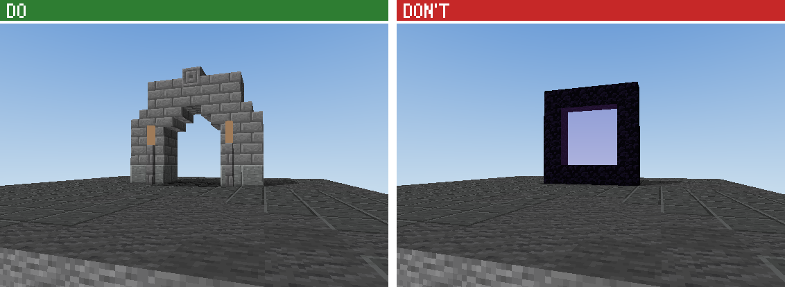
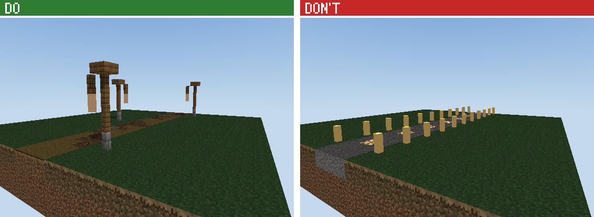
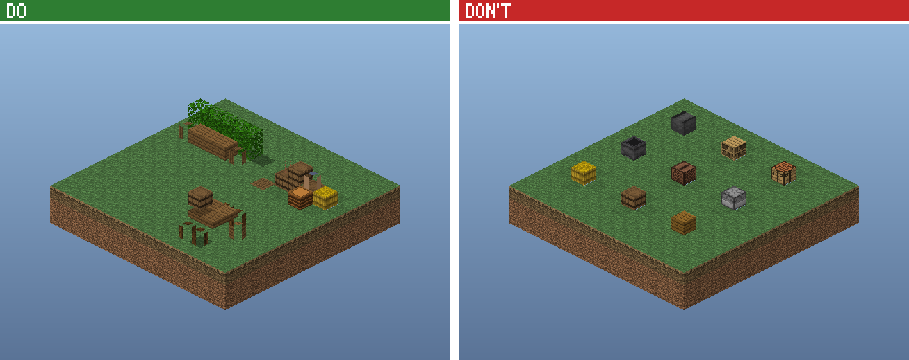
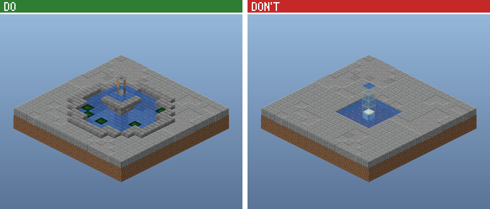

# The spawn manual: building a server spawn by hand

You build every block of the spawn yourself: the island, the ground, the paving, every stone and
tree, every NPC place, the boards, the crates, the gates, every building, every lamp. Nothing is
generated for you and nothing is pasted from a stock piece. This manual teaches each element with a
picture of what to do next to what not to do, and with the code of one worked example.
The examples show how an element is made. What this spawn's elements look like is yours to design
from the user's brief and the theme.

The frame (`frame/frame.mjs` in the spawn folder) does only the plumbing nobody sees: the canvas, a
reservation grid, angles, the world spawn, the records the server admin needs (NPC, hologram, crate,
board and portal positions, regions), spawn-proofing and the export. The kit (`ctx.kit`, `ctx.b`) is
your toolbox: palettes, noise, block states, stairs and slabs, modules, and the building helpers for
roofs, windows and doors (`references/kit-api.md`). Use the tools freely; the design is yours.

| § | Section | Use it when |
| --- | --- | --- |
| 1 | What a great spawn is | planning, judging screenshots |
| 2 | The workflow | always: the order of work |
| 3 | Coordinates, angles and facing | writing any position or direction |
| 4 | The frame, the marks and the tools | the API you build with |
| 5 | The elements, one chapter each | before you write each element |
| 6 | Layouts and their numbers | planning |
| 7 | Materials for a theme | choosing blocks |
| 8 | The cookbook: what the user asks | "make it winter", "add more stuff"... |
| 9 | Looking at it: screenshots, critique, fixes | after every build |
| 10 | Troubleshooting | an error or a warning |
| 11 | Delivery | the end |
| 12 | The reference spawns | seeing how a whole spawn fits together |

The element examples are in `references/spawns/elements/` (copied into every spawn folder as
`elements/`), their pictures in `references/spawns/img/`. `references/spawns/README.md` is the
handbook: the interview, the measured numbers, the don't-look-AI checklist.
`references/building/` covers the building craft in depth.

---

## 1. What a great spawn is

### 1.1 The first minute

A player joins and does these things in order:

1. Sees the first view: the hero and the plaza.
2. Reads the NPC holograms nearest them.
3. Walks to the crates or the boards.
4. Leaves through the RTP gate or a road.

A great spawn makes each step obvious without a sign. The hero pulls the eye, the NPCs face the
player, and the places stand in the open where they can be seen. The way out is in the first view.
Everything below serves that minute.

### 1.2 The rules, with the numbers to hit

1. **The first view is the design.** From the spawn point (eye 1.62 above the dais, facing north):
   - a frame close by (an arch, two big trees, the boards' colonnade);
   - the hero 60-150 blocks out on the axis, filling a quarter to half of the frame height, with open
     sky behind it;
   - the NPC ring and the way on visible;
   - nothing above eye level in the middle 30 degrees.
2. **One hero, three tiers.** One landmark 60-120 tall (a castle keep, a cathedral, a mountain with a
   tower, a giant tree, the server's mascot as a statue), 1.5-2 times the height of what surrounds
   it. Feature buildings 25-50 tall. Ordinary buildings 12-25. NPC stands at human scale.
3. **The core is close, the world is big.** The spawn centre (the dais, the NPC ring, the boards and
   pillars, the crates, the RTP gate) within 40-60 blocks of the spawn point, so a new player finds
   everything in seconds. Around it, the districts and the landscape fill the canvas out to the rim.
   Roads and bridges join them; nothing a player needs is more than ~20 s of sprinting away (110
   blocks).
4. **Places that work.**
   - NPCs 6-8 apart, each turned to the middle, 2 blocks clear in front and 3 of air above.
   - Crates 6-8 apart, 3 x 3 clear in front, open sky above.
   - Boards with a standing area 10-12 deep in front.
5. **Big, not busy.** Fill a big canvas with big things: districts with their own big buildings,
   mountains, rivers and lakes, forests with giant trees, walls and gatehouses. Never hundreds of
   small props or tiny huts spread thin. Small things (benches, barrels, lamps) only as dressing next
   to big ones. The sizes to hit:

   | Thing | Size |
   | --- | --- |
   | the hero | 60-120 tall |
   | feature buildings (halls, keeps, cathedrals, towers) | 25-50 wide, 25-50 tall |
   | ordinary buildings | 15-25 wide, 2-4 storeys, never under 12 x 10 |
   | the spawn dais | 17-31 across, 2-4 tiers |
   | the plaza round it | 80-160 across |
   | gates and gatehouses | 15-30 wide, 15-25 tall |
   | fountains | 15-30 across, 8-15 tall |
   | town walls | 8-14 high, towers 14-25 every 20-40 |
   | rivers | 10-24 wide, 2-5 deep; lakes 40-120 |
   | bridges | 30-80 long, arches 8-14 wide |
   | mountains and cliffs | 40-100 tall |
   | trees | 12-25 tall in groups, giant trees 30-60 |

6. **Shaped floors.** One field material for 70% or more of the floor. Borders and inlays every 8-12
   blocks that point at the exits. No plain patch over 24 x 24, and no per-block random speckle.
7. **Variety, not symmetry.** No exact mirror of the layout: keep the ceremonial axis symmetric and
   vary everything else. At most 3 identical pieces in one view. Neighbouring buildings are
   siblings, not clones.
8. **One accent, used sparingly.** The accent colour at 5% or less of what you see, as points and
   short runs. Gold blocks only on the top-3 pillars (the 2nd place's pillar); lettering in quartz.
9. **Light by design.** Lamps on posts along the walks and at doors and gates, soul lanterns by the
   NPC stands. Hidden light for the rest. `finishSpawn` spawn-proofs what you leave dark.
10. **A designed edge.** The town meets the land with planting, steps and rocks. The island's shore
    and underside look natural, waterfalls pour off the rim. The PvP boundary is a visible red line.
11. **It looks hand-built.** Detail is clustered at entrances and focal points, and 30-50% of walls
    are calm. Partial blocks (stairs, slabs, walls) make up 16-28% of what you see. Trees look grown,
    rivers have banks, bridges have arches.

### 1.3 The three types

| | Normal spawn (FreshSMP-like) | Spawn+ (DonutSMP-like) | PvP lobby |
| --- | --- | --- | --- |
| The idea | a big plaza with the dais and the NPC ring, a town and a landscape round it | a city round a hub, every NPC its own building, districts on spokes | a lobby with the queue NPCs, arenas round it |
| Size | 800-1300 (1000 by default) | 800-1600 (1100) | 450-700 (550) |
| NPCs | 5-20 | 10-30 | 4-10 |
| Boards, crates | by the plaza: boards and pillars on the axis, crates to one side | a hall of fame, a crate hall | boards behind the NPC arc, crates to a side |
| Way out | an RTP gate opposite the first view, roads over bridges | the RTP gatehouse, roads to the districts and the arena | the arenas' gates |

---

## 2. The workflow

| Step | You do | Done when |
| --- | --- | --- |
| 1. Interview | ask in rounds with AskUserQuestion (SKILL.md, README.md §1) | you know the type, size, NPCs, boards, crates, theme and extras |
| 2. Plan | write `brief.md`: the districts, every place with its coordinates, a sentence on each element's design, a top-view sketch; show it, ask "Build this?" | the user said yes |
| 3. Scaffold | `new_spawn` with the name, the size and the brief | the folder exists, the skeleton builds |
| 4. Build, district by district | the land first, then the centre, then each district: read each element's chapter (§5), design it, write it, draft it with `focus`, look, fix | every district passes its loop (§2.2) |
| 5. Look and fix the whole | full builds, screenshots from every player spot (§9), `spawn-critic` until it finds nothing serious | the quality gate (§2.3) passes |
| 6. Deliver | `build_recipe` with `export: true`, `origin`, `world` | they have the files and know how to paste them |

### 2.1 Cook until it is perfect

The user wants the best spawn you can make, not the quickest. Take the time, the builds and the
tokens it needs:

- **Never stop at the first pass.** A great spawn takes 40-100+ builds and hundreds of screenshots.
  After every build you look, and you fix what you see before you move on.
- **Do the most, not the least.** When a chapter lists five things that make an element good, the
  element has all five. When a district could hold one more big building, a river bend, a grove of
  giant trees, it gets them. When a wall is flat, it gets depth. Empty ground on a big canvas is a
  bug.
- **Big first, detail after.** Block out every district's masses (the hero, the halls, the
  mountains, the river) and check the overview and the first view before you detail anything. Then
  detail everything.
- **Never skip a check.** Each element against its chapter's picture; each district from 4+ player
  spots; the whole spawn from the spawn point, from above and from the rim; `inspect_build`;
  `spawn-critic`.
- **Work in parallel when you can.** In Claude Code, the Agent tool runs helpers at the same time:
  give each one a district (its box, the plan, the chapters to read, the theme's materials) to
  build and review in its own file, then put them together and review the whole.
- **Tell the user where you are** between districts, in a line or two, with a screenshot.

### 2.2 The district loop

A big spawn is built one district at a time (the centre, the market, the castle hill, the harbour,
the river valley...). For each district:

1. **Read** the chapters of every element in it.
2. **Block it out**: the big masses only. Draft-build just this district with `focus`
   (`build_recipe` with `focus: "x0,z0,x1,z1"`: about 20-60 s even on a 1500-wide canvas: the whole recipe runs, only the box is kept) and look
   at the overview of the box and 2 player views.
3. **Detail it**: every element designed from its chapter, varied, at the sizes of §1.2.
4. **Look**: screenshots from 4+ spots where players will stand (the way in, the middle, each
   feature, looking back at the centre); compare every element with its chapter's picture.
5. **List every flaw** you see (write them down), fix them all, build again.
6. Repeat 4-5 until a round finds nothing: at least 3 rounds.

### 2.3 The quality gate

**The audit.** Every spawn build prints an audit (`audit: ...` lines; `summary.json`'s `audit`),
measured from the blocks, so "it looks fine" is not the judge:
- bare lawn: the biggest stretch with nothing on it (at most about 48 across) and the share of lawn
  more than 12 from anything (at most 20%);
- flat land: the share of the ground within 2 of one level (at most 80%);
- repeated buildings: 4 or more of the same size fail;
- low decks over water: warned (a bridge arches on piers; a pier may sit low);
- NPC spacing: more than 12 apart fails (6-8 is right; only the NPCs within 60 of the spawn, so a
  spawn+ town's NPCs in their own buildings are not counted);
- views: from the spawn, at least 5 of 8 directions must show something 8+ tall within 160
  blocks (a building, trees, the hero, a hill), or the first minute is floor and sky;
- speckle: more than 3% of the lawn as single blocks unlike their neighbours fails (dirt dots);
  paving salted with odd blocks warns;
- physics: sand, gravel or concrete powder with nothing under it, sugar cane with no water, and
  still water touching air all fail (they fall, break or flow the moment the spawn is pasted);
- effort: the build count from `build-log.json` (15 at the least on a spawn 400+ wide);
- looking: the first-person screenshots taken of the build (`screenshot` logs them in
  `shot-log.json`): 12 at the least, from 8 different spots, before an export.

A spawn whose audit fails is not exported: `convert.mjs` and `build_recipe`'s export refuse, with the
list. Fix each line and build again. `--force` (`force: true`) only when the user asked for an
unfinished draft, and then say what is still open. Under `focus` the audit judges the focus box: use
it on each district as you go.

**Don't stop early, don't ask whether to go on.** While anything on this list is open, keep working:
the next draft, the next look, the next fix. Asking the user "should I carry on?" halfway is
stopping. Look at every screenshot you take (read the PNG): a screenshot not looked at is not a
check.

Deliver only when all of these hold (on a full build, without `focus`):
- the audit passes;

- every element passes its chapter's DO list, and no element looks like its DON'T picture;
- the sizes of §1.2 are met: the hero, the feature buildings, the rivers, the bridges, the walls;
- the first view (§1.2 rule 1) works from the spawn point;
- the core places are readable and clear: no keep-clear warnings, every NPC turned to the middle,
  every board and crate free in front;
- the build reports `problems: []`, `clipped: 0` and no warnings; `inspect_build` checks are clean;
- `spawn-critic` finds nothing above minor in its last review;
- everything the user asked for is there and reads the way they meant it.

### 2.4 The plan

Most bad spawns are bad plans, and a plan costs nothing to change. Decide:

- the districts and their hero buildings, the land (where the mountains, rivers, lakes and forests
  go), the roads and bridges that join them;
- every place with its coordinates: the spawn centre, the first view, each NPC, the boards and
  pillars, the crates, the gates and the buildings;
- for each element, a sentence on its design: "the crates in an open pavilion west of the plaza,
  each under its own arch, the tier in a glass strip".

For example:

```
CHEESE SMP: normal spawn, white-and-blue town, island in a void, 1000 x 200 x 1000, 10 NPCs
Centre (500, 500): a 3-tier dais 25 across on a 120-wide gridded plaza; the NPC ring r 22, 10
  barrel stands with soul lanterns; the boards + top-3 pillars north at 40; the crate pavilion west
  at 45; the RTP gatehouse south at 60 on the axis.
First view: north up the avenue to the castle hill (the hero: a keep 90 tall on a 50-tall crag, 160 out).
Districts: market square NE (a guildhall 40 x 24, a covered market), the harbour SE on the lake
  (a lighthouse 45 tall, warehouses), the temple quarter W (a domed temple 35 tall), farms S.
Land: a mountain ridge NW 80 tall with a waterfall feeding a river that crosses the town W-E under
  3 stone bridges into a lake SE (120 across); giant trees in the parks; cliffs and 2 waterfalls
  off the island's rim.
Walls: round the town at r 200, 10 high, towers every 30, gatehouses on the 4 roads.
```

### 2.5 The scaffold

`new_spawn` with `name`, `size` and `brief` (the plan text). It writes `minecraft-builds/<slug>/`:

| File | What it is |
| --- | --- |
| `spawn.mjs` | The skeleton: the frame and one empty section per element group, each pointing at its chapter. |
| `frame/` | The plumbing. |
| `elements/` | The worked examples of this manual, with their do and don't comments. |
| `parts/` and `examples/` | Reference spawns to read (§12). |
| `brief.md` | The brief and the plan. |

Write each element as its own function, below `build()` or in files next to it (one file per
district keeps a big spawn readable: `import { market } from './market.mjs'`). A full build of a
1000-wide spawn takes 1-3 minutes; a `focus` draft of one district 20-60 s; a screenshot 5-20 s.

---

## 3. Coordinates, angles and facing

```
            north (z smaller)                      angle 0
                  ^                                  |
   west  <--------+--------> east (x bigger)   270 --+-- 90      polar(ctx, angle, r)
   (x smaller)    |                                  |           0 = north, clockwise
                  v                                 180
            south (z bigger)
```

- **Axes.** `x` points east, `y` up, `z` south. The canvas is `S x H x S`. `[cx, cz] = ctx.C` is its
  middle column, where the world spawn usually stands. Players spawn facing **north**.
- **The floor.** `FY` is the plaza's floor block, and players stand at `FY + 1`. The examples take
  positions as **ground block levels**: a thing "at `[x, FY, z]`" starts at `FY + 1`.
- **Angles round the spawn.** `polar(ctx, angle, r)` returns `[x, z]`, not rounded, so use
  `Math.round` before using them as block positions. 0 = north, 90 = east, 180 = south, 270 = west.
- **`facing` = the side the player stands on.** An NPC looks that way, a crate opens to it, a door is
  on that face, an arch reads from there. `facingToward([x, z], [cx, cz])` gives the facing that looks
  at the spawn.
- **Building something that faces a way.** Use `local(pos, facing)` from the frame:
  - `.at(u, d, h)` is the block `u` to the right (as the players in front see it), `d` toward the
    players and `h` up from `pos`.
  - `.out`, `.back`, `.left` and `.right` name the directions for block states.
  - `.across` and `.deep` are the log axes.

  Write the element once in `u, d, h` and it works for all four facings. Every element example
  uses it.
- **Stairs.** `facing` is the side of the tall back: you walk up toward it. Upside-down stairs
  (`half=top`) go under eaves, as sills and in arches, with the tall back toward the wall or pier.
- **Open trapdoors** (shutters, armrests, wheels) lie flat against the side of their block opposite
  their `facing`.
- **Yaw and pitch** (screenshots, NPCs) are Minecraft's own: yaw 0 looks south, 90 west, 180 north
  and -90 east; pitch above 0 looks down. `yawToward(from, to)` computes the yaw.
- **Local and world coordinates.** Everything in the recipe, the screenshots and `placements.json`'s
  `pos` is local: the structure's minimum corner is 0 0 0. World = the paste corner (`origin`) +
  local. setup.md and the `world` fields use world coordinates (§11).

---

## 4. The frame, the marks and the tools

### 4.1 The frame (`frame/frame.mjs`)

| Function | Does |
| --- | --- |
| `startSpawn(api, { name, size, height, seed, floorY })` → `ctx` | The canvas and everything below. `size` 120-320, `height` 80-110. `floorY` defaults to about a third of the height. |
| `finishSpawn(ctx, { safeZone, description, land })` | Removes what the game would drop (flowers on stone, lanterns hanging from air), adds the `spawn` safe region (pvp, mobs, fall damage and item drops denied; priority 10), spawn-proofs every dark walkable cell with invisible light and exports. `land(x, z)` = true on your island keeps spawn-proofing on it. |
| `ctx` | `api`, `kit`, `b` (the builder), `name`, `slug`, `rng` (`rng()`, `rng.int(a, b)`, `rng.range(a, b)`, `rng.chance(p)`), `seed`, `S`, `H`, `FY`, `C`, `grid`, `layout` (your plan), `hologram(id, text, [x, y, z])`, `warn(msg)`, `place(fn, ...args)` (runs `fn(ctx, ...args)` and turns an error into a warning) |
| `ctx.grid` | One tag per column: `reserve(x0, z0, x1, z1, tag, pad)`, `reserveDisc(cx, cz, r, tag)`, `free(x0, z0, x1, z1)`, `freeDisc(cx, cz, r)`, `tag(x, z)`. Reserve every place while planning, so trees and rocks placed later keep off it. |
| `findSpot(ctx, { r, ring: [r0, r1], angles, box, tag, edge })` → `{ x, z, r }` or `null` | Finds and reserves a free disc; `angles` are tried first. |
| `polar`, `facingToward`, `yawToward`, `local` | §3 |

### 4.2 The marks: what the server admin needs

A mark places no block. It records a position for `placements.json` and the commands in setup.md,
and it keeps the cells the place needs clear: `finish()` warns, naming the cell, if anything you
build fills one.

| Call | Records | Keeps clear |
| --- | --- | --- |
| `b.spawnPoint([x, FY, z], facing)` | the world spawn (players appear at `y + 1`) | 2 above it |
| `b.markNpc(pos, facing, { id, label, role, lines })` | an NPC standing on block `pos` (its feet at `y + 1`), its hologram 2.4 above its feet; `lines` = the hologram's lines under the name (the command, what it does, "Tap below"); set the returned record's `yaw` to turn it exactly (`yawToward`) | 3 above its feet, 2 in front |
| `b.markCrate(pos, facing, { id, label, tier, block })` | the crate block at `pos` and its hologram 1.6 above it | 2 above it, 2 in front |
| `b.markBoard([x, y, z], facing, { id, label, size: [w, h] })` | a hologram leaderboard whose top line floats at `[x, y, z]` (fractions allowed) | its volume: `w` across, `h` down |
| `b.markPortal(min, max, { id, label, kind, facing })` | a portal's trigger region (the cells players walk through); `kind` is `rtp`, `warp`, `pvp`, `nether` or any word | the opening |
| `ctx.hologram(id, text, [x, y, z])` | a free-standing hologram (rules, a welcome, a district name); `y` is its top line; `text` may be an array of lines | nothing |
| `b.region(id, min, max, flags)` | a WorldGuard region, e.g. `{ pvp: 'allow', priority: 20 }` (above the spawn's 10 to override it) | nothing |

### 4.3 Big builds

A spawn of 1000-1500 blocks a side holds 30-60 million blocks. The kit stores them in 16 x 16 x 16
sections and writes the file as a stream, so it fits in a few GB; every script gives itself three
quarters of the machine's memory. A full build takes 1-4 minutes. While you work on one district,
draft it with `focus` (`build_recipe`'s `focus: "x0,z0,x1,z1"`, or `run-build --focus`): the whole
recipe runs, but only that box is kept, written and rendered, in 20-60 s. Build without `focus` for
the whole-spawn checks and the delivery. In your own passes over the blocks, use `b.entriesWhere`
for the kinds you need instead of `b.entries()`.

### 4.4 The tools

The kit is in `ctx.kit` and on `b`, documented in `references/kit-api.md`. The ones every element
uses:

| Tool | For |
| --- | --- |
| `b.set(x, y, z, block)`, `b.box(min, max, block)`, `b.get`, `b.nameAt`, `b.remove` | placing and reading blocks; `block` is an id with states (`'minecraft:spruce_stairs[facing=north,half=top]'`) or a palette |
| `kit.palette({ stone: 5, andesite: 3, tuff: 1 }, { scale, seed })` | a clumped mix; `scale` is the clump size in blocks. Give the main block most of the weight: 1 in 7 reads as texture, 1 in 3 as speckle. |
| `kit.noise.fbm2(x, z, { scale, seed })`, `fbm3`, `coherent01`; `kit.hash01(x, y, z, seed)` | smooth noise (about ±0.6; `coherent01` is 0..1) for shapes and patches; a fixed per-block random number |
| `kit.material(name)` | a family's blocks: `.stairs`, `.slab`, `.wall`, `.mossy`, `.cracked`, `.chiseled` (not every family has every variant) |
| `kit.stairs(name, facing, half)`, `kit.slab(name, type)`, `kit.trapdoor`, `kit.log(name, axis)` | state strings |
| `b.module([w, h, d])` and `b.stamp(m, corner, { rotate })` | build a piece once, place it turned |
| `b.entriesWhere(nameTest, blockTest)` | the blocks of a few kinds as `[x, y, z, block]` (cheap on a big build; `b.entries()` copies every block) |
| `b.roof`, `b.window`, `b.door`, `b.column`, `b.arch` | building helpers (kit-api.md, `references/building/components.md`); tools, not designs: choose their sizes, materials and where they go |
| `b.hull`, `b.figure`, the SDF shapes | statues, monuments, ships (`references/building/sculpting.md`) |

---

## 5. The elements, one chapter each

Each chapter has a picture (do on the left, don't on the right), the rules and the worked example
in `elements/`. That file's header repeats the rules, and its code builds the do half of the
picture. Read the code to see how each rule turns into blocks. Then write the element for this
spawn:

- its own sizes, shapes and materials;
- several variants where the spawn has several of it (no two trees, rocks or buildings alike);
- placed where the plan says.

The examples' functions can be imported. When you do, give every call its own options and make the
result fit the spawn, so the element is designed for this place and does not repeat the example.

### 5.1 The land: the landscape (`elements/land.mjs`) and the island (`elements/island.mjs`)


The land is the biggest thing on a spawn and what the user sees first from above. A flat green disc
with a few things set on it is the most common way a spawn fails, and noise hills everywhere the
second. Design the land as a landscape: where the mountains stand, how the valley runs, where the
water goes. Then let the kit's heightfield, `b.land` (kit-api.md, "Landscapes"), do the arithmetic
and the weathering. The numbers below come from pro terraformers and geomorphology
(`terrain-research.md`).

- **Do:**
  - **Landforms first, biggest first.**
    - The ranges that frame the spawn (`land.range`): tallest behind the first view, steep toward
      the players, joined by saddles, with foothills along their foot.
    - A lone peak or two (`land.peak`): stretched, with lesser summits.
    - The valley floor for the town and the plaza, flat pads where people walk (`land.pad`, blended
      over 20-40), a gentle roll of 2-4 on the rest (`land.hills`).
  - **Mountain shapes:**
    - 3-8 times as wide as they are tall;
    - flanks averaging 28-38° (0.5-0.8 rise a block), steeper only where there is a cliff;
    - convex at the crest, straight in the middle, concave at the foot;
    - spurs from the crest every half-width ÷ 2 (about every 25-60 on a spawn), with side valleys
      between.
  - **Weather it:** `land.erode` (rain cuts gullies, sharpens the spurs, lays gravel fans at their
    mouths), then `land.thermal` (scree under the cliffs). Erosion is what makes it look real;
    skipping it is what makes terrain look generated.
  - **Blocks by slope and height** (`land.paint`, a theme or your own):
    - grass with large soft patches on the flats (coarse dirt and podzol under woods, moss where it
      is damp);
    - a slope mix from 30°; scree from 44°;
    - bare rock in tilted, wandering strata above 51°;
    - snow only on ledges, never on cliffs;
    - beaches 2 below to 1 above the water.
  - **Water where water would be:**
    - rivers in the valley's lowest line, meandering with a wavelength of about 11 times their
      width (§5.4);
    - lakes in basins (`paint`'s `water: { level, from }`);
    - every water block held.
  - **Woods by the land:**
    - on the gentle and middle slopes, in clumps with clearings;
    - thinning and shrinking toward a tree line well below the summits;
    - none on cliffs and pads (`land.where` with `b.forest`'s `avoid`);
    - meadows on the valley floor.
  - **Floating land:**
    - an outline that wanders (`land.outline` with a `fall`, so the relief slopes down to the rim
      instead of being cut off);
    - a solid underside that hangs like an upside-down mountain to a ragged point
      (`paint`'s `underside`), deepest in the middle;
    - roots and vines from the rim, a waterfall off the edge if there is a river.
- **Don't:**
  - noise hills everywhere (`height = base + n * fbm(x, z)` over the whole island: lumps of one size
    in every direction, no valley, no ridge, nothing flat to build on);
  - mountains as smooth cones, domes or blobs standing on flat grass with no foothills, or one blob
    in a corner;
  - grass up every slope and on every peak, one ground block everywhere, or single-block speckle of
    dirt and sand on the lawn;
  - a land that ends in a vertical wall at the edge, or a cylinder of an island;
  - more than 80% of the ground within 2 of one level on a big canvas (the audit fails it).
- **The example:**
  - `valleyLand(ctx, { seed, floor, theme })` builds the picture's land, step by step and commented:
    - an outline;
    - a range round the north and west, a lone mountain, foothills;
    - a floodplain and a lake basin;
    - a plaza pad;
    - erosion;
    - paint with an underside and the lake;
    - the river cut with `river()`;
    - woods and meadows by `land.where`.
  - It returns `{ land, groundY, plaza, lake }`.
  - `island(ctx, ...)` (`elements/island.mjs`) is the small round island of the reference spawns, for
    a compact spawn or a floating islet beside the main land.
- **The loop:** shape, `land.preview(file)` (a shaded map in a second or two: read the PNG), adjust,
  preview again; build blocks only once the map is right, then look from the plaza. Players see
  about 160-200 blocks at a normal render distance: the first view must show a mountain, a cliff or
  the hero within that.
- **Make it yours:**
  - a valley ringed by mountains (the picture);
  - a coast: the land falling to a sea bay on one side, headlands, a lagoon held by reefs;
  - a mountain spawn on a plateau with a gorge;
  - desert badlands (`theme: 'mesa'`), an alpine valley (`'alpine'`, snow on the peaks), a winter
    spawn (`'winter'`), a dark land (`'dark'`: deepslate, blackstone, podzol).
- **Numbers:**
  - on a 1000-wide spawn the rim mountains are 80-150 tall and 200-350 wide, and the valley floor is
    300-500 across;
  - lone peaks 50-90;
  - foothills 15-30;
  - the plaza pad's blend 25-40;
  - the underside 40-90 deep;
  - `land.stats()` after erosion: flat 25-50%, gentle 25-40%, sloping 15-25%, steep 5-12%, cliff
    0.5-3%.

### 5.2 Ground, planting and walks (`elements/ground.mjs`)



- **Do:**
  - one main ground block (grass) with 2-3 others in clumps a few blocks across, from coherent noise;
  - flowers in drifts, one or two species per patch, grass round them;
  - walks 3-5 wide that follow the ground, with frayed edges.
- **Don't:** per-block speckle of five ground blocks, flowers one per block in rows, a rainbow of
  every flower, or a 1-wide gravel line ruled across the grass.
- **The example:**
  - `naturalGround(ctx, cells, { mix, seed })` makes the clumped mix;
  - `plantDrifts(ctx, area, { flowers, seed })` makes the drifts;
  - `walk(ctx, points, { width, seed })` makes a frayed walk along points.
- **Make it yours:**
  - the theme's mix (podzol and coarse dirt under spruces, snow and powder snow in winter, sand and
    dead bushes in a desert);
  - the flower species of the season;
  - walks that curve to the doors and gates instead of ruling straight lines.

### 5.3 Paving: the plaza floor (`elements/paving.mjs`)



- **Do:**
  - one field material for 70% or more of the floor, in 2-3 close shades clumped together;
  - borders and inlays of a contrasting block every 7-12 blocks, as rings round the spawn or long
    lines that point at the exits;
  - a rose (a small figure of the best stone) where players land, a kerb where the plaza ends.
- **Don't:** speckle, a checkerboard, one flat block over a huge area, or dotted and scattered inlay
  blocks.
- **The example:** `roundPlaza(ctx, { cx, cz, r, field, border, inlay, rose })`: a rose, a ring
  round it, an inner ring near the edge, inlay lines on the four axes and a kerb.
- **The grid:** `gridPlaza(ctx, { x0, z0, x1, z1, cx, cz, field, line, band, cell })`: the warm look
  of many big servers (see §5.9's picture): a field of close shades (mud bricks and packed mud),
  darker lines every 8-12 blocks, a lighter band on the axes leading in, a kerb.
- **Make it yours:**
  - the shape of your plaza (square with cut corners, a long forum, two linked circles);
  - rings at the radii of your NPC rings (a border band under each);
  - inlay lines toward your exits, not the four axes by habit;
  - the theme's stones (smooth sandstone and cut red sandstone; deepslate tiles and polished
    blackstone; mud bricks and packed mud).
- **Numbers:** paths 5-9 wide; a plaza over 40 across needs a figure every 12-16 blocks.

### 5.4 Rivers, lakes and waterfalls (`elements/river.mjs`)


- **Do:**
  - a meandering course (a spline through points, never a straight line or a sine) whose width
    varies (10-24 on a big spawn), with a lake or a pond on it;
  - still water at one level per stretch, 2 below the land, held by solid blocks at every side and
    underneath; the level changes only at a waterfall, into a deep pool;
  - depth 1 at the edges, deepest on the outside of the bends;
  - sloping banks: a beach of sand and gravel on the inside of a bend, a steep cut bank of dirt,
    roots and rock on the outside; a bed of gravel, sand, clay and mud in clumps;
  - sugar cane in clumps at the waterline, lily pads only in calm water, seagrass where it is 2+
    deep, mossy stones at the bends;
  - the waterfall: a shallow rock lip, a curtain with rock either side, wet mossy rock round it.
- **Water rules:**
  - in a structure, still water is source blocks; anything that is not solid at its side or bed
    (air, a plant, a carpet, a lantern) lets it flood when pasted, so seal every side last;
  - a waterfall is flowing water: `water[level=1]` past the lip, then `water[level=8]` (falling)
    down to the pool; falling water does not spread sideways, so the curtain needs no walls, and
    nothing solid may stand in it;
  - sugar cane grows on dirt, sand, grass or mud with water beside that block (not on gravel).
- **Don't:** a straight trench of one width, 1 deep, flush with the grass; water standing above its
  banks (a wall of water down a cliff); lily pads everywhere or sugar cane in rows.
- **The example:**
  - `course(ctx, points)`: a smooth spline through `[[x, z], ...]` with `at(t)`, `tangent(t)` and
    `nearest(x, z)` (`{ t, d, side, bend }`; `side * bend > 0` is the inside of a bend);
  - `river(ctx, points, { width, depth, bank, level, falls, pools, spring, seed, plants, stones, ground })`
    carves it into the land already there; `width` is a number, a `[min, max]` range or `t => width`;
    `falls: [{ at, drop, pool }]`, `pools: [{ at, r, depth, bank }]`; it returns `{ centre, levelAt,
    widthAt, at, tangent, nearest, isWater(x, z), waterTop, bedAt, surfaceAt, falls }` for bridges
    and paths, and warns if water touches the canvas edge;
  - `holdsWater(block)`, `riverStone(ctx, pos, { r, seed, avoid })`.
- **Make it yours:**
  - a swamp river (2 deep, a mud bed, mangrove roots on the banks);
  - a winter river with snow and packed ice on the banks;
  - a broad river through the town under 2-4 bridges into a harbour lake;
  - a river that ends in a lake at the plaza, or falls off the island's rim (falling water does not
    spread);
  - a canal through a city: stone banks, steps down to the water, moored boats;
  - a harbour: a natural bay with an irregular shore, headlands and coves, widening to its mouth,
    the water held by the land's own rock (on a floating island a lagoon inside a rim of land and
    reefs, never a walled plate hanging off the edge); stone quays with steps only in the harbour
    itself, 3-4 piers on posts, moored boats of blocks, crates and barrels on the quay, a
    lighthouse on a headland.
- **Numbers:** rivers 10-24 wide on a big spawn (the example 8-15), 3 deep in the channel; lakes
  40-120 across; waterfalls 6-20 high into pools 4-6 deep.

### 5.5 Bridges (`elements/bridge.mjs`)


- **Do:**
  - cross square to the flow, the abutments set into both banks;
  - 2-4 arches, the middle one the biggest, the curves smoothed with upside-down stairs and slabs
    inside a ring of lighter stone;
  - piers founded on the river bed, with pointed cutwaters, higher on the upstream side;
  - a humped deck in slab steps that ramps down at the ends, parapets with a coping and a line of
    stair corbels under them;
  - lamps on pillars and newel posts at the ends, wing walls, the road carrying on into the land.
- **Don't:** a flat plank strip at grass level with no rails and its ends floating, one big flat
  slab, piers that stop above the river bed.
- **The example:**
  - `crossing(river, t)` finds the crossing at `t` along a river from §5.4: `{ centre, facing,
    waterY, upstream }` (the road runs along the grid axis most square to the flow);
  - `archBridge(ctx, site, { spans, pier, abutment, width, arch, springing, hump, road, lamps, face, low, paving, landRoad, ring, coping, pillar, lantern, seed })`
    builds it (`arch`: `'round'`, `'pointed'`, `'segmental'`); returns `{ length, deckY(d), ends }`.
- **Make it yours:**
  - a gothic bridge in warm brick: `arch: 'pointed'`, mud-brick faces with a stone-brick ring;
  - a dark one: a single segmental span of 14 in deepslate, a polished blackstone ring, soul
    lanterns;
  - a long bridge over a broad river: `spans: [6, 8, 10, 8, 6]`, or a level causeway with `hump: 0`;
  - a village footbridge: `spans: [12]`, `width: 5`; a covered timber bridge or a bridge with
    houses on it for a fantasy town.
- **Numbers:** 30-80 long on a big spawn (the example 38, 42 with its ramps), arches 8-14 wide, the
  deck 5-9 wide and 6-10 above the water.

### 5.6 Cliffs and mountains (`elements/cliffs.mjs`)


- **Do:**
  - 2-4 peaks of different heights with saddles between them, steep toward the players and longer
    slopes behind;
  - strata bands 1-5 rows thick that tilt and wander: dark at the foot, a pale line every 8-12
    rows; hard bands stand out and soft ones sink back, which makes the lips and overhangs;
  - planted benches every 6-9 rows (grass, moss, bushes, small trees), vertical cracks, a scree
    slope of gravel, slabs and boulders at the foot, the foot buried in the ground;
  - a cave mouth or a snowline if the place calls for it; a waterfall down it into a river (§5.4).
- **Don't:** a noise blob or a smooth cone of one stone, a flat-topped vertical wall, per-block
  speckle or rainbow bands, grass on vertical faces, or the same peak copied.
- **The example:**
  - `massif(ctx, { cx, cz, y, height, radius, face, peaks, seed, terrace, strata, dip, cracks, cave, snow, plants, trees, scree })`:
    a mountain of a steep plinth with 3-4 towers on it; returns `topY(x, z)`.
  - `cliff(ctx, { x0, z0, x1, z1, y, height, face, seed, terrace, summits, ...rock })`: an
    escarpment, a wall with summits set back on it.
  - `strata`: `'grey'`, `'mesa'`, `'dark'` or your own `{ foot, body, cap, accent, scree, slabs, soil, trees, green }`
    (`STRATA` has the presets); `peaks: [{ u, v, h, r, p }]` places the towers yourself.
- **Make it yours:**
  - snowy peaks (`strata: 'dark', snow: 24`), desert badlands (`strata: 'mesa'` on red sand), a
    single Matterhorn or twin peaks with a pass between them;
  - a cliff wall along the back of the spawn, a crag carrying the castle that is the hero;
  - a hidden cave with a warp in it, a path climbing to a lookout.
- **Numbers:** mountains 40-100 tall (the example 44, radius 30); benches every 6-9 rows; scree
  out to a third of the height.
- **Note:** `rng.shuffle(list)` returns a shuffled copy and leaves the list as it was; use what it
  returns.

### 5.7 Stones and rocks (`elements/stones.mjs`)



- **Do:**
  - groups, not singles: one big stone with one or two smaller ones against it and loose bits round
    them;
  - irregular shapes (an ellipsoid pushed in and out by noise), wider than tall, with a flatter top;
  - sunk a block into the ground, in a clumped mix of 3-4 grey stones;
  - moss on the faces that look up, plants at the foot.
- **Don't:** a sphere of one block sitting on the grass, speckle of five materials, the same rock in
  a row or a ring, or stones on paving, in a doorway or in front of an NPC.
- **The example:**
  - `boulder(ctx, pos, { r: [rx, ry, rz], seed, moss })` makes one stone;
  - `rockGroup(ctx, pos, { size, seed })` makes the group (sizes 1 : 0.6 : 0.35).
- **Make it yours:**
  - sizes for the place: 1-2 at a path's edge, 4-8 at the rim; cliffs and mountains are §5.6;
  - the theme's stones (sandstone and terracotta in a desert, calcite and packed ice in winter,
    blackstone and basalt for a dark theme);
  - lean them, stack them into outcrops, or put a waterfall between two.

### 5.8 Trees, bushes and giant trees (`elements/trees.mjs`)


- **Do:**
  - **big, thick trees:**
    - the everyday tree of a spawn is 14-26 tall with a trunk 2-4 across (`bigTree`);
    - in big woods most trunks are 2-5 across;
    - even a small build gets 2-across trunks where there is room;
    - the vanilla 1-wide pole reads small and generated;
  - **trunks and limbs of the all-bark wood block** (`oak_wood`, `spruce_wood`...), never logs
    with their ring ends showing; a trunk that flares at the foot into roots running over the
    ground and narrows as it climbs;
  - **limbs:** 4-7 at different heights and directions, rising as they go out and forking, so wood
    shows inside the crown;
  - **the crown:** wider than tall, lumpy, with gaps you can see the sky through;
  - **three size classes in groups,** big trees first and small ones in their gaps, bushes at their
    feet (feature 20-30, medium 14-20, small 8-12);
  - near the plaza, crowns kept above head height and off NPCs, boards and signs.
- **Don't:**
  - the lollipop: a pole with a ball on top;
  - 1-wide trunks everywhere;
  - perfect spheres or cubes of leaves;
  - every tree the same height, or trees in a row at equal steps;
  - a crown made only of wool or concrete.
- **The example:**
  - `bigTree(ctx, pos, { species, height, trunk, seed, ...giantTree options })` is the everyday big
    tree: the giant's engine (roots, forking limbs, clustered crown) scaled to 14-26;
  - `broadleaf(ctx, pos, { height, seed, log, leaves, branches })` is a small one;
  - `bush(ctx, pos, { r, seed, leaves })` makes a bush.
- **Woods:** `b.forest` places whole woods with trees of the kit's presets. Its `scale` (default 1.6
  on canvases from 400 wide, 1.3 from 150) makes them taller with trunks 2-5 across, all bark. Plant
  `bigTree`s of your own as the feature trees of each wood and along the walks.
- **Make it yours:**
  - the theme's species, each with its own shape:
    - a spruce is a tall cone of tiers on a 2-3 wide trunk;
    - a birch is tall and straight, 2 across, with a narrow crown;
    - a cherry forks low into a few spreading limbs under a flat pink umbrella 1.5-2 times as wide
      as it is tall, with petals underneath;
    - a palm leans and has a fan of fronds;
    - a dead tree is bare limbs;
  - **autumn:** vanilla has no orange leaves, so mix 20-40% orange, red or yellow blocks (honeycomb,
    orange or red terracotta, shroomlight, nether wart blocks) into part of the oak and dark-oak
    crowns, in clumps; keep birch and spruce as they are; podzol, coarse dirt and leaf carpets under
    them;
  - a hero tree 2-3 times the others for a landmark;
  - every tree its own seed, height and lean. Never the same tree twice in one view.
- **Numbers:**
  - feature trees 20-30 tall with trunks 3-5 across;
  - medium 14-20, trunks 2-3;
  - small 8-12, trunks 1-2;
  - bushes 2-3;
  - woods at 1 tree per 60-120 columns (big trees need room), denser at the rim, thinning toward
    the tree line.

**Giant trees** (`elements/landmark-trees.mjs`, the code in `trees.mjs`):


- **Do:** a landmark tree 25-60 tall: a leaning, flared trunk 2-4 across; 5-8 buttress roots, each
  with a fin and a tail along the ground; 5-7 limbs at the golden angle, each forking 2-3 times; a
  layered crown 1-1.5 times the height across with gaps, darker underneath, a drooping hem; vines,
  glow berries, litter at the foot. One or two per park, the biggest as a hero.
- **Don't:** a scaled-up lollipop, a leaf dome with no gaps, leaves floating with no limb to them,
  limbs of one length, a trunk with no roots.
- **The example:** `giantTree(ctx, [x, y, z], { species, seed, berries, ground, ...fields })` with
  `species` `oak`, `dark_oak`, `cherry`, `jungle`, `spruce`, `birch` or `dead`; every field of
  `GIANTS` (height, trunk, log, leaves, fork, limbs, reach, rise, roots, buttress, vines, petals,
  allBark...) can be set. Returns `{ tips, crown }` (reserve the crown's disc so nothing grows into
  it). Trunks and limbs are all bark (`allBark: true`).
- **Make it yours:** a sakura giant with petals underfoot, a dead tree on a hill, a jungle giant
  with cocoa and vines, a dark-oak umbrella over a plaza, a fantasy tree of flowering azalea.
- **Note:** the screenshot renderer draws ring tops on every log whatever its axis, so horizontal
  limbs show pale ends in the pictures; in the game they are bark.


### 5.9 The spawn centre: the dais (`elements/dais.mjs`)


- **Do:**
  - a stepped dais where players land: 2-4 tiers, each 1 high, every tier's edge a ring of stairs,
    17-31 across at the bottom;
  - stripes of a light block running out on the axes and diagonals across the tiers, a medallion on
    the top (a turned checker of 3-4 warm tones), a glowing centre (light-blue glass over a sea
    lantern) at the world spawn;
  - the floor round it in the same family of colours, on a grid that leads to it;
  - the NPC ring 4-8 out from the dais's foot (§5.10), 6+ blocks of open floor between.
- **Don't:** a ziggurat of full blocks you have to jump up, the spawn as one glowstone in a flat
  floor with the NPCs in a row along one side, a dais taller than 4 that hides the view.
- **The example:** `dais(ctx, { cx, cz, R, tiers, body, stripe, tones, centre, facing })` builds
  it and places the world spawn on top (facing the first view); the picture is a whole spawn
  centre: `gridPlaza` (§5.3), `dais` and `npcRing` (§5.10).
- **Make it yours:**
  - round or octagonal tiers instead of square, or a sunken court with steps down;
  - the theme's stones: quartz and blue for a white town, blackstone and crimson for a dark one,
    sandstone and terracotta for a desert, prismarine for a sea spawn;
  - a feature on it: a beacon-like light column, a statue of the mascot behind the spawn, water
    channels in the stripes;
  - the medallion as the server's logo in blocks.
- **Numbers:** a plaza 100-160 across round a dais 17-31; the NPC ring r 18-30.

### 5.10 NPC stands (`elements/npc.mjs`)



- **Do:**
  - a stand of one block: the NPC 1 above the players' floor, so they look it in the face; a
    barrel standing up, a stripped log, a polished block or a stump; the same stand for every NPC of
    a ring (the skins are the variety);
  - a lantern on a short post beside each stand (a soul lantern on a fence), at the side or just
    behind, never in front of its face;
  - the NPCs in a ring round the dais, 6-8 apart, every one turned exactly to the middle;
  - a rich hologram: the name, the command, a line on what it does, "Tap below" (`lines`);
  - head room: 3 clear above its feet, nothing within 2 in front, nothing over the hologram.
- **Don't:** a pillar that puts it 4+ up, a glass box, NPCs on the bare floor with nothing marking
  them, NPCs in a row against a wall, anything in their face.
- **The example:**
  - `npcStand(ctx, pos, facing, { stand, post, light, lantern, label, role, lines, yaw })` builds a
    stand and its post and calls `b.markNpc`;
  - `npcRing(ctx, { cx, cz, r, npcs, from, gaps })` places a ring, every NPC turned to the middle.

  In the pictures the coloured 2-block figures stand in for the NPCs (the renderer cannot draw
  entities); never build them.
- **Make it yours:** the stand for the theme (a mossy stone in a ruin, a crystal block in a fantasy
  spawn, a copper block on a steampunk one); the post (a chain from an arch, a lantern on a log); in
  a town, an NPC on its building's porch or behind its counter.

### 5.11 Leaderboards and the top-3 pillars (`elements/boards.mjs`)


- **Do:**
  - a framed recess: piers at the sides, a base and a lintel, the backdrop set 1 back, dark only
    behind the text;
  - the text's top line 4-6 above the floor, 5 wide and 4 tall per 10-12 lines;
  - free floor in front (6+ deep);
  - the top-3 pillars as players know them: three 3 x 3 columns side by side, the 1st 3 high in the
    middle, the 2nd 2 high on its left, the 3rd 1 high on its right, of diamond / gold / iron blocks
    (or gold / iron / waxed copper, or concrete in those colours: light blue / yellow / light grey);
    a statue on each, a title hologram over the set; the only place gold belongs;
  - the pillars beside the boards or between them, never in front;
  - hidden light.
- **Don't:** a black wall with a glowstone grid, a flat panel in the open, a roof or anything over
  the text, thin 1 x 1 posts for the statues, ranks at one height, or statues in front of a board.
- **The example:**
  - `boardRecess(ctx, pos, facing, { label, width, height, stone, backdrop })` calls `b.markBoard`;
  - `podium(ctx, pos, facing, { set, id, label })` builds the top-3 pillars (`set`: 'classic',
    'metals', 'concrete' or your own three blocks), marks the statues with `b.markNpc` (`role:
    'statue'`) and the title with `ctx.hologram`.
- **Make it yours:**
  - boards set into a building's front, a garden wall, the base of the hero monument or a
    colonnade;
  - 2-5 boards, the middle one bigger;
  - several pillar sets (Top balance, Top kills, Top playtime) round a hall of fame;
  - the server's name over them as a hologram, or in quartz letters only if asked.

### 5.12 Crates (`elements/crates.mjs`)



- **Do:**
  - a crate area as a set piece: an arcade or pavilion 25-40 wide, the crates 6-8 apart in bays;
  - the best crate in the middle, in a taller bay under a pediment, on a 2-high stage; the others
    on carved 1-high stages;
  - the tier's colour only in accents: a backdrop slot lit from behind, candles, a floor mat in
    front, a lunette in the pediment; the stone the same for all;
  - a dark wall with light trim (or the reverse), a floor pattern leading in, lamps at the sides;
  - 3+ blocks clear in front of each crate and nothing over it (`b.markCrate` checks).
- **Don't:** chests on coloured concrete 2 apart, glowstone next to them, signs or roofs over them,
  crates hidden behind pillars or in an unlit hole, every crate a different style.
- **The example:**
  - `cratePavilion(ctx, pos, facing, crates, { bay, heroBay, pier, depth, court, pitch, field, keystone, stone, trim, base, roof, seed })`:
    the arcade; `crates = [{ id, label, tier, colour, block, hero }]` (the `hero` crate takes the
    middle bay); returns the crate records;
  - `crateStage(ctx, pos, facing, { label, tier, colour, block, crateId, hero, backdrop, stone, base, top })`:
    one crate on its stage, for a crate on its own.
- **Make it yours:** the palette reversed (a light wall, dark trim); a dome or an East-Asian roof
  over the hero bay; two arcades facing across a court (a crate cloister) for 7+ crates; an open
  pavilion of stages with backdrops; a seasonal crate in pink under cherry leaves.
- **Numbers:** the example arcade is 39 wide and 9 deep, the pediment's ridge at 18, the crates 7-8
  apart with 14 clear in front.

### 5.13 Gates and gatehouses (`elements/gate.mjs`)



- **Do:**
  - a gatehouse 15-25 wide and 14-22 tall: twin towers rising 3+ above the middle, an opening 5-7
    wide and 7-10 high;
  - depth on every face: the arch in orders (each ring 1 deeper and 1 narrower), a voussoir ring 15+
    lightness points off the wall with a keystone, a vaulted passage 3-6 deep with a portcullis
    groove, a battered plinth, string courses, quoins, a corbelled parapet with crenellations;
  - a podium with steps and a runner of paving leading through, banners and lanterns;
  - the opening kept clear and recorded with `b.markPortal`, the title hologram above;
  - at the end of an axis from the spawn, so it is seen from far.
- **Don't:** a bare obsidian rectangle, a frame of glowstone, glass, water or portal blocks in the
  opening, a gate with nothing leading to it, a small arch on a big spawn.
- **The example:**
  - `gate(ctx, pos, facing, { label, portalId, kind, width, height, depth, tower, towerHeight, rise, approach, banner, field, stone, trim, ring, base, keystone, seed })`:
    the gatehouse (`pos` = the plaza floor under the middle of the opening); returns the portal
    record;
  - `archOpening(span, jambTop)`: the shape of a round-headed opening with stair shoulders, for
    arches of your own.
- **Make it yours:** piers and a pediment for a classical gate; polished blackstone with a red
  nether-brick ring for a PvP or nether gate; sandstone for a desert; `width: 5, height: 8` for the
  smaller warp gates; a torii in a Japanese spawn; `rise: 3, approach: 20` on the main axis.
- **Numbers:** the example is 25 wide (the podium 29) and 22 tall, the opening 7 x 10, the passage
  5 deep.

### 5.14 Big buildings (`elements/buildings.mjs`)


- **Do:**
  - mass it from several blocks: a main range, a cross wing stepping forward with its own gable, a
    tower 1.5-2 times the eaves, a porch; ridges at least 2 apart in height;
  - keep every wall alive in layers of 1-2 blocks: a plinth with a water-table stair, quoins, a
    pilaster or post every 5-7 blocks, a jetty or string course at each floor, the infill 1 behind
    the frame, the glass 1 behind the face with a sill and an arched lintel;
  - bays in an A-B-A beat, windows stacked over each other; scale cues (doors 2-3 tall, storeys
    5-6, windows 2-3 tall);
  - a roof at 45 degrees or steeper with eaves, dormers and chimneys; windows backed with a dark
    block so they read as windows;
  - the ground round it dressed (a forecourt, beds, lamps); neighbours as siblings, not clones.
- **Don't:** the big flat box with flush glass in a row and a flat roof, a small house scaled up,
  detail spread evenly over every face, per-block speckle.
- **The example:**
  - `hall(ctx, pos, facing, opts)`: a guildhall 35 wide (the tower, the main range and the wing)
    and 18 deep, eaves at 12-13, the main ridge at 22, the tower 24 with its roof to 37. Options:
    `width`, `depth`, `wing: { width, ahead, behind } | false`, `tower: { size, height } | false`,
    `porch: { width, depth } | false`, `mirror`, `garden`, `seed`, and the materials (`masonry`,
    `plinth`, `dressed`, `plaster`, `brick`, `trim`, `frame`, `roof`, `glass`, `backing`). The
    facades are worked out from the footprint, so any size and facing works;
  - `house(ctx, pos, facing, opts)`: its small sibling (13 x 8, no wing, tower or garden).

  The kit's roofs (`b.roof`, `b.compoundRoof`, `b.eastRoof`, `b.pagoda`, `b.bellRoof`), windows and
  doors are tools for your own designs (`references/building/components.md`).
- **Make it yours:**
  - a stone guildhall (grey masonry, spruce frame, cream plaster);
  - a Japanese hall: a battered stone base, calcite walls between dark posts, irimoya roofs
    (`b.eastRoof`), a pagoda (`b.pagoda`) for the tower, a raked-gravel forecourt;
  - desert or Moorish: sandstone and terracotta, flat roofs with parapets, a domed tower, pointed
    arches, a courtyard instead of the wing;
  - fantasy: calcite and oxidized copper, a bell-roofed tower (`b.bellRoof`), curved bays;
  - dark gothic: deepslate bricks with tuff bands, tall narrow windows, a steep spire.
- **Numbers:** feature buildings 25-50 wide and 25-50 tall; ordinary buildings 15-25 wide, 2-4
  storeys; a street of them varied in width, height, roof direction and colour.
- **Note:** the renderer draws glass panes, open trapdoors and fences as thin posts: use full glass
  blocks (grey stained glass over a dark block reads as a window) and judge shutters in game.

### 5.15 Walls and towers (`elements/walls.mjs`)


- **Do:**
  - a curtain 3+ thick and 6-14 high with a stepped (battered) foot, the masonry dark at the foot
    and clean at the top;
  - a parapet 1 out on corbels (a corbel every other block: machicolations), merlons 2 high in a
    2-on 1-off beat, slabs in the embrasures;
  - a pilaster-buttress and an arrow slit in each bay;
  - towers every 20-40 that project from the wall and rise above it, varied in shape (round,
    square) and top (a cone roof, battlements, a pyramid), never the same design twice in a row;
  - an outline that follows the land: it takes the high ground, bends round hills and the river,
    with gatehouses where the streets leave (on a big spawn the wall's towers every 40-60, in 3-4
    designs, the corner towers the biggest); never a perfect circle or square of identical towers;
  - a wall-walk that climbs the ground in steps; straight runs with a tower at every corner (a
    diagonal run comes out as a jagged face); gatehouses (§5.13) where the roads pass.
- **Don't:** a 1-thick cobblestone fence with single-block merlons and gaps, towers flush with the
  wall or all alike, battlements on both edges, a wall ending in the air.
- **The example:**
  - `wall(ctx, points, { out, height, thickness, buttressEvery, towers, foot, body, crown, dressed, floor, trim, roof, ground, seed })`:
    a curtain along a polyline (`out`: `'left'` or `'right'`, the outside as you walk from the
    first point); `towers: { every, project, list: [{ t, shape, r, rise, top }] } | false` (by
    default one at each end and corner and more on long runs); returns `{ length, at(t), towers }`;
  - `tower(ctx, pos, { shape, r, height, walk, top, out, ... })`: one tower.
- **Make it yours:** a desert town wall of sandstone with open-decked square towers; a Japanese
  castle wall (a steep stone base, plastered walls with small tiled roofs instead of merlons); elven
  walls of pale stone with copper bell roofs; a nether fortress of blackstone and basalt with red
  nether-brick merlons; a ruined wall with merlons missing in clumps; a log palisade with wooden
  towers.
- **Numbers:** round a town at r 200-300 on a 1000 canvas, 8-14 high, towers 14-25 high and 9-13
  across.

### 5.16 Lamps and light (`elements/lamps.mjs`)



- **Do:**
  - lamps where people walk: posts along the paths every 7-10 blocks, alternating sides; at doors,
    gates, NPC places and crates;
  - a post with a base, a cap and an arm that holds the lantern out;
  - hidden light for the rest: light blocks, a lantern in a hedge, shroomlight in a crown, a sea
    lantern under carpet;
  - warm light for warm themes.
- **Don't:** glowstone or sea lanterns in the floor in a grid, torches every 2 blocks, or lamps in a
  doorway, in front of an NPC or under a board's text.
- **The example:** `lampPost(ctx, pos, armToward, { height, wood, base })`.
- **Make it yours:**
  - an iron post (chains and an iron bar) in a town;
  - a stone column with a brazier (a campfire) on a castle spawn;
  - a stone lantern in a Japanese garden;
  - a lantern on a rope between two posts at a market.

### 5.17 Props (`elements/props.mjs`)



- **Do:**
  - props in groups that tell a story (barrels and a crate by a stall, a bench under a tree facing
    the view, an anvil by the smithy);
  - built props: a bench of stairs with armrests and a back against a hedge, a cart with wheels, a
    table with things on it;
  - barrels upright and on their sides;
  - out of the way, along edges and walls.
- **Don't:** random single blocks (an anvil, a cauldron, a hay bale, a jukebox) scattered in a grid
  or a ring, the same prop at every lamp post, or a prop in the middle of a path.
- **The example:** `bench(ctx, pos, facing)`, `stallGoods(ctx, pos, facing)`, `cart(ctx, pos, facing)`.
- **Make it yours:**
  - the theme's life: nets, barrels and a rowing boat at a dock; a forge with a grindstone at a
    smithy;
  - market stalls with awnings in the accent colour;
  - pumpkins and hay in autumn, presents under a decorated tree in winter.

### 5.18 Fountains (`elements/fountain.mjs`)



- **Do:**
  - a basin 15-25 across with a seat-and-coping rim you can sit on, a raised second basin, and 2-3
    tiers 8-14 tall;
  - each cup 2 smaller than the water under it, so every stream lands in water; the cups as
    saucers (a thin plate with an upside-down-stair edge on a small cone and a stem), not cones;
  - notched spouts in slab lips (they read as streams), pillars and planting round it, benches
    outside, hidden light under the water (waterlogged);
  - the fountain off the landing point, on an axis.
- **Don't:** a square hole of water flush with the floor with a glowstone in it, a glass pillar
  spouting water, water that can escape (every fall must land in water).
- **The example:** `fountain(ctx, [cx, y, cz], { r, inner, tiers, stone, coping, carve, bed, falls, surround, seed })`
  (two cups need `inner` 6 or more); `falls: true` also places the flowing and falling water the
  game makes from the sources, so the pictures show it (`false`: sources only).
- **Make it yours:** `r: 12, inner: 7` for the main plaza, `r: 8, inner: 5, tiers: 1` for a district
  square; a round or quatrefoil basin; a sandstone or prismarine family; a full water veil instead of
  spouts; cherry trees round it.
- **Numbers:** the example's basin is 21 across (23 with the seats, about 35 with the planters), the
  top 13 above the floor.

### 5.19 Signs, holograms and the name

- **Holograms are the text of a spawn:** NPC names, crate titles, board text, the rules, the
  district names and the welcome. The marks record them (§4.2). Add your own free-standing ones
  with `ctx.hologram(id, text, [x, y, z])`, with the top line 3 above the floor and nothing over it.
- **Block letters** only when the user asks for them. Use them for the server's name and at most 2-3
  titles, in quartz (never gold), at least 1/12 of the viewing distance tall, with 30+ L* contrast
  to their board. Write them yourself, letter by letter, from a 5-high pixel font
  (`kit.signWidth` measures a text, `b.sign` builds one: kit-api.md).
- **Signs** (the block) for small things: shop prices, a "coming soon", a joke on a notice board.

### 5.20 The PvP line, AFK and regions

- **A PvP area** (a ruin, a pit, an arena, a warzone round the spawn) has a red line where it
  starts: red concrete or red terracotta 2 wide, continuous, with a hologram warning at each
  entrance. Add a region with `b.region('pvp', min, max, { pvp: 'allow', priority: 20 })`. A
  warzone round the whole spawn has priority 5, with `finishSpawn(ctx, { safeZone })` set to the
  spawn's square.
- **An AFK area** is a quiet garden or pool with its own region (`'afk'`).
- Keep PvP and AFK out of the first view's middle, and their entrances off the main paths.

### 5.21 The hero and landmarks (`elements/keep.mjs`)


The hero is the one thing this server has that no other has: its mascot or logo as a statue, a
castle keep on a crag, a cathedral, a giant tree, a ship in a harbour, a lighthouse, a volcano. It
stands on the spawn's axis, 100-200 out, 60-120 tall, 1.5-2 times the height of the buildings round
it, seen over the boards in the first view. Its silhouette must read from the spawn, and it is lit
at night. Build it big and then detail it at every scale: from the spawn its outline, from its foot
its doors, windows and carvings (`references/building/sculpting.md` for statues and ships,
`components.md` and §5.14 for buildings). Add 2-4 more landmarks on the diagonals behind the
districts (a ruined tower on a hill, a windmill, a stone circle, a waterfall gorge), never on the
axis in front of the hero.

- **Do:**
  - **The silhouette reads from the spawn:**
    - a main mass with smaller masses round it (turrets, a stair tower rising above the rest);
    - a roofscape whose spire is the highest point;
    - 60-120 tall from the plaza.
  - **It grows out of its ground:**
    - a natural crag under it (rock with strata, ledges, scree);
    - a platform cut into the rock;
    - a battered plinth that steps out where it meets the rock.
  - **Depth at every scale:**
    - buttresses and string courses;
    - windows in groups that grow as they climb;
    - a corbelled parapet with machicolations;
    - turrets corbelled out from the corners.
  - **A curtain round the top, and a road that winds up to the gate,** lit at the gate and in the
    high windows at night.
- **Don't:**
  - a cylinder in rings of two stones with a cone on top, standing on the flat;
  - a castle on a plain block of stone, or on a flat lawn;
  - flat faces with windows in a grid and a flat roof;
  - a statue as a flat silhouette with no shading, no layers and no face.
- **The example:** `keep(ctx, { cx, cz, y, crag, w, d, height, face, seed, foot, body, crown, trim,
  roof })` builds the picture:
  - the crag (`massif` from §5.6);
  - the platform and its batter, the curtain;
  - the keep with plinth, buttresses, courses, windows, parapet and hip roof;
  - corner turrets and the stair tower (`tower` from §5.15);
  - the gate and the road.
  It returns `{ top, platform, gate }`.
- **Make it yours:** a cathedral (a nave and transepts, a crossing tower, flying buttresses), a
  lighthouse on a headland, a giant statue (sculpting.md: an armature, layered plates, a shaded
  face), a ship in the harbour, a volcano with a temple. The rules above hold for each.

### 5.22 The town: streets lined with houses (`elements/town.mjs`)


- **Do:**
  - **Streets first:**
    - 5-9 wide, leaving the plaza toward the gates and curving with the land (never ruled straight
      for long);
    - paved in a clumped mix with a kerb;
    - widening into squares where they meet.
  - **Then the lots** along them (`kit.plan.lotsAlongRoad`), then a building on every lot.
  - **Shoulder to shoulder:** houses 0-2 apart, fronts on the street line, a back yard behind each (a
    fence or hedge, a vegetable plot, a shed, barrels).
  - **Every house its own:**
    - 5-11 wide, 2-3 storeys;
    - the gable or the eaves to the street;
    - upper storeys jettied over the street;
    - a stone ground storey and timber-framed plaster above;
    - its own roof, a chimney, windows with shutters and flower boxes, a door with a step;
    - shops with awnings near the plaza.
  - **Neighbours differ** in height, width, front and colour; a feature building (§5.14) at every
    square and corner; alleys between some houses.
- **Don't:**
  - houses standing apart on a lawn with no street they front on;
  - the same house again and again in a row at equal steps (the audit fails 4 of one size);
  - a 1-3 wide dirt line as the street;
  - streets ruled straight from end to end.
- **The example:**
  - `street(ctx, points, { width, ground, paving, kerb, seed })` paves a smooth street and returns
    `{ path, cells, width }`;
  - `townHouse(ctx, pos, facing, { width, depth, storeys, front, jetty, look, shop, awning, seed,
    yard, ground })` builds one house on a lot;
  - `townStreet(ctx, street, { ground, looks, occupied, shops, frontage, depth, seed })` lines a
    street on both sides, every house different from its neighbours;
  - `LOOKS` holds six house looks. Make your own per district: the theme's stones, plasters,
    timbers and roofs.
- **Make it yours:**
  - a market street of shops with awnings in the accent colour;
  - a harbour row of tall narrow houses on the quay;
  - a winter town with snow on the roofs and spruce frames;
  - a desert town of flat roofs and courtyards;
  - a hillside town whose streets climb in terraces with retaining walls.
- **Numbers:**
  - on a 1000-wide spawn the town has 6-10 streets and 40-120 houses;
  - streets 5-9 wide, lanes 3-5;
  - lots 5-11 along the street, 12-18 deep;
  - houses 9-16 tall to the eaves;
  - a square every 80-150 blocks of street.

## 6. Layouts and their numbers

A spawn is laid out from the middle out: the spawn centre, the ring of districts round it, the land
to the rim. These are starting numbers for a 1000-wide canvas; scale them with your canvas.

### 6.1 Normal spawn (FreshSMP-like, big)

| Piece | Number |
| --- | --- |
| The spawn centre | the dais (17-31 across, 3 tiers) in the middle of a plaza 100-140 across, a grid floor (§5.3) |
| NPC ring | r 18-30 round the dais, 6-8 apart along it, broken by 4 paths 9 wide; more NPCs: a second ring 8-10 further out |
| Boards and top-3 pillars | north on the axis, 35-50 out, facing the spawn; pillars between or beside the boards |
| Crates | west (or east), 40-60 out, a pavilion or court facing the spawn |
| RTP gate | south on the axis at the plaza's rim: a gatehouse 15-25 wide |
| Town | a ring of districts from r 70 to r 250: 3-6 districts, each a square or a street with 4-10 big buildings and one feature (a guildhall, a cathedral, a market hall, a castle) |
| The hero | on the north axis 100-200 out, 60-120 tall, seen over the boards in the first view |
| Land | to the rim: a mountain range or crag behind the hero, a river from the mountains through the town under 2-4 bridges into a lake, forests with giant trees, cliffs and waterfalls at the island's edge |
| Walls (optional) | round the town at r 200-300, gatehouses on the roads |
| Canvas | 800-1300; height 200 (the island's underside 50-80 below the floor) |

### 6.2 Spawn+ city (DonutSMP-like, big)

- A hub plaza 120-180 across with the dais, a ring road (7-9 wide) and big buildings round it: the
  first NPCs (shop, auction house) get the buildings in the first view.
- 5-9 districts on spokes, 150-300 deep, each with its feature building and its NPC: the crate hall,
  the auction house, the bank, the arena, the tavern, the guild quarter, the harbour.
- Lots 20-35 wide; feature buildings 30-60 wide; the hero (a palace, a cathedral, a castle) 80-120
  tall at the end of the main avenue.
- A river through the city with bridges, walls with gatehouses on the spokes, parks with giant trees.

### 6.3 PvP lobby (big)

- The lobby: a raised dais facing north, the queue NPCs on stands in a 150-degree arc (r 15-30),
  the boards and pillars behind the arc.
- 3-6 arenas round it, 60-120 across each (a colosseum, a ruined castle, a jungle temple, a sky
  bridge), each behind its gate and red line, the FFA arena in the first view.
- Canvas 450-700.

### 6.4 Composing your own

Mix them: a round plaza with a city of districts, a warzone round any of them, a town on a
mountain terrace, a harbour city on a coast. Keep the rules:

- one hero on the spawn's axis, everything important within 40-60 blocks of the spawn;
- districts that each have a big feature, joined by roads and bridges;
- nothing mirrored exactly, at most 3 identical pieces in one view;
- the sizes of §1.2.

The order of work never changes:

1. Plan: the districts, every place, reserve the footprints, fill `ctx.layout`.
2. The land: the island, the mountains and cliffs, the rivers and lakes.
3. The floors: paving, ground, walks.
4. The spawn centre and the places.
5. The districts' buildings, walls, bridges and the hero.
6. Rocks, trees, planting, props, lamps.
7. Text.
8. `finishSpawn`.

---

## 7. Materials for a theme

A theme is your choice of blocks for each role. Write it down in the plan, then use it in every
element:

- the ground mix;
- the paving's field, border and inlay;
- the wall stone and the wall's infill;
- the timber;
- the roof;
- the trim (it needs stairs and slabs);
- the tree species;
- the flowers;
- the light;
- the one accent colour.

Some starting points:

| Theme | Walls | Roofs | Trees | Accent |
| --- | --- | --- | --- | --- |
| Medieval | stone bricks and white terracotta plaster with spruce or dark oak timber | dark oak or deepslate tiles, steep gables | oak, birch | red or blue |
| Autumn | stone bricks, spruce timber | steep dark oak | oaks with orange, red and yellow crowns (acacia, cherry, mangrove leaves mixed) | orange |
| White town | smooth quartz with deepslate frames | deepslate tile hips | oak | blue |
| Japanese | white plaster, dark oak | curved deepslate roofs | cherry, pine | red |
| Winter | spruce log cabins | steep spruce under snow | snowy spruce | red |
| Fantasy | calcite, birch timber | prismarine bell roofs | azalea, blossom | purple |
| Dark / lifesteal | polished blackstone bricks, crimson stems | nether bricks | crimson fungi | red |
| Tropical | white terracotta, sandstone, jungle timber | bamboo, thatch of hay | palms | light blue |
| Desert | smooth and cut sandstone, cut red sandstone | flat with parapets, domes | palms, cacti | cyan |

Rules:

- 3-5 shades per material, in clumps, with the main one weighted most.
- Partial blocks of the same family for depth.
- The accent at 5% or less.
- No gold except the top-3 pillars (§5.11); lettering in quartz.
- Plants grow only on soil (grass, dirt, moss, podzol): on sand, use dead bushes, cacti and an oasis.

---

## 8. The cookbook: what the user asks, and what you build

| They ask | You build |
| --- | --- |
| "Make a winter version" | snow on every open top (snow layers, deeper in drifts, walks swept), snowy spruces, frozen water edges, log cabins with steep roofs; a decorated tree as the hero |
| "Autumn feel" | autumn crowns, leaf litter (carpets in clumps on the ground), pumpkins and hay by doors |
| "Christmas" | winter, plus a decorated tree on the axis (lights in the crown, presents under it), red and white accents |
| "Halloween" | autumn, orange accent, jack o'lanterns, a dead tree on the axis, cobwebs in corners |
| "Tropical / pirate" | a coast with a beach, palms, a ship moored at a jetty, a lighthouse |
| "Desert", "candy", "sci-fi" or any look | your own theme (§7) |
| "Add more stuff" | bigger things first: another district with its feature building, a river with bridges, a mountain with a waterfall, a castle on a crag, town walls with gatehouses, a lake with a harbour; then places with a job (an AFK garden, a market, a top-3 set); keep the plaza readable and the corridors free |
| "Bigger buildings" / "make it grander" | §1.2's sizes: feature buildings 25-50 wide and tall, broken into masses (a main block, wings, a tower), a hero 60-120 tall; replace clusters of small houses with fewer, bigger buildings |
| "A river", "a lake", "a waterfall" | §5.4: the river from a spring or a waterfall in the hills, through the town under bridges (§5.5), into a lake or off the island's rim |
| "Mountains" | §5.6: a range or a crag behind the hero, ledges with trees, a waterfall down it |
| "It looks empty" | a big canvas needs big things: a district, a mountain, a lake, a forest of giant trees; then planters and benches between the rings, inlay lines, a fountain, rocks at the rim |
| "It looks crowded" | fewer props, wider rings (a bigger canvas), corridors 9 wide |
| "Bigger" / "smaller" | the canvas `size` (up to 2000), then re-plan the districts and the land; keep the core within 40-60 blocks of the spawn |
| "More NPCs" / "fewer" | re-plan the rings (§6.1's formula) or the lots |
| "Move the crates" | re-plan: move them to the other side and turn them to face the spawn |
| "Their logo / mascot" | a statue as the hero (§5.21) |
| "A welcome message", "rules" | `ctx.hologram(...)` |
| "Signs on the sections" | holograms by default; block letters only if they insist (§5.19) |
| "A warzone", "a moshpit", "KOTH" | §5.20, with a sunken pit or a stepped hill and their regions |
| "Another variation" | a new seed, and new designs for the places, not only new positions |
| "A night look" | lamps along every walk; show it with `node scripts/render.mjs --nbt <file> --lighting night` |
| "Make it more unique" | a hero only this server has, a set piece on a diagonal sightline, a story detail (a statue of the season-1 champion, a "coming soon" scaffold) |

---

## 9. Looking at it: screenshots, critique, fixes

### 9.1 The shot list

`build_recipe` returns the overview and the view from the spawn. After every change, take
screenshots of what you changed. Before delivering, take the whole set:

| Shot | How |
| --- | --- |
| The spawn view | `{ "name": "spawn", "spawn": true }` |
| In front of the crates | stand 4-6 out along a crate's facing and look at it |
| At the boards | stand 8-10 in front of the middle board and look at its anchor |
| At each NPC place | stand 4 in front and look at its hologram |
| The plaza rim looking back | stand at the street on the south axis and look at the spawn |
| The way out | stand at the RTP gate looking out, or on a corridor |
| Each set piece | from where players first see it |
| High views | `{ "eye": [x, FY + 40, z + 60], "yaw": 180, "pitch": 32 }` over the plaza; `render_build` from two corners |

Positions come from `<slug>.placements.json`, next to the .nbt, in local coordinates:

- every `crate`'s `pos` and `facing`;
- every `leaderboard`'s `anchor`;
- every NPC's `pos`;
- the `spawn`'s `pos` and `yaw`.

"Stand in front of X" means X's pos plus its facing's step times the distance (north `z - d`, south
`z + d`, east `x + d`, west `x - d`), with `lookAt` set to X.

`screenshot` takes up to 6 shots per call:

- `pos: [x, z]` stands on the ground there (`[x, y, z]` = the feet block);
- `eye` places the camera exactly;
- `lookAt`, or `yaw` and `pitch`, aims it;
- `fov` defaults to 70.

`render_build` gives isometric views from above:

- `px` 2-3 for the whole spawn;
- `px` 6-9 with a `box` (`x0,z0,x1,z1`) for a district;
- `ymin` to cut the island away.

### 9.2 What to check, in every picture

- **The first view:** the hero on the axis, framed, sky behind it; NPCs visible; the way out visible.
- **The places:** every NPC, crate and board readable and reachable, with nothing in front of it,
  no tree over it and nothing blocking a walk.
- **Nothing broken:** no floating or buried pieces, no building cut by a path, no tree in a doorway,
  no lantern hanging from air.
- **Each element against its chapter:** compare it with the do and don't picture. Stones in groups
  and sunk; trees with branches and gaps; buildings with a plinth, depth and eaves; paving
  structured, not speckled; rivers with banks and plants; bridges with arches and parapets.
- **The scale:** the sizes of §1.2 met; big things fill the canvas, small things only dress them;
  no district without its feature building; no empty stretch of plain grass bigger than a district.
- **Variety:** no two identical neighbours, no exact mirror, three height tiers.
- **The edge:** the town meets the land with planting and steps; the shore and the underside look
  natural.
- **The brief:** everything the user asked for is there and reads the way they meant it.

Then run `inspect_build` (mode `checks`): floating blocks, plants on stone, fluids, dark spots. The
`spawn-critic` agent reviews the folder and answers with ranked fixes as code.

### 9.3 Symptom → fix

| You see | Fix |
| --- | --- |
| The first view is a wall, a tree trunk or empty sky | move or shrink what blocks it; put the hero 20-45 out on the axis |
| A tree covers an NPC, a crate or a board | a smaller crown there, or move the tree 2-3 off the line; reserve the place's footprint before you plant |
| A piece floats or is half buried | build it on `groundY(x, z)` from your island, or level a pad under it |
| Buildings overlap | reserve every lot on the grid while planning; check `grid.free` before you place |
| The plaza looks empty | planters, benches, inlay lines, a fountain, a gateway, more places with a job |
| Everything looks the same | vary sizes, storeys, set-backs, roofs, seeds; break symmetry on purpose |
| Speckled ground or walls | give the main material more weight, a bigger palette `scale` |
| A rock, a tree or a building looks generated | compare it with its chapter's picture: groups, sinking, irregular shapes, depth, variation |
| The overview looks thin, spread out, small | fewer, bigger things: merge small houses into halls, add a district feature, a mountain or a lake; §1.2's size table |
| Water spills or floods | every water block needs solid sides and a bed at its level (§5.4); a waterfall's top is a source on a lip of stone |

---

## 10. Troubleshooting

| Report line | Means | Do |
| --- | --- | --- |
| `build failed: run-build: X is not defined` | a name your code uses is not imported or is misspelled | check the imports at the top; the `at build (.../spawn.mjs:LINE:COL)` line under it is where |
| `build failed: run-build: ...` with any other message | your code threw | the `at` lines under the message name the file and line |
| `spawn: <fn> failed: ...` | a function run by `ctx.place` threw and was skipped | call it directly to see the error with its line |
| `problems: ["unknown block id ..."]` | a block id that does not exist in 1.21.1 | fix the id; check `kit.material(id)` for families (not every block has stairs, mossy or cracked variants) |
| `clipped: N` with `clippedFrom` | N placements fell outside the canvas | the line named; keep pieces inside the canvas, or make it bigger |
| `... cell(s) that must stay clear are filled` | something blocks an NPC's head room or front, a crate's front, a board's text or a portal's opening | move it; the cell is named |
| `hanging lantern(s) hang from air` | a lantern with nothing above it | put a chain or a block above it |
| `spawnPoint called twice` | two world spawns | keep one `b.spawnPoint` |
| `no world spawn` | `b.spawnPoint` was never called | call it on the plaza |
| `spawnProof: N dark walkable cell(s) left` | no free cell for a light there | add a lamp near the cell named |
| A build takes several minutes | a 1000-1500 canvas | normal for the full build; draft one district with `focus` while iterating (§4.3) |
| `JavaScript heap out of memory` | a big build ran with too little memory | the scripts give themselves 3/4 of the machine's memory; if you run node yourself, add `--max-old-space-size=12000` (12 GB) or more; draft with `focus` |

---

## 11. Delivery

1. **Ask where it goes** if they have not said: the world name, and the paste corner (the world
   block where the schematic's minimum corner goes), or "centred on 0, 0". To centre the spawn on
   0, 0 with the plaza floor at world height Y, use `origin = [-cx, Y - FY, -cz]`. Local `cx`, `FY`
   and `cz` come from the placements' spawn, which stands at `[cx, FY + 1, cz]`.
2. **Export:** `build_recipe` with `export: true`, `origin: "x,y,z"` and `world: "name"`. It writes
   these files next to `spawn.mjs`:

   | File | For |
   | --- | --- |
   | `<slug>.schem` | WorldEdit / FAWE |
   | `<slug>.litematic` | Litematica |
   | `<slug>.nbt` | structure blocks, `/place template` |
   | `<slug>.setup.md` | every command |
   | `<slug>.placements.json` | the same positions as data |

3. **Check the setup sheet.** It has, all in world coordinates:
   - the world spawn (`setworldspawn` with its angle);
   - the NPCs (Citizens and FancyNpcs lines);
   - the holograms (DecentHolograms: NPC labels, boards, crates, your free ones);
   - the crates (ExcellentCrates and CrazyCrates);
   - the regions (WorldGuard).
4. **Send** the .schem and .litematic, setup.md, 3-4 screenshots (the spawn view, the overview, the
   main sections) and a short note:

```
Cheese SMP spawn: 200 x 90 x 200, white town, 10 NPCs, 3 boards, 4 crates.
Paste: //schem load cheese-smp, stand at -100 64 -100 (the minimum corner) and //paste.
The world spawn is then 0 95 0 facing north (setworldspawn is in setup.md).
setup.md has every NPC, hologram, crate and region command, ready for the console.
Holograms carry the names and board text, so in the schematic the NPC places, boards and crates
are empty stages until the plugins fill them.
```

WorldEdit pastes the minimum corner at your feet (`//paste -a` skips air; a void world needs no
`-a`). A spawn of tens of millions of blocks pastes best with FastAsyncWorldEdit (FAWE) on a server
with a few GB of free memory; a void or flat world pastes fastest. For Litematica, put the file in `.minecraft/schematics`, load it, and set the placement origin
to the corner. Vanilla structure blocks load at most 48 x 48 x 48; `/place template` from a datapack
has no such limit (`references/formats.md`).

---

## 12. The reference spawns

Every spawn folder also gets two reference sets to read. They show how a whole spawn fits together:
how a layout is planned, how places are reserved, how districts connect, how a spawn+ town lines its
streets.

- `examples/`: whole spawns written earlier (a round-plaza spawn, a square one, a town, a PvP lobby,
  a pirate island).
- `parts/`: the library those spawns are built from (sites, plinths, buildings, landscapes,
  landmarks, warzones). Each file starts with a header listing its functions.

Read them for structure and ideas. They are references, not starting points: this spawn's plan,
layout and elements are designed for this server, and its elements follow the chapters of §5. A
function from `parts/` may be imported when it does exactly what the plan needs, but note that
`parts/` functions take the context of `parts/spawn.mjs`'s own `startSpawn` (with `ctx.theme` and
`ctx.site`), not the frame's: in a spawn built on the frame, use `elements/` (written for the frame)
or copy the idea. Then give it this spawn's sizes, materials and options, look at the result, and
change it until it fits the place.
