# Spawn case studies: why our spawns read as AI-made

The user's verdict on every spawn so far: "the builds don't look human, they feel AI".

This file critiques four builds at three scales each: the whole build, a district, and eye level (FOV 70, camera at a standing player's eye height). Numbers come from the block data.

The **ranked lessons in §2** are the part to act on. Images are in `docs/spawns/cases/`.

## 1. The four spawns in brief

### Case 1: Highcrest Keep castle lobby (user upload, 141 x 106 x 141)

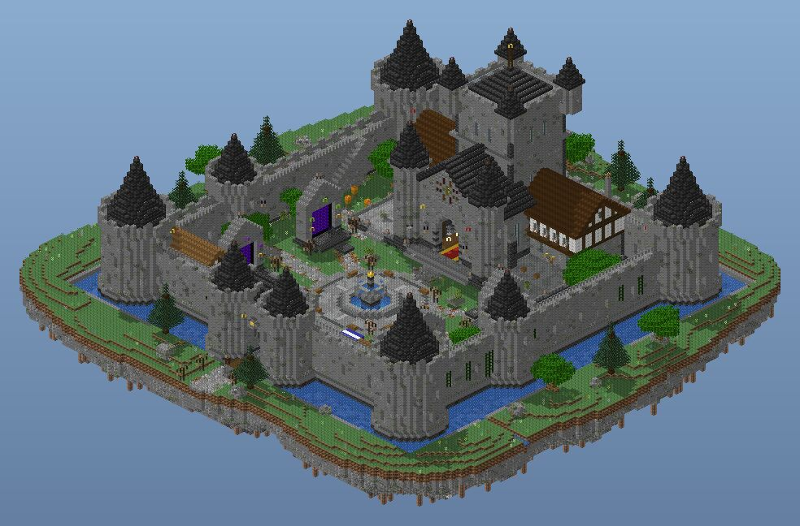
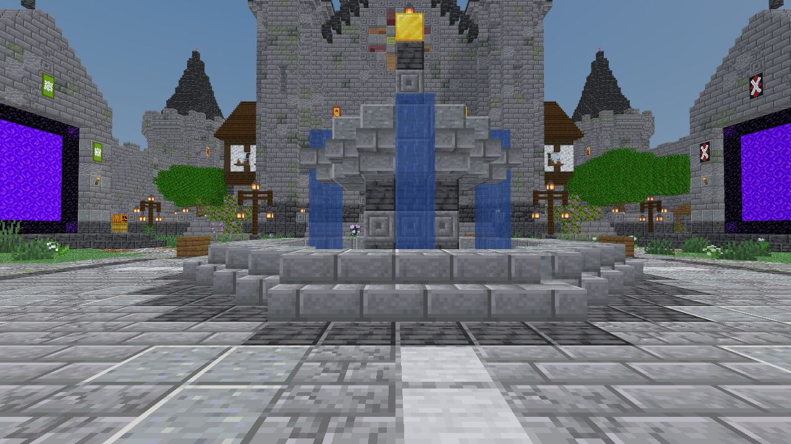

**Works:**
- A strong silhouette: cone towers, gatehouse, keep, and a moat waterfall off the island edge.
- The gate passage frames the plaza and keep, with compression then release.
- The timber keep wings are warm, and the masonry is weathered.

**Tells:**
- Almost total mirror symmetry: 90% of courtyard columns match their mirror. The four portal shrines come from one loop and differ only in banner colour, and there are four identical corner towers, lamp posts and planters.
- No spawn point is defined, and the plaza centre is the fountain itself.
- From the ring around the fountain, its 10-tall column hides the keep door, and its gold finial sits on the rose window.
- The courtyard is 79 x 79 (the example castle's is 46 x 50), and 33% of it is open lawn. The four 5 x 4 stalls are lost in it.
- The shrines are 3-deep "cards", and a portal shows through an arrow slit from outside.
- There is no text anywhere.
- The NPC "pedestals" are bare 3 x 3 steps in the grass.
- Trees come from one oak recipe and one perfect-cone spruce.
- The island terrain is contour-striped.
- Everything is grey on grey.
- 17% of walkable cells have no light within 14 blocks.

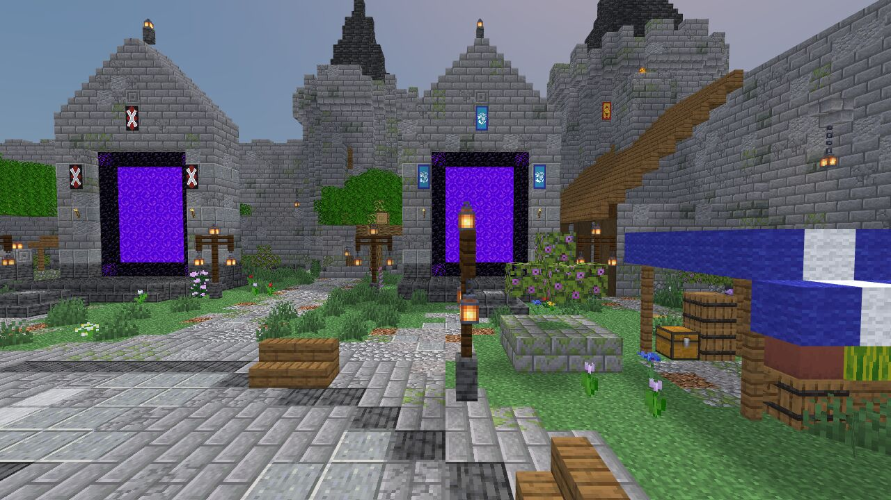
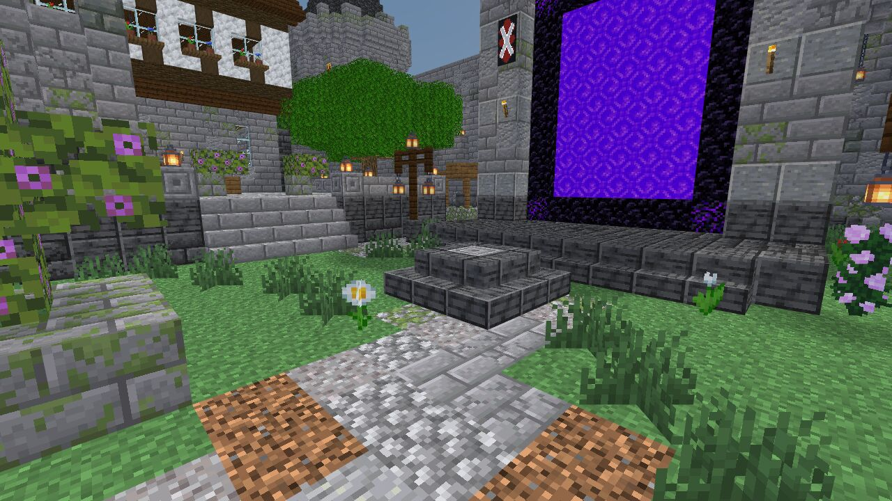

### Case 2: CheeseSMP v2 (user upload, DonutSMP-style, 800 x 800)

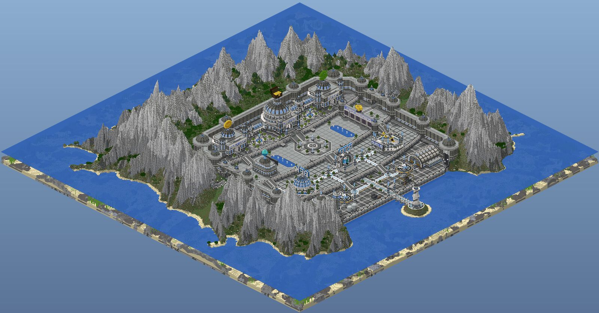
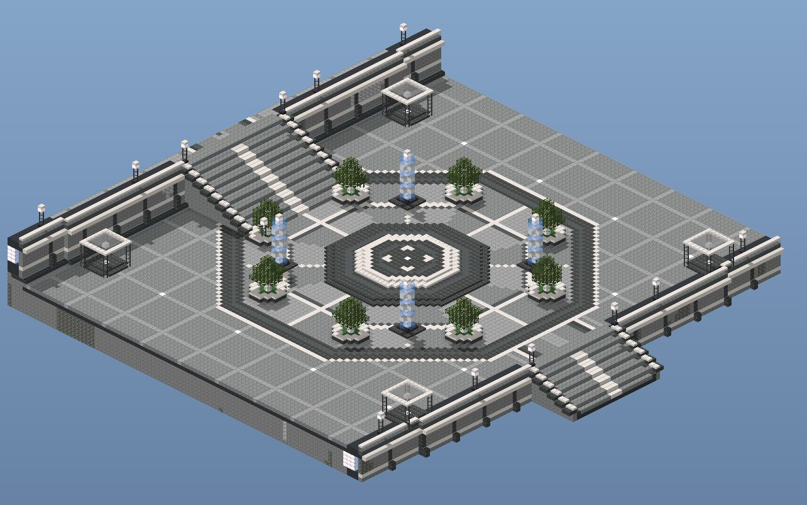

**Works:**
- An excellent macro plan: four terraces stepping down to the sea.
- One landmark type per function: dome for crates, ring for RTP, arena for duels, plus a harbour and a lighthouse.
- Big block letters with depth.
- Named gameplay spots.

**Tells:**
- **Dead floor:** 61% of the hub is flat open paving, 31% of it more than 6 blocks from any object, and the emptiest point is 21 blocks from anything.
- Grid tiling everywhere.
- 76% of top surfaces are grey or white.
- 88% mirror match.
- Identical towers, and identical tub trees (71 of them).
- Floating mascot props stuck on domes: a coin, a chest, a trophy, a gem.
- Text in quartz on pale glass, so it has low contrast.
- The leaderboards are five blank 11 x 12 black panels on a 78-long wall.
- The crates are six identical plinths in a 40-wide white hall.
- A ring of identical needle peaks, and the hub cut square into the rock.
- Only 6 lanterns, with glowing froglight walls instead, so 36% of the spawn plaza is unlit.

### Case 3: CheeseSMP v3 (this skill's rebuild)

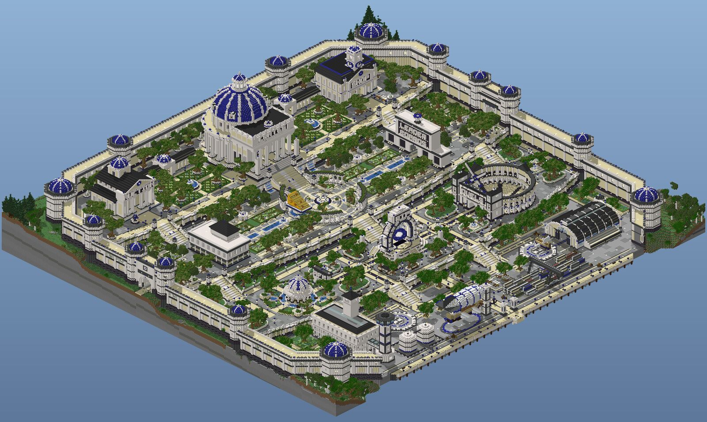
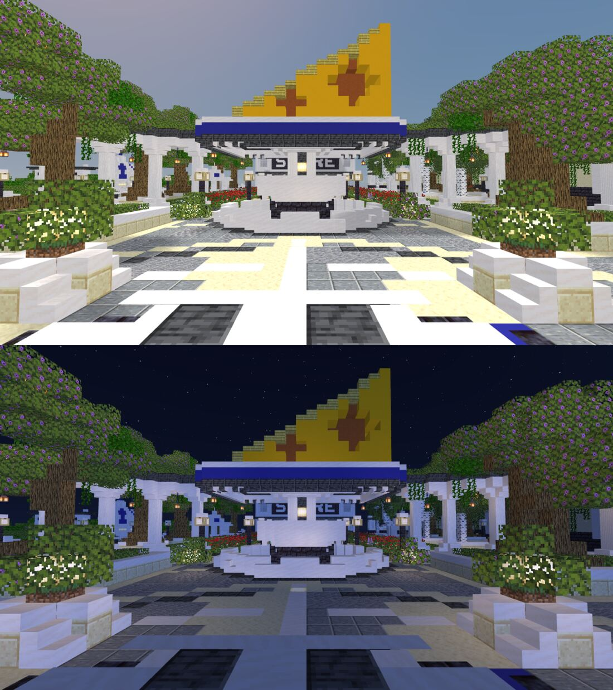
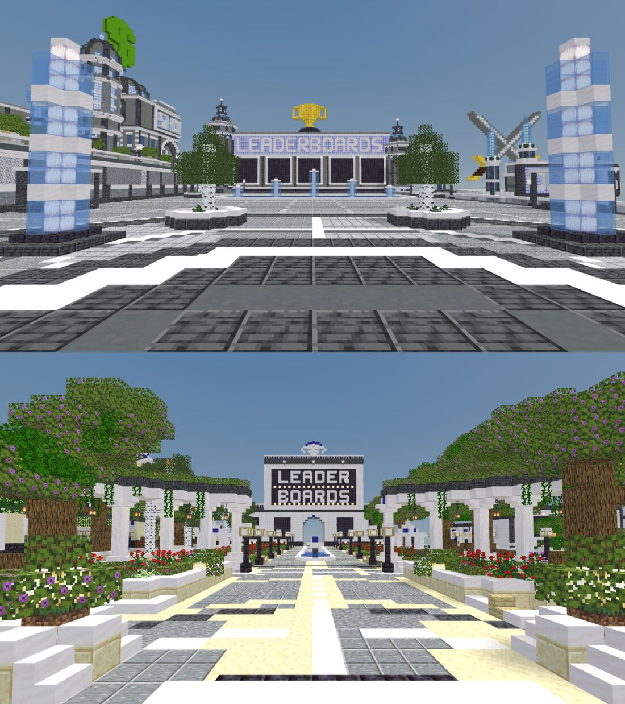

**Improved over v2:**

| Area | v2 | v3 |
| --- | --- | --- |
| Open floor more than 6 blocks from anything | 31% | 4% |
| Unlit spawn plaza | 36% | 2% |
| Lanterns | 6 | 995 |

- Real forested mountains with snow, cliffs and beaches.
- A warm white, cream and charcoal value structure.
- Readable quartz-on-charcoal signs.
- Recognisable building types: domed crates hall, colosseum, hangar, lighthouse.

**Still AI:**
- **A uniform tree carpet:** about 350 trees and 600 shrubs of one size class, hiding the buildings.
- **Confetti paving:** five materials in random rectangles.
- **The cheese monument** is a flat 17 x 10 pixel-art prism with plus-shaped "holes", on a saturated blue stripe. It covers the STORE sign behind it (only "S RE" shows) and is unlit at night.
- **Blue concrete** is used as long flat bands, the same mistake as the gold version the user called "ugly".
- **The plan is still mirrored:** 69% match, with over a dozen identical blue-domed towers and identical lamps, planters and columns.
- **Flat roofs** on the main buildings.
- **The hero dome** is invisible from the spawn.
- **The leaderboards** are a white box with four flush black squares and a pool in the approach.
- **The crates** are six identical baldachins, each over one shulker box, in a 40-wide hall.
- **Terrain formulas:** an even spruce field, a round punched-in tarn, a wall on a flat grass shelf.

The root cause is systemic: one function per module, applied everywhere with the same parameters, and no per-view editing pass.

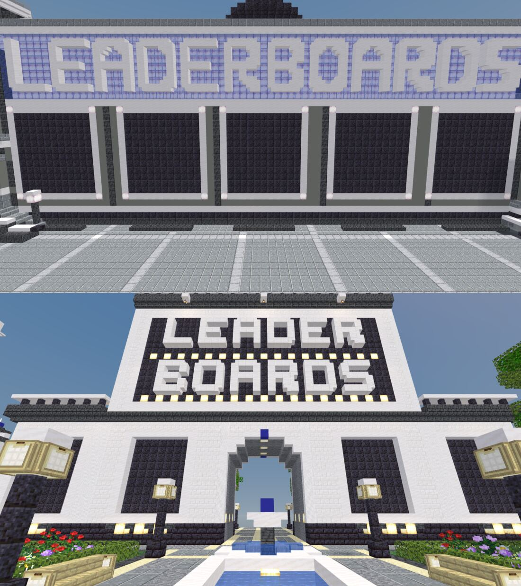
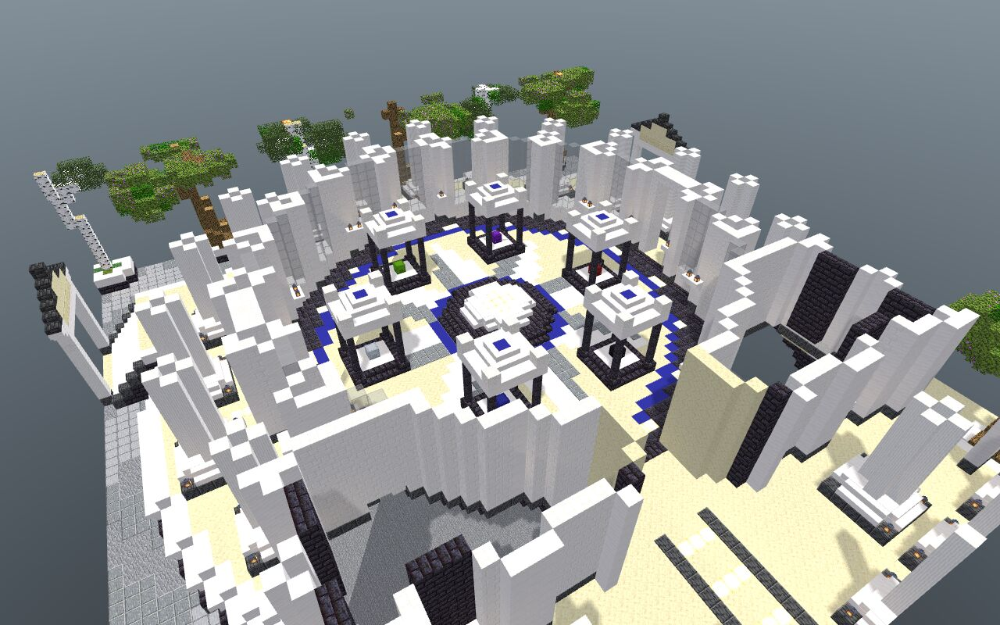
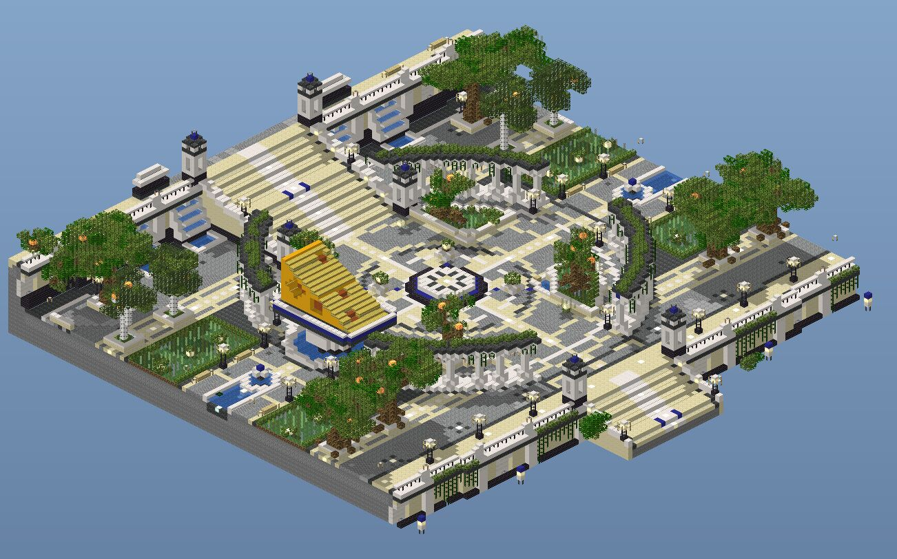
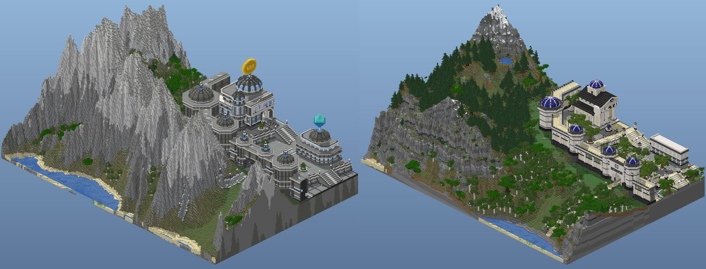

### Case 4: the example castle (`assets/examples/castle.mjs`), the scale reference

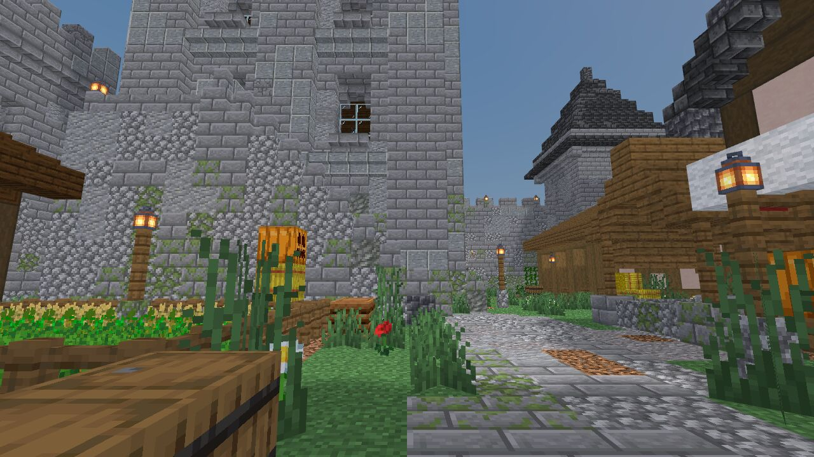

It does what the lobbies don't:
- Only 23% mirror match. The keep is off axis, the east wall jogs, and seven towers stand at five heights with five different tops.
- A 46 x 50 courtyard with 12% open floor, its emptiest point 3.4 blocks from an object.
- Lean-tos against the walls, and lanes between buildings.
- Towers 9-11 across and 18-23 apart (the lobby's are 15 across and 42 apart).

Don't copy its contour-striped mound or its single tree recipe.

## 2. Lessons for spawn builds (ranked by impact)

Run every check from an eye-level render at the real spawn point, FOV 70, unless the rule says otherwise.

1. **First view.** From the spawn point, frame ONE hero object 25-45 blocks away, on axis, filling 25-50% of the frame height, with open sky behind its top third. Nothing taller than eye level stands in the central 30° between the spawn and the hero.
2. **Brand monument.** Sculpt it in 3D at hero scale: at least 25 tall, curved forms from stairs and slabs, round cut holes, 3-5 shades, uplit at night. Never a flat pixel-art prism or a mascot prop on a roof. *Check:* recognisable from the front and from 45° either side, by day and by night.
3. **Symmetry.** Only the ceremonial axis is symmetric: at most 60% heightmap mirror match across it. Paired districts get different footprints, heights and architecture.
4. **Repetition.** No more than 3 identical copies of any module in one view (towers, lamps, planters, shrines, trees, benches). Use 2-3 variants and break the spacing.
5. **Height hierarchy.** The hero is at least 1.5x any secondary, and a secondary at least 1.3x any tertiary. Only one hero-height mass per view. *Check:* the 5 tallest masses in the hub isometric.
6. **Never block a name.** No monument, canopy, tree or lamp covers a building's name from the spawn or the main approach.
7. **Floor.** At most 5% of open floor more than 6 blocks from a standing object. No paved patch over 16 x 16 without a feature. Each plaza keeps an open, sky-lit centre 9-15 across.
8. **Paving hierarchy.** One field material covers at least 70%, every feature gets a 1-block border, and inlays point to exits. Never a random patchwork of 4+ materials, never one grid over a whole terrace. *Check:* can you state the pattern in one sentence?
9. **Human scale.** Plazas 25-45 across; avenues 5-9 wide; paths 3; courtyards over about 50 across get subdivided; interactive things (stalls, crates, NPC booths) are 3-6 tall, never 1-block items in 20-tall halls.
10. **Paths.** Follow desire lines from the spawn to each destination, and end every route at a visible door, sign or landmark. Concentrate wear on the centre line and thresholds, never as even noise.
11. **Signage.** Block letters 5-7 tall, proud by 1, on a framed panel; contrast at least 30 L* (quartz on blackstone or deepslate, or charcoal on quartz). Never on glass; letter height at least the viewing distance ÷ 12; each destination is also named at its door or NPC.
12. **Hologram anchors.** Every NPC, crate and board gets a clear 3-tall air column for its hologram. *Check:* air at y + 2..y + 5 above each named spot.
13. **NPC places are niches, not plinths.** A 3-5 wide alcove with a dark backdrop, and a canopy or arch at y + 4 or above; lanterns at y + 3 on both sides, and a name panel above; a floor 0-1 above the path, and a counter no more than 1 deep (the click range is 3); a 5 x 5 apron facing the approach, and at least 4 blocks between NPCs. *Check:* with no NPC present, the spot still reads as a place from 8 blocks.
14. **Leaderboards.** Panel height = lines x 0.3 + 1, so a 10-line board needs about 4.5 tall x 5-6 wide; centre the panels at y + 3..y + 5, with 3-6 in an arc or row; add a top-3 podium and a 10-12 deep viewing apron with seats; no water or trees in the reading zone. *Check:* from 10 blocks in front, the panels fill 40% of the view or less and nothing blocks them.
15. **Crates.** 3-6 crates on a stage 1-2 high, 3-4 apart, each clickable block no more than 1.5 above the floor; each crate gets its own tier backdrop and light; hall depth 25 or less, so the crates fill at least 30% of the view width from the door; a queue apron at least 5 deep.
16. **Spawn point.** A defined coordinate and yaw, on a dais at least 5 x 5 and 1-2 high; never inside a fountain, pool or planter; one "start here" NPC, a map board and a rules plaque within 10 blocks.
17. **Palette.** Roles: field 35-45%, warm secondary 15-25%, dark frame 15-20%, accent 5% or less; accent in points and runs of 5 blocks or fewer. Never an unbroken stripe of saturated concrete or gold longer than 8 blocks; floors one value step below the walls.
18. **Warm secondary for medieval and fantasy lobbies.** Timber, terracotta or brick roofs on at least 20% of visible surfaces, and grey masonry 60% or less.
19. **Planting.** Canopy covers at most 20% of the hub, seen from above; one feature tree per plaza, at least 1.5x the others; avenues of one species only along the main promenades; groves of 3-7 mixed sizes elsewhere; at least 3 species; no canopy on any sightline from the spawn to a landmark.
20. **Planters spill.** Moss carpet, flowers at 2 heights, ferns, vines over kerbs, root flares. Never a cube of leaves in a quartz box.
21. **Story props.** Every district shows 3 or more function props within 10 blocks of its eye-level view (market: crates, sacks, cart; arena: weapon racks, banners; harbour: nets, cargo).
22. **Terrain.** Peak heights vary by about 40%, with no repeated peak profile; ridges and scree; forest thinning with altitude, with species clumped (birch by water); irregular lakes with outflows; no 1-block contour stripes: soften terrace edges longer than 3 blocks with stairs and slabs.
23. **Transitions.** Where the build meets land, use a 4-10 block zone: buttressed retaining walls, stepped gardens, rubble, roots. Never a cut face or a flat grass shelf.
24. **Roofs.** No empty flat roofs in public view (under 5% of footprint). Pitched, hipped or domed roofs with eaves, or roof gardens.
25. **Towers and wall feet.** Perimeter towers in at least 3 heights and 3 cap designs; something every 8-12 blocks along each wall base: a lean-to, crates, firewood, ivy, a bench; never let a portal or interior show through an exterior wall.
26. **Lighting.** At least 60% of walkable cells have a light within 7 (Manhattan), and none are more than 14 from one; warm visible fixtures every 6-10 blocks along routes, with hidden fill lights; uplight the hero and signs. No glowing wall cladding as the lighting plan. *Check:* the night render from the spawn.
27. **Arrivals.** Every gate, tunnel and portal opens with compression then release onto a lit plaza with a framed landmark (the castle lobby's gate is the model).
28. **Editing pass.** After generating, fix 6-8 key cameras: spawn facing, spawn reverse, each destination's approach, and night. Hand-adjust until each passes rules 1-27.
29. **Review at three scales plus night.** Whole build: `isorender --px 1-2`; each district: `--px 6-8 --box`; eye level from the spawn and 10 blocks before every NPC, crate and board, plus a night shot. Read every image before showing the build.
