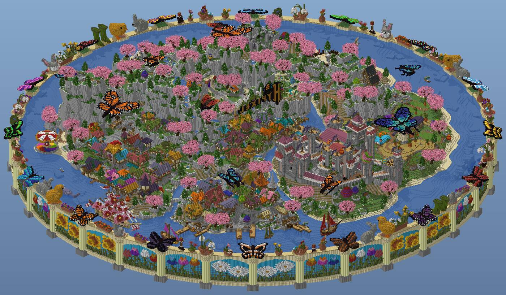
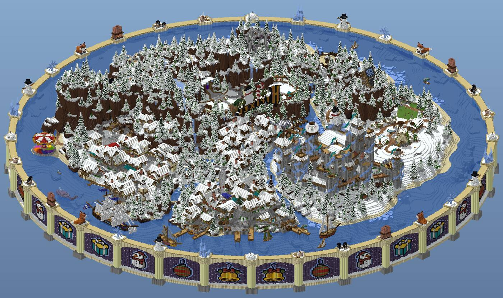
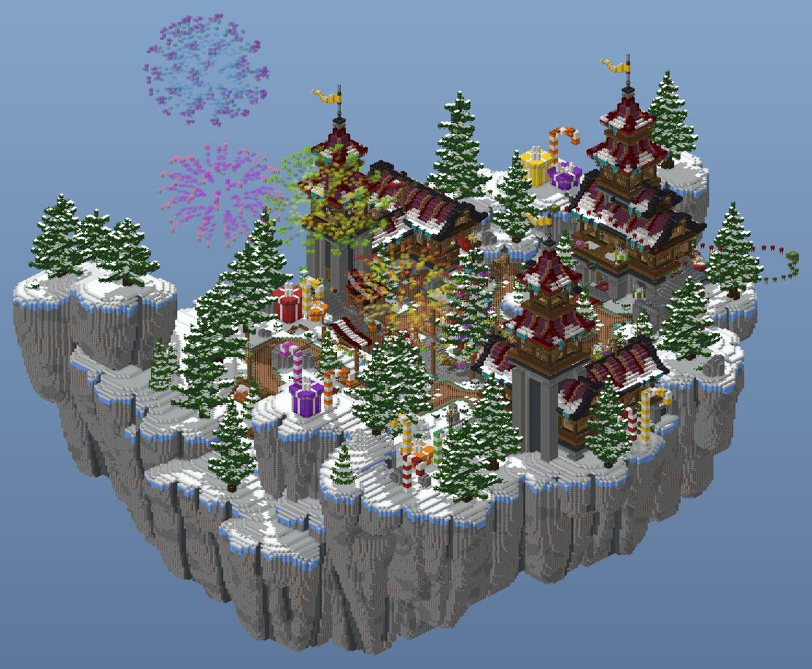
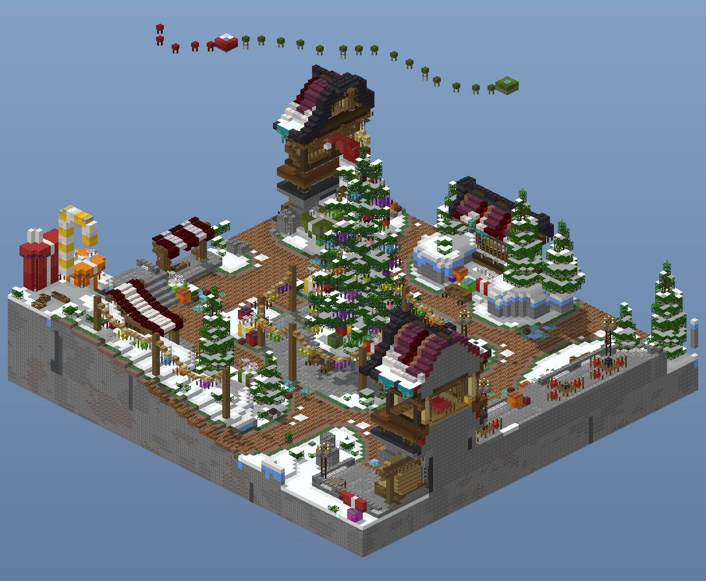
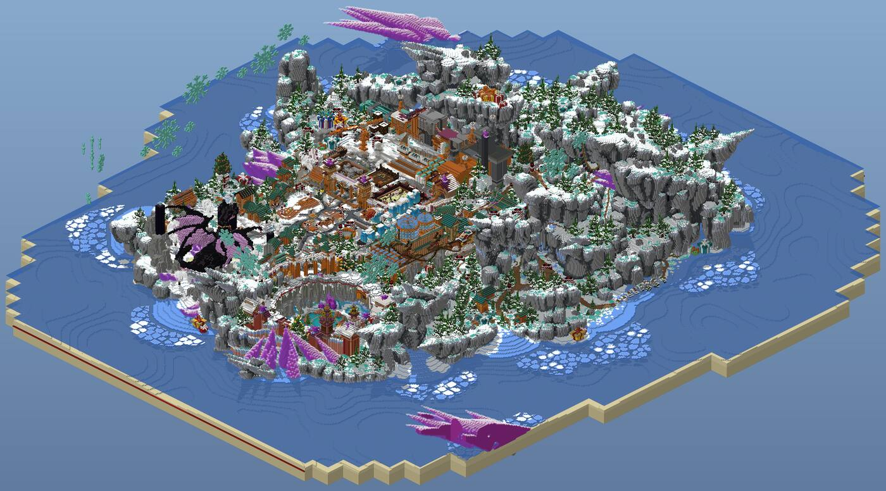
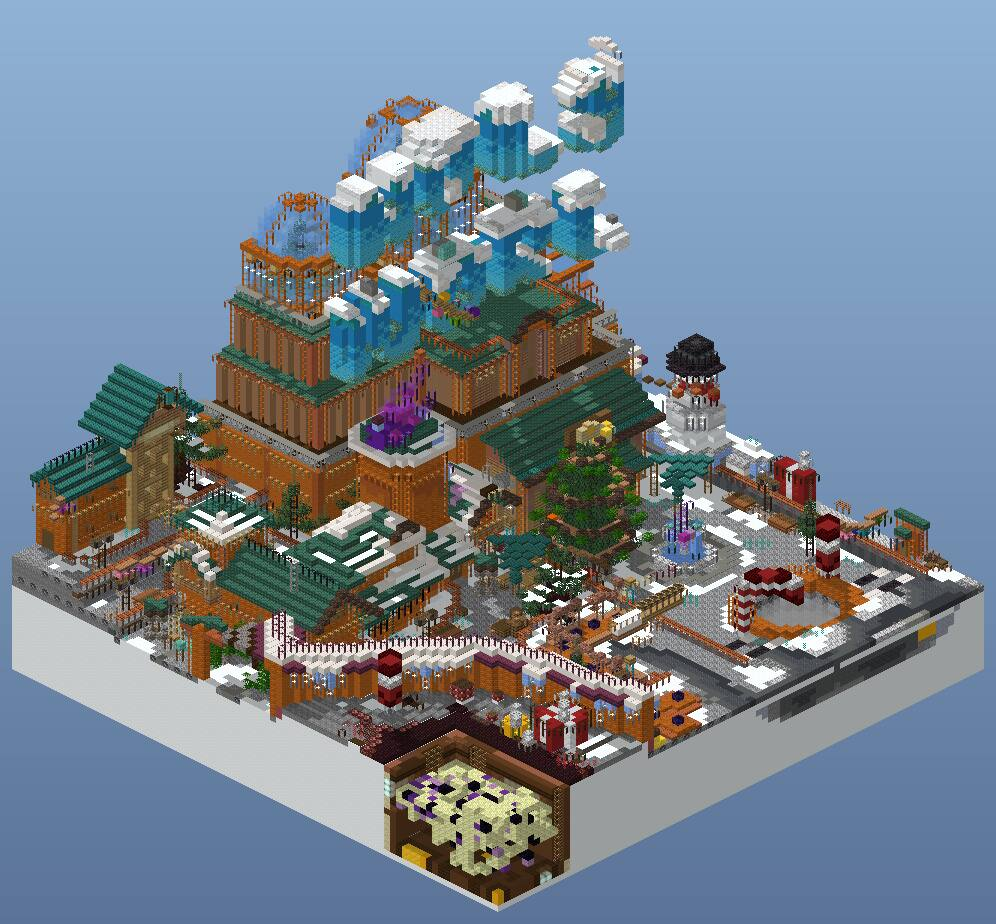
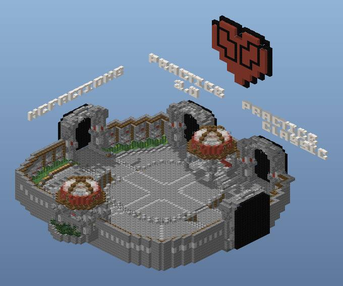
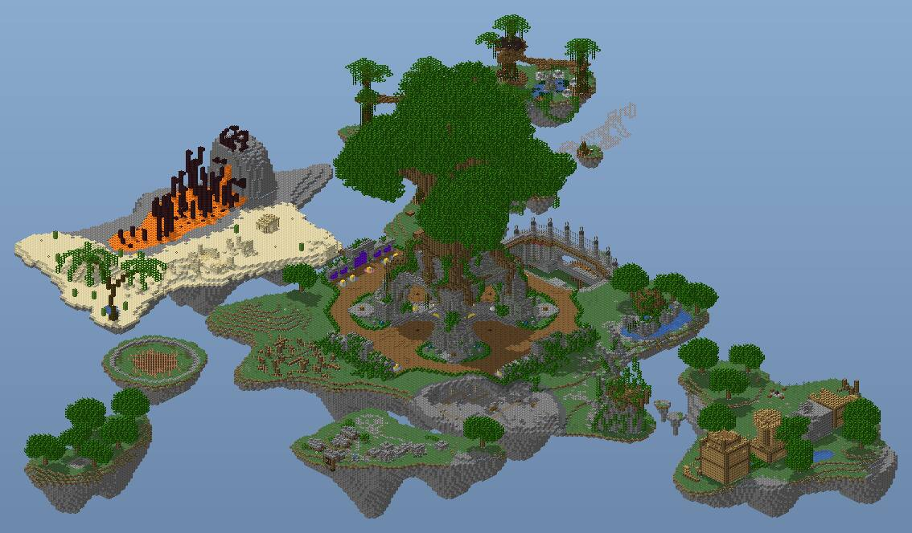

# Real server spawns and lobbies, measured

22 human-built spawns, hubs and lobbies were captured from world downloads, cropped, rendered and
measured block by block. Five of them are written up below, followed by the patterns across all
22. Use this file to check a spawn design against real ones.

**Sources (archive.org world saves, private study only, credit to the build teams):**
- **Hypixel:** 17 lobbies (Jan 2026) and Main Lobby (Mar 2026), by the Hypixel Build Team.
- **Russian network lobbies (Jan/Feb 2026):** FunTime, HolyWorld (spawn and hub), PolitMine and
  Renatus.cc. Captured with WorldTools, so holograms and armor stands were saved too.
- **Older and smaller servers:**
  - Mineplex main lobby (2019, Mineplex LLC).
  - Kohi hub (PvP).
  - Livecraft spawn (2019-22).
  - TotalFreedom SMP spawn (2020).
  - Monkeycraft old spawn (about 2015-19).
  - Mineplay hub.
  - BrokenLens hub and lobbies (2022; their team asks that the builds not be reused).
  - Mojang's Legacy Console minigame lobby.
- **No licences:** none of these come with a licence. Study them; never copy them.

**Metric notes:**
- **Visible palette:** palettes count *exposed* blocks only. Hypixel fills terrain cores with
  stone and sponge, and HolyWorld fills sculptures with black concrete, so raw totals mislead.
- **Walking surface:** found with a 3D walk from the spawn point (step up 1 block, drop up to 3).
- **Path width:** the area-weighted local width of paved walking cells.
- **Plaza:** paved area left after removing everything narrower than 9 blocks.

## The best five

### 1. Hypixel Main Lobby: a ring-walled island, reskinned every season

- **Size:** 577x577 in total, with a 170-177 block height span.
- **Island:** a 3-lobed island inside a circular moat, enclosed by a **ring wall of pilasters every
  about 20 blocks**. The bays between pilasters hold 2D pixel-art panels: snowmen and presents in
  winter, flowers and butterflies in spring. Seasonal props stand on top of each pilaster.
- **Same plan in winter and spring:** only the trees (snow spruce or cherry), the wall panels, the
  floating statues and the leaf colours change.
- **Spawn:** on a hill terrace, 3 blocks above a smooth-stone-slab plaza (clear span 21-25). The
  3D "HYPIXEL" letters sit on the cliff behind the spawn as the focal backdrop.
- **Districts:** a village of about 40 small houses with steep roofs on the left, a castle on the
  right and docks with ships on the front shore. Each lobe holds one district, never a mix.
- **Numbers:** paths 5 wide (IQR 4-6) and 323 visible block ids. 70-72% of stairs are
  upside-down. Of the 4,230 lights, 2,436 are hidden (sea lanterns and glowstone under the floor).

### 2. FunTime main lobby: a compact floating hub-and-spoke

- **Island:** 193x263 with a sheer rock underside. Visible blocks are 32% architecture, 48% terrain
  and 19% plants.
- **Arrival:**
  - The spawn sits on a forecourt between a **mirrored pair of stalls 16 apart**.
  - 20 blocks ahead stand **3 NPC plinths**: end portal frames 1 block high, **4 blocks apart**.
  - Each plinth carries a 3-4 line hologram (mode, online count, "click to enter"; lines 0.25
    apart).
  - Behind the plinths hangs an **11x4 map-art billboard** of 44 frames in a 13-wide stripped
    dark oak frame. 3x3 chiseled stone pillars stand 16 apart on either side.
- **Central plaza:** a ring plaza with a decorated tree, with 6 brown dirt and coarse dirt roads
  radiating to the halls. Roads are 7 wide (IQR 5-8) with snow and grass verges.
- **Detail:**
  - Market stalls with red-and-white awnings, giant presents and candy canes.
  - Tables at an outdoor cafe, and a parkour line floating in the sky.
  - Partial blocks are 28%, and 44% of the lights are hanging lanterns.

### 3. HolyWorld: an anarchy spawn island with a dense core

- **Island:** 495x480 of snow mountains in a sea ringed by ice floes. All the building is packed
  into one core of about 110x90; the rest is landscape.
- **Core:**
  - Roads of **lodestone, andesite and coal block**: dark "asphalt" that reads as a street.
  - Candy-cane posts mark the corners.
  - The orange halls are red sandstone and terracotta, with red sandstone wall rails and teal
    roofs.
  - **3D block letters with snow caps** stand on the main roof.
- **Portal:** a 7x7 end portal sits at the feet of a black-and-purple dragon sculpture, a set piece
  guarding the exit.
- **Decor counts:** 422 player heads (presents and props), about 4,400 signs used as trim, and
  teal nether sprouts and warped roots as "frozen grass".

### 4. Kohi hub: a minimal PvP lobby

- **Size:** a 72x77 stone-brick platform with only 35 block ids (87% architecture).
- **Plaza:** a circular plaza of smooth stone with crossing 7-wide walks. Two domed kiosks sit on
  the axis.
- **Portals:** **4 portal arches** (black portal fill) on the rim. Above each arch floats a **3D
  block-letter mode name** ("HCFACTIONS", "PRACTICE 2.0", "PRACTICE CLASSIC"), with the heart logo
  above the spawn.
- **Symmetry:** 97% mirror symmetry on x and 35% on z. This is the one corpus build that is
  symmetric on purpose.

### 5. Mineplex 2019: a floating archipelago around a world tree

- **Plaza:** an oval spruce-plank plaza (about 74x74, clear span 17) around a giant tree. The
  plaza is ringed by a stone-brick kerb and grass, with a portal row on one side.
- **NPC pads:** 3x3 pads with a gold-block core 1 block high and a rim of light-blue or pink
  stained glass.
  - They stand in mirrored rows on the east and west edges and a row of 5 on the south edge.
  - **Spacing follows a rhythm of 4-7-7-4** about the plaza axis.
- **Satellites:** a volcano, a desert, a forest and an arena island, joined by bridges.

Also strong:
- **Renatus** ([render](../../docs/spawns/corpus/renatus-se.jpg)):
  - Greek temples in a mountain river valley.
  - 5 mode NPCs on pistons stand in an arc 6 blocks apart, facing a beacon at the spawn.
  - An 11-line "Total Online" hologram board.
- **PolitMine** ([render](../../docs/spawns/corpus/politmine-se.jpg)):
  - A plaza 214x181 with a clear span of 25, the largest plaza in the corpus.
  - It is ringed by landmark replicas and giant block-letter logos.
  - A 12-line parkour top-10 hologram stands on a beacon.

## Numbers across the corpus (n = 22)

| metric | network / SMP spawns | PvP / minigame lobbies |
| --- | --- | --- |
| build bounding box | 190-600 per side; core about 100x100 | 70-340 per side (Kohi 72x77) |
| visible split arch / terrain / plants | 25-45 / 20-50 / 4-20 % | 60-95 / 5-40 / 0-4 % |
| distinct visible block ids | 140-420 (median about 250) | 35-270 (median about 190) |
| main path width (paved) | **5-7** (IQR 4-8) | **4-6** (Kohi 7) |
| walkable width (incl. lawn and sand) | 7-8 | 5-7 |
| main plaza clear span | **11-31** (one central hub of about 25) | 11-19 (arena-style 80) |
| NPC spacing | **4-6 blocks** in a row or arc | 4-7, in rhythmic groups |
| NPC plinth height | +1 (portal frame, piston, gold block) | +1 |
| hologram lines / spacing | 2-4 lines for NPCs; 10-12 for leaderboards; 0.25-0.3 apart | same |
| leaderboard / billboard | hologram stack of 11-12 lines on a beacon or plinth; map wall 11x4 | holograms |
| dye-colour accents (visible arch) | 1-17 % (median about 5) | 1-60 %; cartoon lobbies above 30 |
| partial blocks (stairs, slabs, trapdoors...) | 16-28 % | 5-32 % |
| upside-down stairs, share of stairs | 27-72 % (median about 50) | 44-74 % |
| lights per 1,000 arch blocks | 0.2-5; many hidden under floors | 1-23 |
| custom trees | 60-520 crowns, median width 7-10, max 21-38 | few or none |
| footprint mirror symmetry (same top block) | **under 16 %** | 5-97 % (Kohi 97) |

## Layout patterns that recur

1. **One central hub and spokes:** a spawn plaza with 4-6 radiating paths to feature buildings
   (FunTime, HolyWorld core, Hypixel).
2. **A district per lobe or island:** each feature gets its own island or terrace (Mineplex,
   BedWars, the Mineplay floating cluster). Bridges and rope walks join them.
3. **An axial ceremonial plaza** with landmark buildings around the edge (PolitMine, Renatus).
4. **A compact symmetric platform** for PvP lobbies (Kohi): portals on the rim, logo above, no
   terrain.
5. **A boundary set piece:** a ring wall with art panels (Hypixel), a sea of ice floes
   (HolyWorld), or a sheer floating-island cliff (FunTime). The edge is always designed.

**Recurring set pieces:**
- **NPC rows:** plinths 1 block high, spaced 4-6, with holograms.
- **Billboards:** map-art walls or hologram boards on beacon or plinth bases.
- **Logos:** giant 3D block-letter logos, used for mode names too.
- **Portal gates:** arches, a dragon guard, or a stained-glass gradient doorway (TotalFreedom).
- **Festive props:** presents, candy canes, a decorated tree.
- **Market stalls:** awnings in striped wool or banners.
- **Parkour:** floating jump lines.
- **Ships:** moored at docks.
- **Mascot statues:** HolyWorld hub, Hypixel Duels.

**Recurring palettes:**
- **Base materials:** stone bricks, andesite and smooth stone paving. Wool and terracotta replace
  grass (Renatus used lime terracotta and green wool as "grass").
- **Woods:** spruce and dark oak.
- **Custom terrain:**
  - Cliffs in brown, gray and blue terracotta or coal block (Hypixel).
  - Snow made of white concrete powder or snow blocks, with icicles in light-blue blocks.
- **Accents:** limited to festive and brand colours.

## Human-made tells (check every spawn against these)

- [ ] **Symmetry is local, not global.** The arrival axis may be mirrored (stall pairs, NPC rows,
  pillars), but the whole footprint is under 16% mirror-identical.
- [ ] **One landmark per view.** Give the spawn a backdrop focal (logo letters, tower, tree) and
  give each district its own hero building.
- [ ] **Detail clusters, open space breathes.** Put props in knots at junctions and plaza edges.
  Keep plazas clear 11-25 wide, and keep paths 5-7 wide with soft verges (snow, grass, flowers)
  rather than hard edges.
- [ ] **Rhythm in NPC spacing.** Use 4-block spacing with breaks of 6-7 (4-7-7-4), or an arc
  facing the spawn. Avoid an even grid.
- [ ] **Materials of the setting, not a palette sheet.** Mix 3-6 blocks per surface (lodestone,
  andesite and coal roads; mossy and cracked stone bricks). Use over 150 visible ids in a
  network spawn.
- [ ] **Custom trees in mixed sizes.** Crowns 7-10 wide with a few giants of 20-40, mixed leaf
  species, and some floating islets with a tree each.
- [ ] **Designed edges and undersides.** Use ring walls, cliffs, ice floes, docks and tapered
  rock undersides. Never end at a cut-off flat.
- [ ] **Height is spent on a few things.** 45-60% of columns rise more than 10 above the floor in
  dense hubs (towers, roofs), but the spawn plaza itself stays flat.
- [ ] **Lights are hidden.** Use floor sea lanterns and glowstone under slabs, hanging lanterns,
  and end rods. Avoid torch grids.
- [ ] **Seasonal and story props.** Presents, carts, ships, cafe tables and parkour lines tell
  players that people use the place.
- [ ] **Upside-down stairs on about half of all stairs** (eaves, trims, corbels). Partial blocks
  should be about 15-28% of visible architecture.
